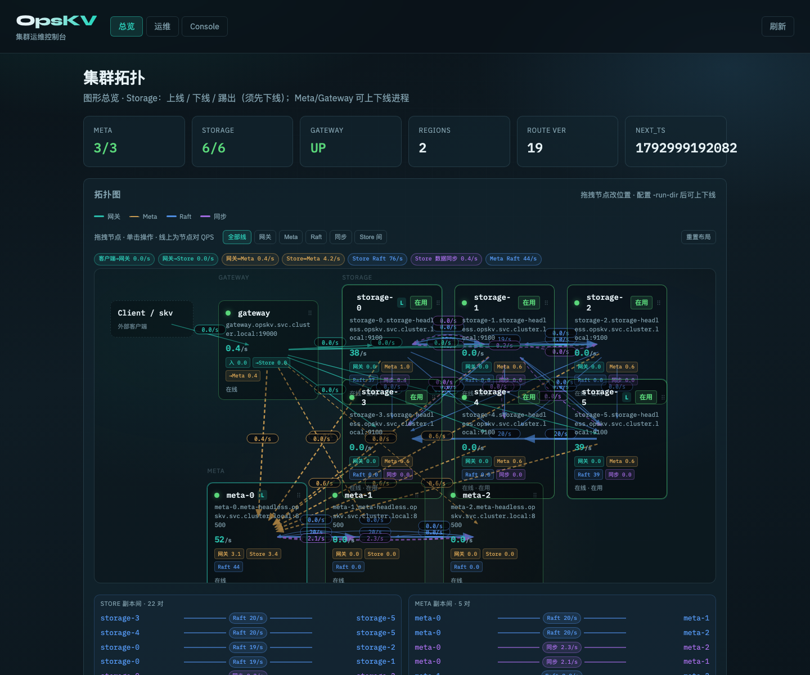

# OpenKV

> Language: [English](#openkv) · [中文](#openkv-zh)

Distributed KV store with compute/storage separation: **Multi-Raft + RocksDB + gRPC** (C++ Meta/Storage/Gateway). Keys live in ordered **Range Regions**; default replication factor **3**.

**License:** [Apache License 2.0](LICENSE) · Copyright 2026 devotionalist (see [NOTICE](NOTICE))

## Clients

Official SDKs live in **separate repositories** (Gateway gRPC `:19000`):

| Language | Repository | Package |
|----------|------------|---------|
| **Go** | [openkv-client-go](https://github.com/devotionalist/openkv-client-go) | `github.com/devotionalist/openkv-client-go` |
| **Rust** | [openkv-client-rust](https://github.com/devotionalist/openkv-client-rust) | crate `openkv-client-rust` |
| **Java** | [openkv-client-java](https://github.com/devotionalist/openkv-client-java) | `io.openkv:openkv-client-java` |
| **TypeScript** | [openkv-client-typescript](https://github.com/devotionalist/openkv-client-typescript) | npm `openkv-client-typescript` |

```bash
# Go
go get github.com/devotionalist/openkv-client-go@latest

# Rust
# Cargo.toml → openkv-client-rust = "0.1"

# Java (Maven)
# io.openkv:openkv-client-java:0.1.0

# TypeScript
npm install openkv-client-typescript
```

API surface (v0.1): `Dial`/`connect` · `Get` · `Put`/`PutTTL` · `PutCAS` · `Delete`/`DeleteCAS` · `RawGet`/`RawPut`/`RawDelete` · `Scan`/`ListPrefix` · `TTL`/`Expire`/`Persist` · DS (Hash/Set/List/ZSet).  
Design notes: [docs/flows/15-multi-client-sdk.md](docs/flows/15-multi-client-sdk.md).

> This repo’s `client/go` is **in-tree tools only** (examples / e2e / Meta·Storage stubs). Applications must use the SDK repos above.

## Topology

```
openkv-client-{go,rust,java,typescript} / skv
      │ gRPC :19000
      ▼
Compute Gateway (C++ gateway_node)  ←── MetaService gRPC ──→  Meta Raft ×3 (:8500–8502)
      │ Store / Admin gRPC
      ▼
Storage ×N (:9100…)  · per-Region Raft (RF=3) · RocksDB
      │ RaftService gRPC (peers)
      └──────────► other Storage
```

After `make admin-run`, open `http://127.0.0.1:19100` for the live console. See [Architecture](docs/en/architecture.md) and [User guide](docs/en/user-guide.md).



## Documentation

| Language | Entry |
|----------|-------|
| **English (default)** | **[docs/en/](docs/en/README.md)** |
| 中文 | [docs/zh/](docs/zh/README.md) |

| Doc | English | 中文 |
|-----|---------|------|
| Quick start | [quickstart](docs/en/quickstart.md) | [中文索引](docs/zh/README.md) |
| User guide | [user-guide](docs/en/user-guide.md) | [USER_GUIDE](docs/USER_GUIDE.md) |
| Networking | [networking](docs/en/networking.md) | [NETWORKING](docs/NETWORKING.md) |
| Architecture | [architecture](docs/en/architecture.md) | [ARCHITECTURE](docs/architecture/ARCHITECTURE.md) |
| Clients | [15-multi-client-sdk](docs/flows/15-multi-client-sdk.md) | same |
| Version CAS / TTL | [13](docs/flows/13-version-cas.md) · [14](docs/flows/14-kv-ttl.md) | same |
| Scan / ListPrefix | [16](docs/flows/16-scan-list-prefix.md) | same |
| Contributing | [contributing](docs/en/contributing.md) | [中文](docs/zh/contributing.md) |
| Ops / SOP / flows | — | [ops](docs/ops/) · [flows](docs/flows/README.md) |
| Tests | — | [TEST_CASES](docs/test/TEST_CASES.md) |

## Quick start

```bash
make          # configure + build + unit tests
make e2e      # build → start cluster → Go client → stop
```

```bash
cmake --build build -j --target skv
./build/tools/skv start --fresh
./build/tools/skv put hello world
./build/tools/skv get hello
./build/tools/skv stop
```

```bash
make cluster-up      # gateway :19000
make admin-run       # http://127.0.0.1:19100
make cluster-down
```

gRPC C++ is **required**. Details: [Networking](docs/en/networking.md).

## Features

- **Range Region** sharding with Multi-Raft (default RF=3)
- Stateless **C++ Gateway** + C++ **Meta** (Raft×3) / **Storage** (RocksDB)
- Single-key **version CAS** and **KV TTL**
- Multi-language clients (Go / Rust / Java / TypeScript) in sibling repos
- Online split / merge / place / scale-out SOPs
- Web console (`:19100`) and `skv` ops CLI
- Helm charts under `deploy/helm/`
- Apache-2.0

## Tests

```bash
make
make e2e
# see docs/test/TEST_CASES.md and docs/test/INTEGRATION_TEST.md
```

## Layout

```
proto/      gRPC definitions (authoritative IDL for clients)
common/    config, Region, logging
raft/      Multi-Raft + GrpcRaftTransport
storage/   RocksDB + Storage node (gRPC)
meta/      cluster state + scaler (gRPC)
compute/   C++ Gateway (gateway_node)
client/go/ in-tree Go tools (examples/e2e) — SDK → openkv-client-go
tools/skv/ ops CLI
web/       admin console
docs/      documentation (en + zh)
deploy/    Docker / Helm
conf/      local configs
```

Sibling client repos (not in this tree): `openkv-client-go` · `openkv-client-rust` · `openkv-client-java` · `openkv-client-typescript`.

## License

Licensed under the [Apache License 2.0](http://www.apache.org/licenses/LICENSE-2.0). Full text: [LICENSE](LICENSE); attribution: [NOTICE](NOTICE).

---

<a id="openkv-zh"></a>

# OpenKV（中文）

基于 **Multi-Raft + RocksDB + gRPC** 的存算分离分布式 KV（C++ Meta/Storage/Gateway）。分片为 **Range Region**，默认副本因子 3。

## 客户端（独立仓库）

| 语言 | 仓库 |
|------|------|
| Go | [openkv-client-go](https://github.com/devotionalist/openkv-client-go) |
| Rust | [openkv-client-rust](https://github.com/devotionalist/openkv-client-rust) |
| Java | [openkv-client-java](https://github.com/devotionalist/openkv-client-java) |
| TypeScript | [openkv-client-typescript](https://github.com/devotionalist/openkv-client-typescript) |

说明：[docs/flows/15-multi-client-sdk.md](docs/flows/15-multi-client-sdk.md)

**文档：** [English](docs/en/README.md) · [中文](docs/zh/README.md)

```bash
make && make e2e
# Gateway :19000 · 管控台 http://127.0.0.1:19100 · Meta :8500–8502
```

完整中文文档见 [docs/zh/](docs/zh/README.md)。
