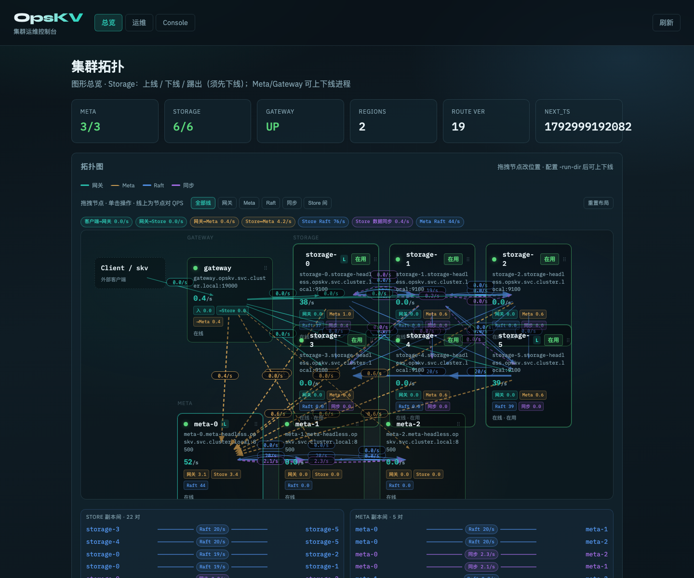

> Language: [English](./architecture.md) · [中文](../architecture/ARCHITECTURE.md)

# Architecture overview

Compute/storage-separated distributed KV. Deep Chinese docs: [ARCHITECTURE.md](../architecture/ARCHITECTURE.md) and the [Chinese index](../zh/README.md).

## Goals

| Goal | Approach |
|------|----------|
| Network | **Mandatory gRPC** end-to-end |
| Persistence | RocksDB (one KV store per Storage; Regions via key ranges) |
| Consistency | Multi-Raft (one Raft group per Region, default RF=3) |
| External API | gRPC → Go Compute Gateway (`KVService` + `DSService`) |
| Separation | Stateless Gateway; Storage owns replication & disk |
| Online scale | Region split/merge + Raft membership + data move |

## Logical topology

```
Go Client / skv
      │ gRPC :19000
      ▼
Compute Gateway (Go, stateless)  ←── MetaService gRPC ──→  Meta Raft ×3 (:8500–8502)
      │ Store / Admin gRPC
      ▼
Storage ×N (:9100…)  · per-Region Raft (RF=3) · RocksDB
      │ RaftService gRPC (peers)
      └──────────► other Storage
```

| Component | Responsibility |
|-----------|----------------|
| **gateway_node (C++)** | Stateless range routing, leader cache, retry |
| **storage** | Multi-Raft + RocksDB; Admin / Raft on same gRPC port |
| **meta** | Region table, topology, split/merge/scale orchestration; **Raft ×3 HA** |
| **client/go** | gRPC SDK |
| **tools/skv** | C++ ops CLI |
| **web/** | Console (`:19100`): topology / Region / ops / KV |



## Sharding & consistency

- Keys sit in ordered Regions `[start, end)` (`end` empty = +∞).
- Boot: Region 0 covers the full key space; replicas on the first RF Storage nodes.
- Writes: Client → Gateway → Region leader → AppendEntries → majority commit → RocksDB apply.
- Reads (default linearizable): leader + TSO/MVCC; `linearizable=false` may read any replica snapshot.

## Where to go deeper (Chinese)

| Topic | Doc |
|-------|-----|
| HA model & fault domains | [DATA_HA.md](../architecture/DATA_HA.md) |
| Scale-out | [DATA_SCALE.md](../architecture/DATA_SCALE.md) |
| Scale-in | [DATA_SCALE_IN.md](../architecture/DATA_SCALE_IN.md) |
| Error tokens | [ERROR_CODES.md](../architecture/ERROR_CODES.md) |
| Range sharding | [RANGE_SHARDING.md](../architecture/RANGE_SHARDING.md) |
| Flow diagrams | [flows/README.md](../flows/README.md) |
