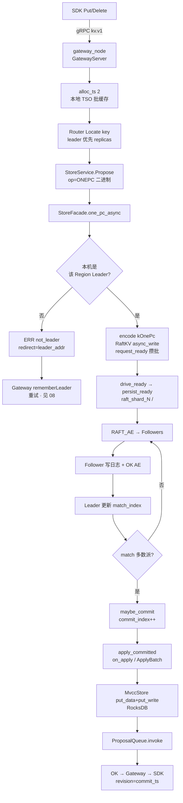

# 流程：写入 Put / Delete

**路径：** SDK → gRPC Gateway → Locate Region → `StoreService.Propose(ONEPC)` → Region Raft Leader → 多数派提交 → apply → RocksDB → 唤醒 waiter

**关键代码：**

| 层 | 符号 / 路径 |
|----|-------------|
| SDK | `openkv-client-go`（及 rust/java/ts）`Put` / `Delete` |
| Gateway | `GatewayServer::put_async` · `alloc_ts` · `store_propose_onepc_async` |
| Storage | `StoreFacade::one_pc_async` · `CmdOp::kOnePc` · `MvccStore` · `ProposalQueue` |
| Raft | `RaftKV::async_write` · `Store::request_ready` · `RaftNode::persist_ready` |

短 Put/Delete 走 **ONEPC**（1 次 Raft Propose，一次写入 MVCC data+write）。多 key / 显式 Txn 仍 **Prewrite → Commit**（见 Gateway `Txn*`）。

无事务写入见 **`RawPut` / `RawDelete`**（plain Propose，无 TSO）：[27-raw-vs-txn.md](27-raw-vs-txn.md)。与 Put **同 key 空间，勿混用**。

**多数派：** RF=3 → 需 ≥2 副本 `match_index` 推进 `commit_index`。



> 磁盘目录名可能仍为 `shard_<id>`（与 `region_id` 同号）；路由语义是 **Range Region**，见 [RANGE_SHARDING.md](../architecture/RANGE_SHARDING.md)。

---

## 短写 vs 事务写

| 路径 | Gateway | Storage | Raft 次数 |
|------|---------|---------|-----------|
| 短 Put/Delete | `alloc_ts(2)` → `one_pc` | `kOnePc` apply 写 data+write | **1** |
| PutCAS / DeleteCAS | 同 ONEPC，带 `cas`+`expected` | apply 内校验可见版本 | **1** |
| Txn* 多 key | Prewrite → Commit | `kPrewrite` / `kCommit` | **≥2** |
| DS（HSet 等） | TxnGet blob → Prewrite → Commit | 同 Txn | **≥2** |

TSO 批缓存说明：[16-gateway-tso-perf.md](16-gateway-tso-perf.md)。

---

## 落盘边界

| 层 | 目录 / 内容 |
|----|-------------|
| Raft WAL | `{data_dir}/raft_shard_<id>/`（hard.state + log） |
| KV | `{data_dir}/shard_<id>/` RocksDB（或单 Store 引擎按 Region 区间） |
| 耐久 | 默认 `persist_sync=data`：**Raft log sync**，KV apply 异步；ACK 仍在 apply 后（可见性），崩溃靠日志重放 |

批写与 fsync 摊销：[23-write-path-batching.md](23-write-path-batching.md)。

---

## 时序要点

1. Gateway 热路径在 **Callback 接收线程** 取本地 TS，再 `store_propose_onepc_async`；不在 handler 里 sleep 等 apply（见 [22](22-async-threading-model.md)）。
2. `propose` 后按 index 挂 **ProposalQueue**；apply `invoke`（或 `wait_async` 回调）唤醒。
3. 仅当前 term 日志可 commit；空心跳 / 写触发的 AE 都会推进复制。
4. 撞 `locked` → Lock Resolver 后重试；`splitting` / `epoch_not_match` → 刷路由重试。
5. Latch：ONEPC/CAS 用 `lock_key_async` 持到 apply；非 CAS Raw Put/Delete 跳过（[19](19-architecture-hardening.md) · [27](27-raw-vs-txn.md)）。

---

## 失败与重试（Gateway）

| 错误 | 行为 |
|------|------|
| `not_leader` + redirect | 缓存 Leader，改打该地址 |
| `epoch_not_match` / `key_not_in_region` | bump epoch，重新 Locate |
| `splitting` | 短暂退避重试 |
| `write_conflict` / `locked` | resolve 或换 TS 重试 |
| `cas_failed` | 不重试业务失败（见 [13](13-version-cas.md)） |

---

## 验收

```bash
make cluster-up
cd client/go && go run ./examples/basic   # Put/Get
go run ./examples/bench -op put -w 8 -n 200
make cluster-down
# 单测
./build/tests/openkv_unit_tests --gtest_filter='*OnePc*:*ProposalQueue*'
```

期望：Put 返回递增 revision；bench `fail=0`。记录见 [TEST_CASES.md](../test/TEST_CASES.md)。
