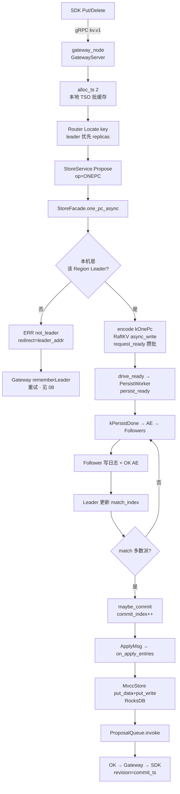
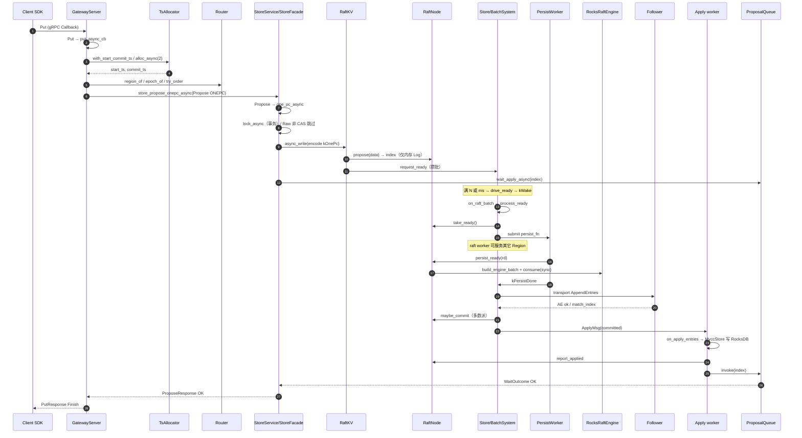

# 流程：写入 Put / Delete

**路径：** SDK → gRPC Gateway → Locate Region → `StoreService.Propose(ONEPC)` → Region Raft Leader → 多数派提交 → apply → RocksDB → 唤醒 waiter

**关键代码：**

| 层 | 符号 / 路径 |
|----|-------------|
| SDK | `openkv-client-go`（及 rust/java/ts）`Put` / `Delete` |
| Gateway | `GatewayServer::Put` · `put_async_cb` · `alloc_async` · `store_propose_onepc_async` |
| Storage | `StoreFacade::one_pc_async` · `CmdOp::kOnePc` · `MvccStore` · `ProposalQueue` |
| Raft | `RaftKV::async_write` · `Store::request_ready` · `PersistWorker` · `RaftNode::persist_ready` |
| ACK/落盘 | [36-propose-ack-durability.md](36-propose-ack-durability.md)（ACK=apply；persist 先于 apply） |

短 Put/Delete 走 **ONEPC**（1 次 Raft Propose，一次写入 MVCC data+write）。多 key / 显式 Txn 仍 **Prewrite → Commit**（见 Gateway `Txn*`）。

无事务写入见 **`RawPut` / `RawDelete`**（plain Propose，无 TSO）：[27-raw-vs-txn.md](27-raw-vs-txn.md)。与 Put **同 key 空间，勿混用**。

**多数派：** RF=3 → 需 ≥2 副本 `match_index` 推进 `commit_index`。

---

## 1. 逻辑流程（概览）



> 磁盘目录名可能仍为 `shard_<id>`（与 `region_id` 同号）；路由语义是 **Range Region**，见 [RANGE_SHARDING.md](../architecture/RANGE_SHARDING.md)。

---

## 2. 一次 Put 的方法调用链（逐步）

默认路径：**事务平面 Put → ONEPC**（`RawPut` 差异见 §4）。



### A. Gateway（客户端入口）

| # | 方法 | 作用 |
|---|------|------|
| 1 | `GatewayServer::Put` | Callback 入口，挂 `put_async_cb`；接收线程不阻塞等 apply |
| 2 | `put_async_cb` | 编排重试（≤4：`not_leader` / `locked` / `conflict`） |
| 3 | `with_start_commit_ts` → `TsAllocator::alloc_async(2)` | 本地 TSO 批缓存取 `start_ts`+`commit_ts`；miss 时异步打 Meta |
| 4 | `region_of` / `epoch_of` / `try_order` | 路由到 Region Leader 地址 |
| 5 | `store_propose_onepc_async` | 出站 gRPC `StoreService.Propose(op=ONEPC)` |

### B. Storage 接收与提议

| # | 方法 | 作用 |
|---|------|------|
| 6 | `StoreServiceImpl::Propose` | Callback 收到 ONEPC |
| 7 | `StoreFacade::one_pc_async` | 校验 splitting / key_in_region；组 `CmdOp::kOnePc` |
| 8 | `Scheduler::lock_async`（事务） | 同 key latch；**Raw 非 CAS 跳过** |
| 9 | `RaftKV::async_write` | 写路径**唯一**门面（`start()` 后必挂；无裸 `propose` 兜底） |
| 10 | `RaftNode::propose` | **只** `RaftLog::append`，返回 `index`；未落盘、未复制 |
| 11 | `Store::request_ready` | 按 `SKV_READY_COALESCE_*` 攒批，稍后 `drive_ready` |
| 12 | `StorageNode::wait_apply_async` → `ProposalQueue` | 按 `index` 挂 waiter，等 apply 再 ACK |

### C. Raftstore Ready + 异步 persist

| # | 方法 | 作用 |
|---|------|------|
| 13 | `Store::drive_ready` → `mark_hot` / `kWake` | 唤醒该 Region 的 raft mailbox |
| 14 | `BatchSystem` raft worker → `Store::on_raft_batch` | 同 Region 串行 drain Tick/Wake/Msg |
| 15 | `Store::process_ready` | `take_ready()` 取出 unstable 日志 / HardState / 待发消息 |
| 16 | `PersistWorker::submit` | **IO 线程**落盘；raft worker 可去别的 Region（`SKV_PERSIST_WORKERS`，默认 2） |
| 17 | `persist_fn` → `RaftNode::persist_ready` | 组 `RaftLogBatch`，`Engine::consume(sync)`（默认 Raft WAL fsync） |
| 18 | `SignificantMsg::kPersistDone` | 落盘完成后回到同 Region raft worker |
| 19 | `dispatch_ready_after_persist` | **先 durable，再**发 AE / 投递 Apply / `advance` |

### D. 复制与提交

| # | 方法 | 作用 |
|---|------|------|
| 20 | `transport_fn` → `GrpcRaftTransport` / `AppendEntries` | Leader → Follower 复制本批日志 |
| 21 | Follower `on_append_entries` + 回包 | 写本地日志，回 `match_index` |
| 22 | Leader `on_append_entries_reply` → `maybe_commit` | 多数派 `match_index` 推进 `commit_index`（RF=1 本地即可） |

### E. Apply 与 ACK

| # | 方法 | 作用 |
|---|------|------|
| 23 | `router_->send_apply(ApplyMsg)` | 投递 Apply worker |
| 24 | `Store::on_apply_batch` → `ApplyBatchFn` / `on_apply_entries` | 解码 ONEPC，`MvccStore` 写 data+write（默认 KV **不** sync） |
| 25 | `RaftNode::report_applied` | 推进 `last_applied`，可能 compact |
| 26 | `ProposalQueue::invoke(index)` | 唤醒步骤 12 的 waiter |
| 27 | `Propose` `Finish` → Gateway → Client | **此时客户端才算 Put 成功**（可见 = 已 apply） |

### 不变量

```text
propose(内存)  ≠  落盘  ≠  多数派  ≠  apply  ≠  客户端 ACK

ACK 卡在：apply 完成（ProposalQueue.invoke）
Raft 耐久点：persist_ready / consume(sync) —— 且必须在发 AE、apply 之前
```

相关：[36-propose-ack-durability.md](36-propose-ack-durability.md) · [23-write-path-batching.md](23-write-path-batching.md) · [35-raft-module-call-flows.md](35-raft-module-call-flows.md)。

---

## 3. 短写 vs 事务写

| 路径 | Gateway | Storage | Raft 次数 |
|------|---------|---------|-----------|
| 短 Put/Delete | `alloc_ts(2)` → `one_pc` | `kOnePc` apply 写 data+write | **1** |
| PutCAS / DeleteCAS | 同 ONEPC，带 `cas`+`expected` | apply 内校验可见版本 | **1** |
| Txn* 多 key | Prewrite → Commit | `kPrewrite` / `kCommit` | **≥2** |
| DS（HSet 等） | TxnGet blob → Prewrite → Commit | 同 Txn | **≥2** |

完整说明（何时 1PC/2PC、MVCC、跨 Region）：[37-onepc-vs-2pc.md](37-onepc-vs-2pc.md)。  
TSO 批缓存说明：[16-gateway-tso-perf.md](16-gateway-tso-perf.md)。

---

## 4. Put vs RawPut

| | Put（事务） | RawPut |
|--|-------------|--------|
| TSO | `alloc_async(2)` | 无 |
| Storage | ONEPC + MVCC | plain Put，无 start/commit_ts |
| Latch | 一般有 | 非 CAS 跳过 |
| 后续 Raft / persist / apply | **同一套**（§2 C–E） | 同左 |

详见 [27-raw-vs-txn.md](27-raw-vs-txn.md)。

---

## 5. 落盘边界

| 层 | 目录 / 内容 |
|----|-------------|
| Raft WAL | `{data_dir}/raft_shard_<id>/`（hard.state + log） |
| KV | `{data_dir}/shard_<id>/` RocksDB（或单 Store 引擎按 Region 区间） |
| 耐久 | 默认 `persist_sync=data`：**Raft log sync**，KV apply 异步；ACK 仍在 apply 后（可见性），崩溃靠日志重放 |
| 异步 persist | `SKV_PERSIST_WORKERS`（默认 2）；`0`=raft worker 同步落盘；入站 RPC 仍同步 |

批写与 fsync 摊销：[23-write-path-batching.md](23-write-path-batching.md)。

---

## 6. 时序要点

1. Gateway 热路径在 **Callback 接收线程** 取本地 TS，再 `store_propose_onepc_async`；不在 handler 里 sleep 等 apply（见 [22](22-async-threading-model.md)）。
2. `propose` 后按 index 挂 **ProposalQueue**；apply `invoke`（或 `wait_async` 回调）唤醒。
3. 仅当前 term 日志可 commit；空心跳 / 写触发的 AE 都会推进复制。
4. 撞 `locked` → Lock Resolver 后重试；`splitting` / `epoch_not_match` → 刷路由重试。
5. Latch：ONEPC/CAS 用 `lock_key_async` 持到 apply；非 CAS Raw Put/Delete 跳过（[19](19-architecture-hardening.md) · [27](27-raw-vs-txn.md)）。
6. 同 Region Ready 落盘经 `PersistWorker` 与其它 Region 步进重叠；同 Region 仍 `persist_inflight` 串行至 `kPersistDone`。

---

## 7. 失败与重试（Gateway）

| 错误 | 行为 |
|------|------|
| `not_leader` + redirect | 缓存 Leader，改打该地址 |
| `epoch_not_match` / `key_not_in_region` | bump epoch，重新 Locate |
| `splitting` | 短暂退避重试 |
| `write_conflict` / `locked` | resolve 或换 TS 重试 |
| `cas_failed` | 不重试业务失败（见 [13](13-version-cas.md)） |

---

## 8. 验收

```bash
make cluster-up
cd client/go && go run ./examples/basic   # Put/Get
go run ./examples/bench -op put -w 8 -n 200
make cluster-down
# 单测
./build/tests/openkv_unit_tests --gtest_filter='*OnePc*:*ProposalQueue*'
```

期望：Put 返回递增 revision；bench `fail=0`。记录见 [TEST_CASES.md](../test/TEST_CASES.md)。
