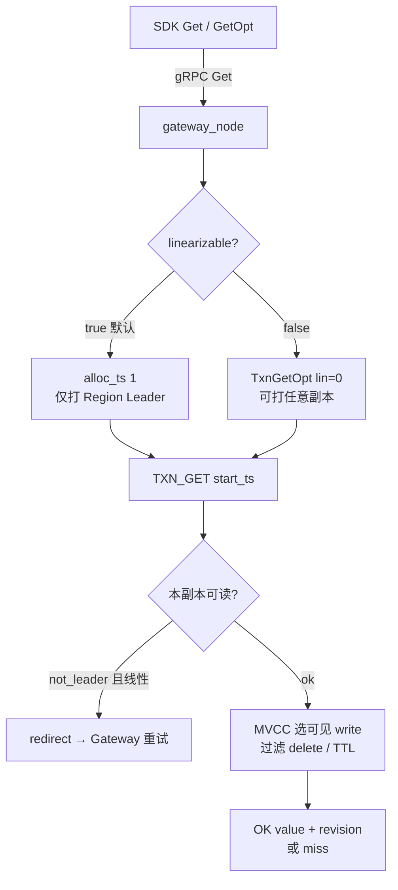

# 流程：读取 Get

**路径：** SDK → gRPC Gateway →（线性）AllocTs → Locate → Storage `TXN_GET` → MVCC 可见性

**关键代码：** `GatewayServer::Get` / `TxnGetBody` · `StoreClient::txn_get_opt` · `StoreFacade::txn_get` · `MvccStore`



---

## 两种读语义

| 模式 | `linearizable` | 行为 |
|------|----------------|------|
| 线性一致（默认） | `true` | TSO + **Leader** `TXN_GET`；按 `start_ts` 做 MVCC 可见性 |
| 副本 / 脏读 | `false` | 任意副本本地快照；**无 ReadIndex**，可能落后于 Leader |

SDK：`Get` = 强一致；`GetOpt(ctx, key, false)` = 副本读。  
`BatchGet` 固定强一致；逐 key 副本读请用 `GetOpt`。

---

## MVCC 可见性（摘要）

对用户 key，在 `start_ts` 下：

1. 找 commit_ts ≤ start_ts 的最新 write  
2. 若为 delete → miss  
3. 若挂 `expire_at_ms` 且已过期 → miss（[14-kv-ttl](14-kv-ttl.md)）  
4. 否则返回对应 data；`revision` = 该 write 的 commit_ts  

锁冲突：读碰到未过期 lock 时按锁解析策略等待 / 报错（与写路径 Resolve 同源）。

---

## 注意

- **无 Raft ReadIndex**：副本读不提供线性一致边界。  
- 线性读打到 Follower → `not_leader`，走 [08-not-leader-redirect](08-not-leader-redirect.md)。  
- Scan / ListPrefix 的线性语义与 Get 相同，跨 Region 扇出见 [16-scan-list-prefix](16-scan-list-prefix.md)。

---

## 验收

```bash
make cluster-up
cd client/go && go run ./examples/basic
go run ./examples/stale_read   # 若有：对比 lin true/false
make cluster-down
```
