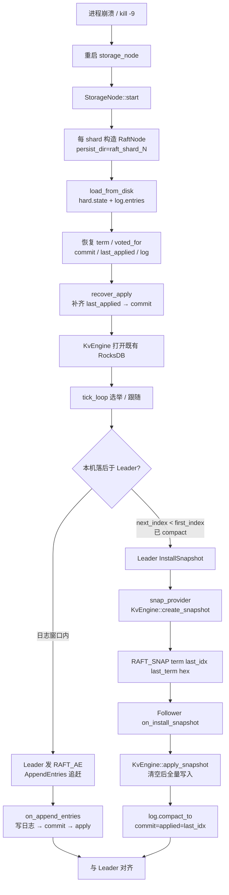
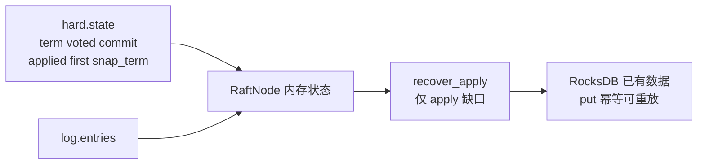

# 流程：故障恢复

**设计总览：** [DATA_HA.md](../architecture/DATA_HA.md) §3.2 · 演练：[FAULT_DRILL.md](../ops/FAULT_DRILL.md)  
**场景：** Storage 宕机再启；或落后过久超出本地日志窗口。  
**关键代码：** `RaftPersist` · `RaftNode::load_from_disk` / `recover_apply` · `RAFT_AE` / `RAFT_SNAP` · `KvEngine::{create,apply}_snapshot`

启动装载见 [07-storage-startup](07-storage-startup.md)；选举见 [06-raft-election-commit](06-raft-election-commit.md)。

## 启动装载细节

## 何时走 Snapshot

| 条件 | 动作 |
|------|------|
| Leader `log.size() > compact_threshold(128)` 且已 apply | `maybe_compact` 丢弃前缀日志 |
| Follower `next_index < log.first_index()` | 无法 AE 对齐 → `InstallSnapshot` |
| AE 失败 | Leader 递减 `next_index`，可能最终落入快照窗口 |

## Split 后重启：`recover_local_regions_from_meta`

REGISTER 成功后 Storage 拉 `GET_ROUTE`，对本机副本 `ADMIN_ENSURE_REGION`，恢复 split 出的兄弟 Region（不仅 bootstrap 的 region-0）。

线格式须为 `rid:startHex:endHex:epoch:nrep,id@addr*L,...`（与 `MetaNode::format_route` 一致）。typed 回退 `format_routing_table_line` 若漏掉 `nrep,`，RF=1 无逗号会导致 `ensured=0`，Gateway 按路由打到未装载 Region → `no_region`。

## 验证

- 单测：`RaftPersistTest.SaveAndRecoverApplied` / `InstallSnapshotCompactsAndApplies` / `MetaRpcTest.FormatRoutingTableLineIncludesNrepComma`
- 冒烟：杀 `storage-1` 再启，日志出现 `recovered term=`；split 后重启日志 `recover_local_regions_from_meta ensured=N`（N=本机 Region 数）
- 验收：`ctest -R MetaRpcTest`；k8s 杀 `storage-0` 再启后 `go run ./examples/basic` 对任意 key 不再 `no_region`
