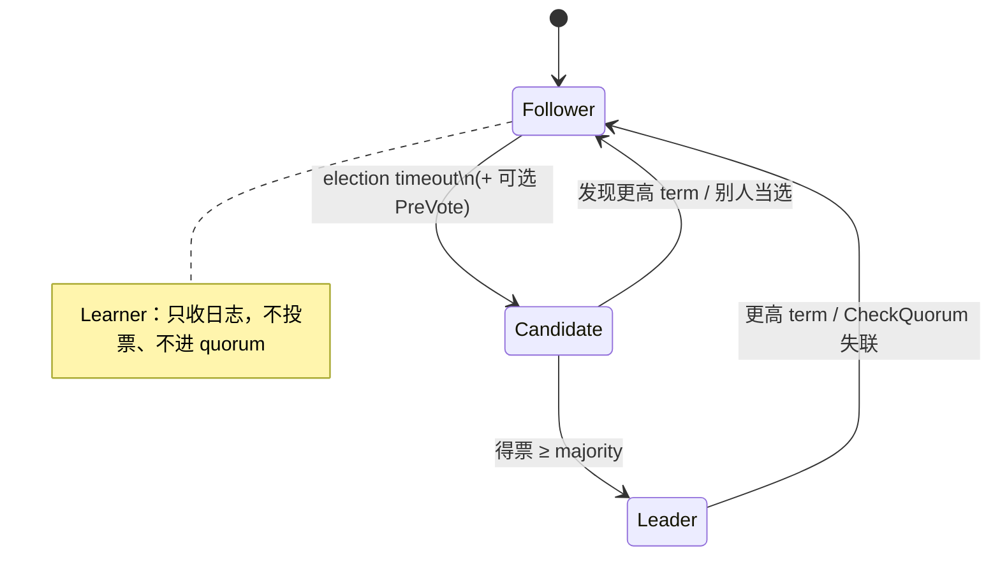
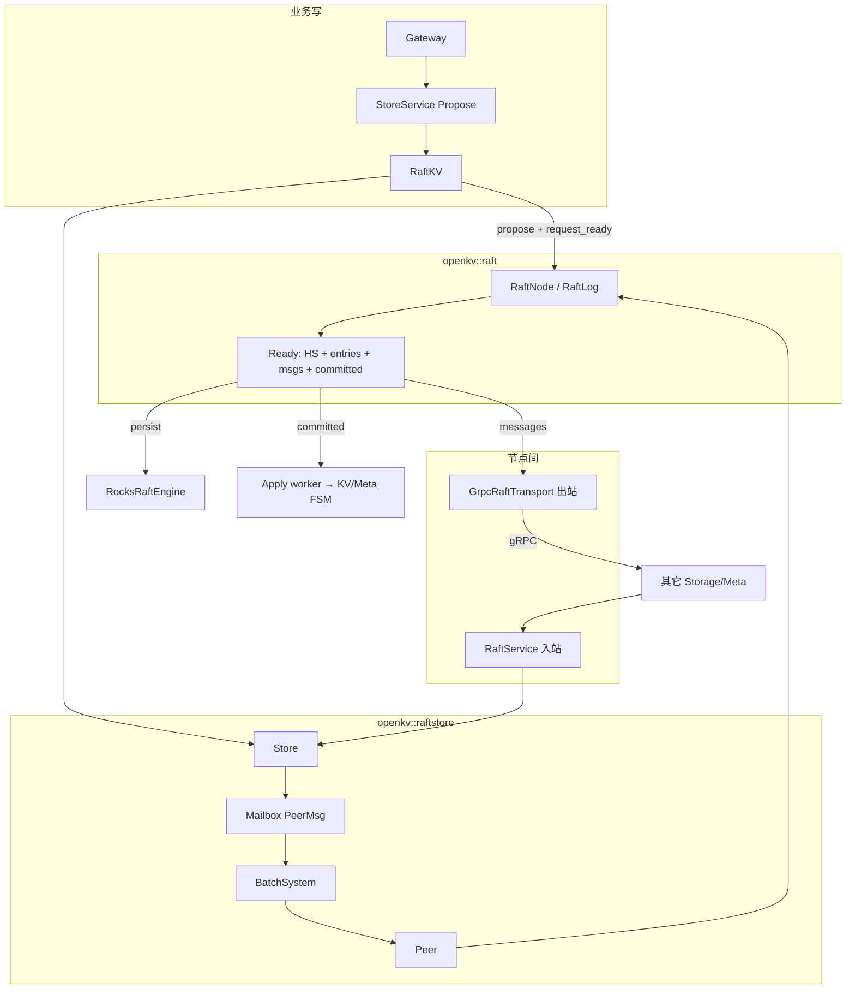
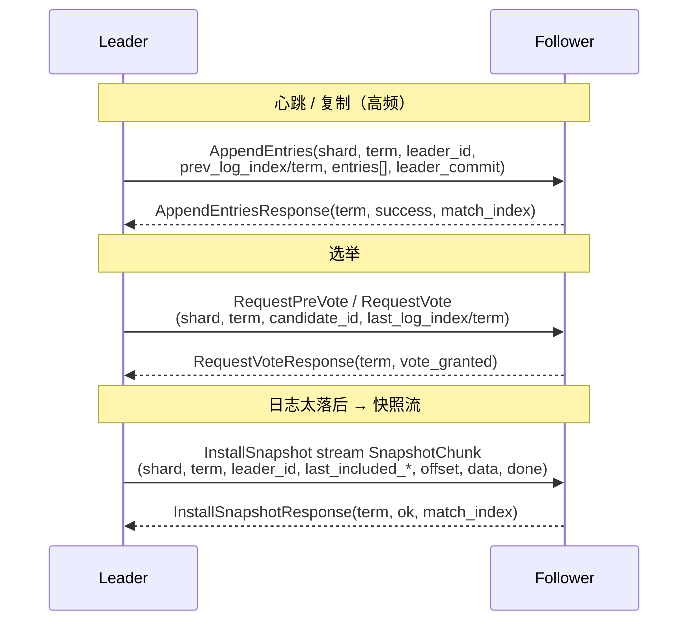
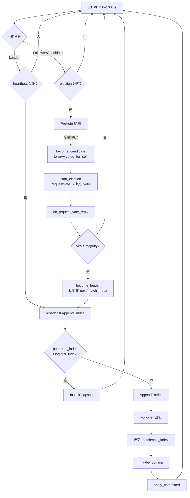
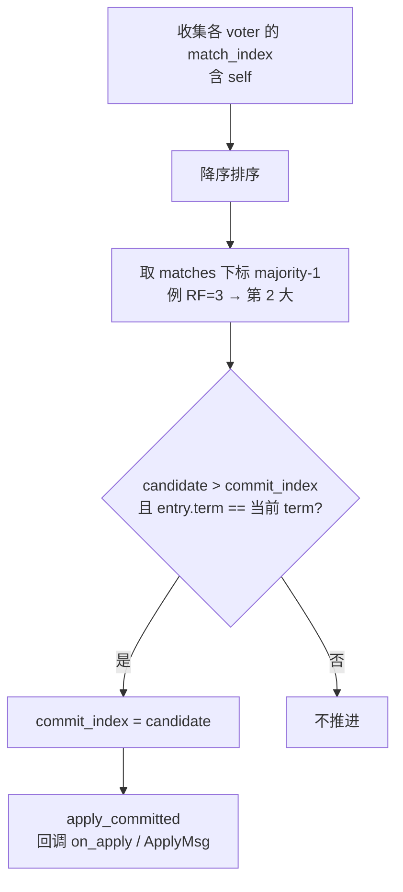
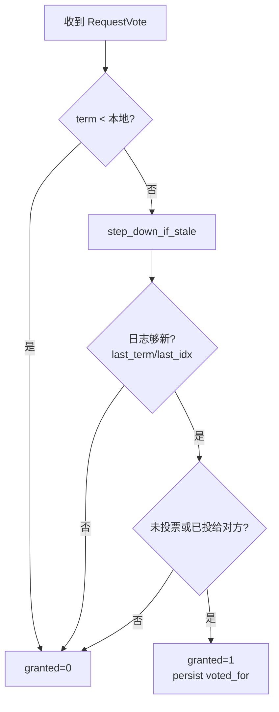
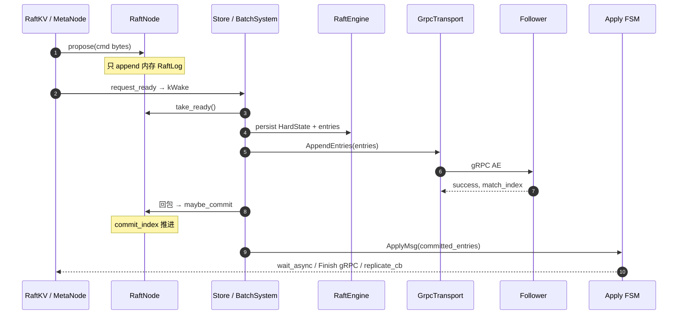

# 流程：Raft 原理、交互与提交

**状态：** 与源码对齐  
**适用范围：** Storage 每 Region 一组 Raft；Meta 单组 Raft。算法同一套 `RaftNode`。  
**关键代码：** `raft/src/raft_node.cpp` · `raftstore/msg.hpp` · `GrpcRaftTransport` · `proto/storage/v1/storage.proto`（`RaftService`）  
**相关：** [35-raft-module-call-flows](35-raft-module-call-flows.md) · [RAFT_DATA_TOPOLOGY](../topology/RAFT_DATA_TOPOLOGY.md) · [26-raftstore-schedule-pipeline](26-raftstore-schedule-pipeline.md) · [24-persist-raft-vs-kv](24-persist-raft-vs-kv.md) · [NETWORKING](../NETWORKING.md)

OpenKV 分两层：**协议核**（`RaftNode`）算日志/选票；**raftstore**（Mailbox + BatchSystem）调度；节点间只走 **`RaftService` gRPC**（无独立 TCP 双栈）。

---

## 1. 原理：角色、任期、日志

| 概念 | 含义 |
|------|------|
| **term** | 逻辑时钟；RPC 带 term，落后则 step down |
| **LogEntry** | `{term, index, data}`；`data` = KV Command / ConfChange / MetaCommand |
| **commit_index** | 多数派已复制、可 apply 的水位 |
| **match / next_index** | Leader 记每个 peer 已对齐到哪、下一条发哪 |
| **HardState** | `{term, vote, commit}`，须持久化 |

---

## 2. OpenKV 组件交互

### 本机邮箱（`raftstore/msg.hpp`，不跨机）

| 类型 | 数据 | 作用 |
|------|------|------|
| `TickMsg` | 空 | 选举 / 心跳时钟 |
| `RaftMessage` | `from, type, payload` | 入站 RPC 或回环 |
| `SignificantMsg` | `kWake` / TimeoutNow / Unreachable | propose 后唤醒 Ready（批内合并） |
| `ApplyRes` | `region_id, applied_index, conf_change` | Apply 回告 Raft worker |
| `ApplyMsg` | `entries[]` | 已提交日志批 → Apply worker |
| `SnapTask` | `SnapshotMeta + data` | 出站快照任务 |

`PeerMsg` = Tick / RaftMessage / SignificantMsg / ApplyRes；`ApplyControl` = ApplyMsg / SnapTask。

---

## 3. 节点间 RPC 与载荷

`RaftService`（`storage.proto`；Meta 同端口复用同组 RPC）：

| RPC | 请求关键字段 | 响应 |
|-----|-------------|------|
| **AppendEntries** | `prev_log_*` 一致性检查；`entries` 可空=纯心跳；`leader_commit` 推进 Follower commit | `success` + `match_index` |
| **RequestVote / PreVote** | 候选人 `last_log_*`（日志够新才给票）；**PreVote 不抬高**本机 term | `vote_granted` |
| **InstallSnapshot** | 分片流：`last_included_index/term` + chunk；拼完装 FSM | `match_index ≈ last_included` |

`Ready::Message.type` 为 `AppendEntries` / `RequestVote` / `RequestPreVote` / `InstallSnapshot`；出站 `GrpcRaftTransport`，入站 `Store::apply_inbound_raft` → Mailbox。

历史行协议语义（单测 / 文本调试仍可能见到）：

| 类型 | 请求行 | 响应行 |
|------|--------|--------|
| RequestVote | `RAFT_VOTE shard from term last_idx last_term` | `OK VOTE term granted` |
| PreVote | `RAFT_PREVOTE …` | `OK PREVOTE term granted` |
| AppendEntries | `RAFT_AE shard from term prev prev_term commit n …` | `OK AE term success match` |
| InstallSnapshot | `RAFT_SNAP …` / snap chunk | `OK SNAP term success match` |

---

## 4. 选举 / 心跳 / 提交（tick 循环）

### 提交规则（maybe_commit）

### 选票授予（on_request_vote）

---

## 5. 一次写：Propose → 多数派 → Apply

要点：**先本地 WAL（`must_sync` 时 durable），再发网**；客户端 ACK 在多数派 commit +（按耐久策略）apply 路径上完成。详见 [36-propose-ack-durability](36-propose-ack-durability.md)。

---

## 6. Storage vs Meta

| | Storage | Meta |
|--|---------|------|
| 组数 | Multi-Raft：每 Region 一组（`shard_id`） | 单组 Meta Raft |
| 协议 | 同一套 `RaftNode` + `RaftService` | 同左 |
| 日志 `data` | KV Command / ConfChange | `MetaCommand`（路由、TSO、节点态…） |
| 持久化 | `RocksRaftEngine`（生产） | `FileRaftEngine` / 配置目录 |

字段级拓扑：[RAFT_DATA_TOPOLOGY](../topology/RAFT_DATA_TOPOLOGY.md)。源码调用图：[35-raft-module-call-flows](35-raft-module-call-flows.md)。

---

## 验收

| ID | 标准 |
|----|------|
| D1 | 本文覆盖角色、本机邮箱、gRPC 载荷、tick/commit、写路径时序 |
| D2 | 与 `RaftService` proto、`raftstore/msg.hpp` 字段一致 |
| D3 | flows README 已挂链接 |
