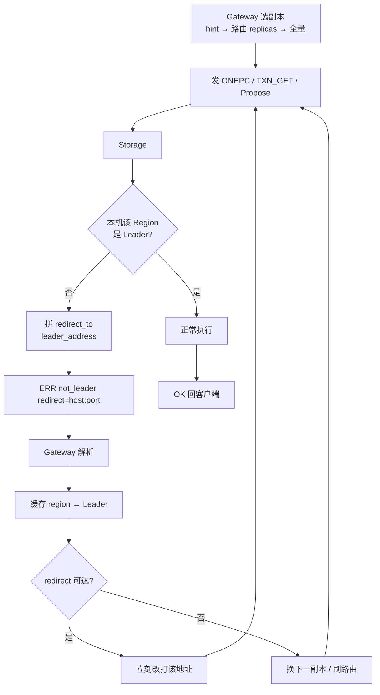
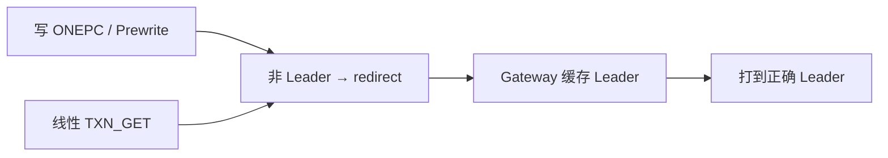

# 流程：not_leader 重定向

**目的：** 写或线性读打到 Follower 时，引导 Gateway 改打当前 Leader，避免错写或脏读。

**错误码总目录：** [ERROR_CODES.md](../architecture/ERROR_CODES.md)。

**关键代码：** `StoreFacade::{propose,txn_get}` · `GatewayServer` / `Router`（leader hint · `with_leader`）· Meta `WHO_LEADER` / ExecLine redirect

---

## 各层错误形态

| 层 | 形态 |
|----|------|
| Storage ExecLine / gRPC | `ERR not_leader redirect=<addr>` 或业务 error 字段 |
| Meta | `ERR not_leader redirect=<meta_leader>` |
| Gateway | 更新 leader hint 后有限次重试；耗尽则返回客户端 |

---

## 与读写交叉

`linearizable=false` 的副本读**不要求** Leader，也不会因 not_leader 强行改打（除非该副本拒绝服务）。

---

## 边界

- hint 过期（Leader 已迁）：再收到 not_leader，用新 redirect 覆盖。  
- redirect 不在已知 `storages` 列表：尝试直连一次，并触发路由刷新。  
- 分裂窗：可能同时出现 `splitting` / `epoch_not_match`，优先刷路由再重试。
