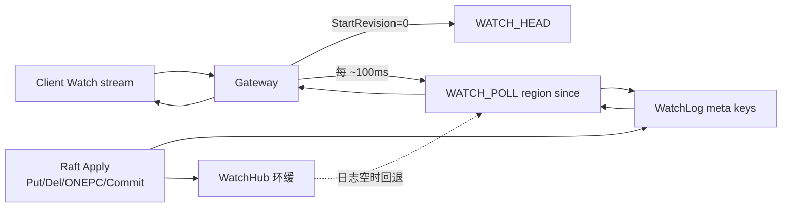

# 流程：Watch

**路径：** Client `Watch` 流 → Gateway 轮询 Storage `WATCH_POLL` → 持久化 Watch 日志  
**关键代码：** `gateway_watch.cpp` · Storage `WATCH_HEAD` / `WATCH_POLL` · `WatchLog` / `WatchHub`



| 项 | 说明 |
|----|------|
| 精确 key | 订阅时先推当前快照（TxnGet），再推增量 |
| 前缀 | 过滤 `key_prefix`；轮询路由表内相关 Region |
| revision | **一律 Raft apply index**（含 Commit / ONEPC） |
| 持久化 | `\xff\xffskv/watch/{be64 index}`；默认保留最近 4096 条 |
| `WATCH_HEAD` | 返回 `last_applied`，供 `StartRevision=0` 起点 |
| 限制 | 单 Gateway 轮询 Leader；非 Storage→Client 长连接推送 |

示例：`client/go/examples/watch`。

## 边界

- 多 Gateway 各自轮询，事件可能重复；客户端按 revision 去重。  
- 落后过久超出 WatchLog 窗口 → 需从新 HEAD 重新订阅（类似压缩缺口）。  
- apply 批写后统一 `WatchLog::trim`（见 [23](23-write-path-batching.md)）。  
- 流生命周期：只在客户端取消或写失败时 `stop`/`Finish`；轮询间隔 sleep **不得**无条件关流（曾误在每轮 sleep 后 `stop`，约 100ms 就 EOF，见下节）。

## 回归：轮询 sleep 后误关流

**现象：** `client/go/examples/watch` / fault-drill Watch 冒烟立刻 `EOF`；Put/Get 正常。  
**根因：** `watch_async` 扫完一轮 region 后 sleep 100ms，本应继续 `poll_round`，却多写了一句无条件 `st->stop()` → `Finish(OK)` → 客户端 `Recv` 得 `io.EOF`。示例先 Watch 再 Sleep(200ms) 才 Put，流已先关。  
**修复：** 去掉该 `stop`；仅 `!live()`（取消/已死）时才 `stop`。

## 验收

```bash
# 集群已起（persist_sync 任意）
(cd client/go && go build -o ../../.run/kv-watch ./examples/watch)
./.run/kv-watch 127.0.0.1:19000
# 期望：打印若干 event PUT … 并以 "watch ok" 退出 0
```
