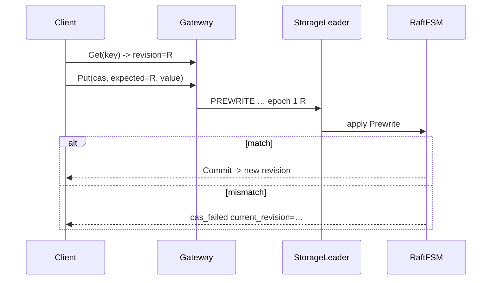

# 流程：版本 CAS（revision）

**状态：** 已实现  
**读者：** 客户端 / Gateway / Storage  
**相关：** [01-write-put.md](01-write-put.md) · [ERROR_CODES.md](../architecture/ERROR_CODES.md)

## 问题

业务需要「读到版本 R 后再写，仅当仍为 R」的乐观并发。Leader 上先 Get 再 Propose 有 TOCTOU：两个并发 CAS 都能通过前置检查。

## 方案

条件写进 Raft Command，在 **apply** 内校验；失败不改用户状态，错误 token：`cas_failed current_revision=<n>`。

### 两平面

| 路径 | revision 含义 | 谁用 |
|------|---------------|------|
| **Gateway Put/Get（MVCC）** | 可见版本的 **commit_ts** | `kv.Client.PutCAS` / `DeleteCAS`；`Get.revision` |
| **Gateway RawPut/RawGet（plain）** | `KvRecord.revision`（Raft apply index） | `RawPut(cas=…)` / `RawGet.revision` |
| **plain Propose Put/Del** | 同上 | Storage `Propose.cas`；与 Raw* 同平面 |

Gateway 事务读写走 MVCC ONEPC / Prewrite/Commit；CAS 在 apply 内校验最新可见版本。Raw/plain CAS 校验 RocksDB value 头 revision。两平面 **勿混用同 key**（见 [27](27-raw-vs-txn.md)）。

### 语义

| `cas` + `expected_revision` | 含义 |
|-----------------------------|------|
| `cas=false` | 无条件（兼容旧行为） |
| `cas=true, expected=0` | **create-only**：不得有可见 Put 值 |
| `cas=true, expected=R>0` | 当前版本（commit_ts 或 KvRecord.revision）必须等于 R |



## 边界

- 与多 key 事务互补：单 key 版本 CAS 用 PutCAS；跨 key 仍走 Txn*。
- plain Propose 与 MVCC **不共享**同一物理 value；不要混用两平面的 revision。
- 分裂窗：`splitting` 拒写（与普通 Put 相同）。
- 幂等：服务端无 `request_id` 缓存；CAS 冲突靠 `cas_failed` + 客户端重试。

## 验收

```bash
# 单测（统一目标 openkv_unit_tests）
cmake --build build -j --target openkv_unit_tests
./build/tests/openkv_unit_tests --gtest_filter='*Cas*'

# 集群（Gateway）
make cluster-up
cd client/go && go run ./examples/cas 127.0.0.1:19000
make cluster-down
```

期望：create-only 成功；同 R 二次 CAS 一条成功一条 `cas_failed`；Get→PutCAS(R) 成功且新 revision ≠ R。
