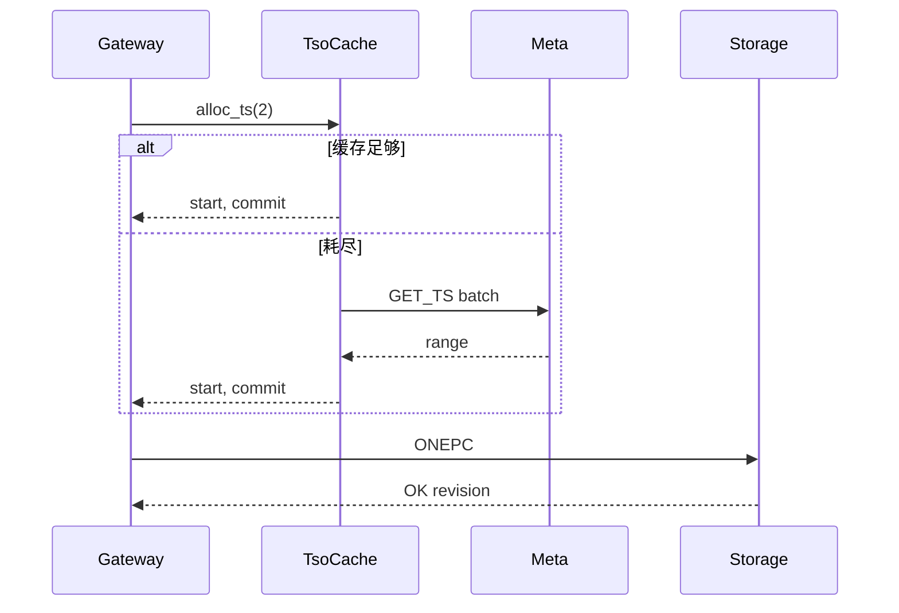

# Gateway TSO / Meta RPC 热路径

**状态：** 已实现  
**相关：** [01-write-put](01-write-put.md) · [18-cpp-gateway](18-cpp-gateway.md) · [22-async-threading-model](22-async-threading-model.md)

---

## 问题（背景）

短 Put 若每次 `AllocTs → … → AllocTs` 且每次新建 Meta 连接，Meta RPC 成为写放大主因。

---

## 当前行为

| 项 | 位置 | 效果 |
|----|------|------|
| Meta channel 复用 | `compute/src/meta_client.cpp` | 不按请求建连 |
| TSO 批缓存 | `compute/src/tso.cpp` | 一次 `GET_TS` 批量本地发放；`OPENKV_TSO_BATCH`（≤1 关闭） |
| Put/Delete 双 TS | `GatewayServer::PutBody` 等 | `alloc_ts(2)` 一次取 start+commit |
| 统一 alloc | Get / Scan / TTL / Txn* | 走同一批缓存 |

```text
Put/PutCAS:  [本地 TS×2] → ONEPC          （Meta 热路径 0 跳；Storage 1 次 Propose）
Get lin:     [本地 TS] → TxnGet            （Meta 0；Storage 1）
批耗尽:      GET_TS N → 填缓存             （偶发 1 次 Meta）
```



---

## 边界

- 批大小过大只影响「一次 Meta 拿走多少号」；不改变线性语义。  
- 显式 Txn 仍可能多次 alloc（primary / for_update 等）。  
- 关闭缓存（`OPENKV_TSO_BATCH=1`）便于对照调试，生产勿关。

---

## 未做（可选下一刀）

- 单 key 快速 PutCAS 绕过完整 MVCC 头（仍 1 Propose，语义需 RFC）  
- Meta 侧 TSO 预分配与多 Gateway 公平性调参

---

## 验收

```bash
# 日志可见 TSO batch / 写路径无「每 Put 两次 GetTs」
cd client/go && go run ./examples/bench -op put -w 8 -n 200
./build/tests/openkv_unit_tests --gtest_filter='*Tso*'
```
