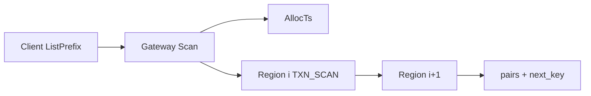

# 流程：Scan / ListPrefix（无旁路索引）

**状态：** 已实现  
**读者：** Client / Gateway / Storage  
**相关：** [02-read-get.md](02-read-get.md) · [14-kv-ttl.md](14-kv-ttl.md) · Coprocessor `ADMIN_COP`（物理键，运维用）

---

## 问题

Gateway 原先无 Scan RPC。业务 `ListPrefix` 只能自维护旁路 key 索引（Put/Delete 双写），易与主数据不一致。

Storage 虽有 `ADMIN_COP` / `Coprocessor`，扫的是**引擎物理键**（含 `L`/`D`/`W`+ts），不能直接当用户 API。

---

## 方案

一等公民 **MVCC Scan**：

1. `kv.v1.Scan`（Unary + `limit` 分页）
2. Storage 行协议 `TXN_SCAN`：按 Write 键序扫，按用户键聚合可见版本（与 `TXN_GET` 写选择一致：delete / TTL 不可见）
3. Gateway 跨 Region 扇出：`Locate` → 交集裁剪 → Leader `TXN_SCAN` → 未满则下一 Region
4. SDK：`ListPrefix(prefix, limit)` = `Scan{prefix, end=prefix_upper_bound}`

**不做：** 旁路索引；无界全表扫；把 `ADMIN_COP` 暴露给业务；第一期 gRPC streaming。

---

## API

| 字段 | 语义 |
|------|------|
| `prefix` | 非空 ⇒ `start=prefix`，`end=prefix_upper_bound` |
| `start_key` / `end_key` | 半开区间；`end` 空=+inf（仍受 limit） |
| `start_after` | 排他游标（上一页 `next_key`） |
| `limit` | 0→256；硬顶 4096 |
| `keys_only` | 不返回 value |
| `linearizable` | true：TSO+Leader；false：副本本地快照 |

`ScanResponse.next_key`：截断时供下一页 `start_after`。

---

## 存储

`TXN_SCAN rid start_hex|- end_hex|- start_ts limit [after=hex] [keys_only] [lin]`

- 忽略锁；只读已提交 Write（ListPrefix 不因单 key 锁失败整段）
- Region `KeyRange` 过滤用户键
- 与 Get 相同：过期 / delete 不可见

---

## 验收

| 项 | 命令 / 期望 |
|----|-------------|
| 单元 | `./build/tests/openkv_unit_tests --gtest_filter='MvccTest.TxnScan*'` → PASS |
| SDK 冒烟 | 集群起好后 `go run ./client/go/examples/scan` → `scan smoke PASS` |
| 登记 | [TEST_CASES.md](../test/TEST_CASES.md) |

---

## 边界

- 物理 `ADMIN_COP` 仍仅运维/调试
- 大前缀必须分页；禁止依赖一次扫完全部
- DS 大对象拆分仍见 [DATA_STRUCTURES.md](../architecture/DATA_STRUCTURES.md) v2 规划（本流程覆盖用户 KV 前缀）
