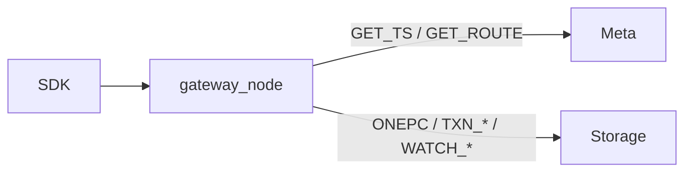

# C++ Compute Gateway（`gateway_node`）

**状态：** 生产路径 · Go `compute-gateway` 已删除  
**实现：** `compute/` → 二进制 `gateway_node`  
**端口：** `:19000` gRPC（`kv.v1` / `ds.v1`）· `:19001` `/stats`  
**对外：** 不改 proto；SDK dial Gateway。

---

## 角色

无状态计算节点：路由、TSO、事务编排、Watch 轮询、DS blob RMW。  
**不存用户数据**；所有 KV 落在 Storage Multi-Raft + RocksDB。



---

## 组件

| 组件 | 路径 | 职责 |
|------|------|------|
| 进程入口 | `compute/src/gateway_main.cpp` | 解析 `--listen` / `--metas` / `--storages` |
| GatewayServer | `gateway_server*.cpp` | KV / Txn / Scan / TTL / Watch / DS |
| Router | `router.hpp` | epoch、Locate、leader 优先 replicas |
| MetaClient | `meta_client.cpp` | GetRoutingTable / GetTs(count) / 连接复用 |
| TSO | `tso.cpp` | 批缓存本地发放 |
| store_rpc | `store_rpc.cpp` | StoreService async Propose/Get/Scan/… |
| dsencode | `ds_encode.cpp` | Hash/Set/List/ZSet blob |

镜像：`deploy/Dockerfile.gateway` → `/opt/openkv/gateway_node`。

---

## 热路径行为

| API | 行为 |
|-----|------|
| Put / Delete | `alloc_ts(2)` → `one_pc`；重试 splitting / epoch / conflict |
| PutCAS / DeleteCAS | 同上 + apply 内 CAS（[13](13-version-cas.md)） |
| Get | 线性：`alloc_ts` + Leader `TXN_GET`；stale：`lin=false` |
| Scan / ListPrefix | 跨 Region 扇出 `TXN_SCAN`（[16-scan](16-scan-list-prefix.md)） |
| Txn* | Prewrite → Commit；lock resolve |
| Watch | 轮询 Leader `WATCH_POLL`（[11](11-watch.md)） |
| DS | MetaKey TxnGet → mutate → Prewrite/Commit（[12](12-data-structures.md)） |

线程模型：[22-async-threading-model.md](22-async-threading-model.md)。  
TSO：[16-gateway-tso-perf.md](16-gateway-tso-perf.md)。  
代码地图 / 路径矩阵 / 已知粗糙点：[29-compute-code-map.md](29-compute-code-map.md)。

---

## 启动

```bash
./build/compute/gateway_node \
  --listen 0.0.0.0:19000 \
  --stats-listen 127.0.0.1:19001 \
  --storages 127.0.0.1:9100 \
  --metas 127.0.0.1:8500,127.0.0.1:8501,127.0.0.1:8502
```

兼容 `-listen=` 风格。Helm / compose 入口同为 `gateway_node`。

---

## 已删除（历史）

- `client/go/cmd/compute-gateway/`
- `client/go/internal/{route,storagetcp,dsencode,traffic}/`

本仓 `client/go` 仅 examples / e2e；SDK 见独立仓（[15](15-multi-client-sdk.md)）。

---

## 验收

| ID | 标准 |
|----|------|
| G1 | `gateway_node` 听 19000；`examples/basic` Put/Get PASS |
| G2 | `DsEncodeTest|MetaClientTest|RouterTest` + `make e2e` PASS |
| G3 | 无 `cmd/compute-gateway`；镜像入口为 C++ |
| G4 | 本节已登记 [TEST_CASES](../test/TEST_CASES.md) |
