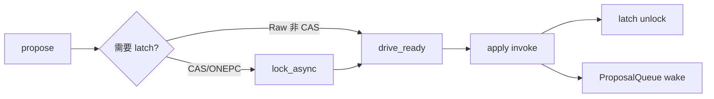

# 架构硬化（写等待 · latch · split · Meta CV）

**状态：** 已实现  
**相关：** [23-write-path-batching](23-write-path-batching.md) · [RANGE_SHARDING](../architecture/RANGE_SHARDING.md) · [16-gateway-tso-perf](16-gateway-tso-perf.md)

---

## 目标

去掉写路径与 Meta 热路径上的 **sleep 轮询**；把 latch / split / place 钩子补到与 Range 模型匹配的最小可用形态。

---

## 当前行为

| 主题 | 行为 |
|------|------|
| 写等待 | `RaftKV::async_write` → propose + `drive_ready`；`ProposalQueue` **CV / wait_async** 等 `invoke`（无 5ms tick 空转） |
| Latch | 事务/CAS：`lock_key_async` 在 propose 前，**持到 apply**；非 CAS Raw Put/Delete **跳过**（见 [27](27-raw-vs-txn.md)） |
| 廉价 size | RocksDB `GetApproximateSizes` + `estimate-num-keys`；`pick_split_key` 近似对半 |
| Split worker | tick 只做廉价阈值判定入队；独立线程跑 Meta SPLIT + PREPARE/SPLIT |
| Meta CV | `apply_cv_` 唤醒 GET_TS / replicate；`route_cv_` + version 唤醒 WATCH_ROUTE |
| Post-split place | `SKV_PD_AUTO_BALANCE=1` 且 RF>1 时对 right `SUGGEST_PLACE` + `place_region`（默认关） |

Ready 批合并与 apply WriteBatch 见 [23](23-write-path-batching.md)。异步线程见 [22](22-async-threading-model.md)。

---

## 边界

- gRPC 同步语义仍「等到 apply」；只是不再占线程 sleep 轮询。  
- `GetApproximateSizes` 为估计；可用 `SKV_SPLIT_*=0` 关自动分裂。  
- Place 默认关，避免与手动 scale 打架。

---

## 验收

| ID | 命令 / 期望 |
|----|-------------|
| H1 | `ctest -R 'ApproxAndPickSplit\|ProposalQueue\|LatchHold\|MetaWatch\|OnePc'` PASS |
| H2 | 本文与 `ARCHITECTURE` / `RANGE_SHARDING` 一致 |
| H3 | put bench `fail=0`；无 Meta HB Deadline 风暴 |
