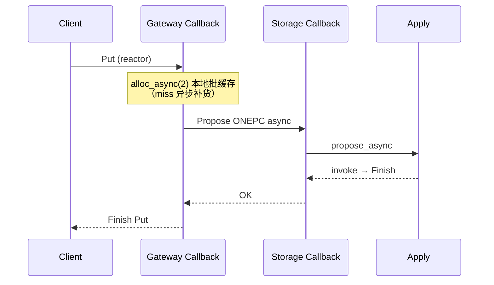

# 全链路异步网络（gRPC Callback）

**状态：** 已实现  
**相关：** [22-async-threading-model](22-async-threading-model.md) · [19-architecture-hardening](19-architecture-hardening.md) · [GRPC_MANDATORY](GRPC_MANDATORY.md)

## 问题（背景）

同步 `Service` 下 Storage Propose/ExecLine、Meta GetTs、Gateway Put 在 handler 内阻塞到 apply / 下游返回，占满 gRPC 工作线程，写放大时 Deadline / 队列堆积。Raft 出站（`GrpcRaftTransport` worker）已异步；业务入站对齐同一模型。

## 当前行为

| 层 | 行为 |
|----|------|
| ProposalQueue | `wait_async(index, timeout, cb)`：apply `invoke` 或超时回调，不占调用方线程 |
| Storage | `propose_async` / `one_pc_async`；`Store`/`Admin` → `CallbackService`；ONEPC 热路径 Finish@apply；其它行 `SKV_STORAGE_GRPC_WORKERS` |
| Meta | `alloc_ts_async`；`MetaService` → `CallbackService` + `SKV_META_GRPC_WORKERS` |
| Gateway | `KV`/`DS` → `CallbackService` + `SKV_GATEWAY_WORKERS`；Put：`alloc_async` → `Propose(ONEPC)`；Get：`alloc_async` → `StoreService.Get(start_ts)`；BatchPut/Get CQ fan-in（见 [28](28-compute-net-opt.md)） |
| Raft | 出站 worker 队列；入站 AE/Vote 短路径同步 Finish |

## 边界

- Admin 低频 RPC、Raft 入站：Callback 包装后立即 `Finish`（不阻塞 sync 线程池即可）。
- WATCH 流式：仍用 server writer；长等走 `route_cv_`，后续可再迁 `ServerWriteReactor`。
- 同步 `propose()`/`handle_line()` 保留给单测与行协议 CLI。

## 失败与回滚

- apply 超时 → `apply_timeout` / reactor `Finish(OK)` 带业务 error 字段（与现语义一致）。
- 回滚：各服务改回 `::Service` + 同步 `wait`（不推荐）。

## 验收

| ID | 命令 / 期望 |
|----|-------------|
| A1 | `ctest -R 'ProposalQueue'` 含 WaitAsync 用例 PASS |
| A2 | `ctest -R 'OnePc\|MetaHa\|ExecLine\|TsoTest\|RouterTest'` PASS |
| A3 | 本地/集群 Put：无长期 gRPC Deadline；写路径日志无 handler 内 sleep 等 apply |
