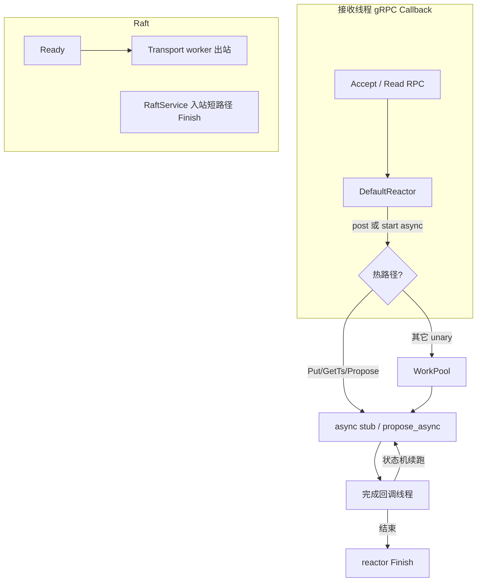

# 全链路异步线程模型（接收线程 + 工作线程）

**状态：** 已实现  
**相关：** [21-async-network](21-async-network.md) · [NETWORKING](../NETWORKING.md) · [18-cpp-gateway](18-cpp-gateway.md)

## 选型结论

1. **协议栈**：继续 gRPC，全面采用 **CallbackService + ServerUnaryReactor**（reaction 内禁止同步 RPC / 等 CV）。
2. **线程角色**：  
   - **接收线程** = gRPC callback/CQ 线程（只投递 / 发起 async / `Finish`）  
   - **工作线程** = `WorkPool` / BatchSystem / Transport worker（编排与 Raft）  
   - **完成回调** = client async / `ProposalQueue::invoke`（续跑状态机）
3. **热路径零同步等待**：接收线程与 gRPC reaction 上禁止 `stub->Foo()`、`future.get()`、`wait_apply`；下游一律 async stub 或 `propose_async`→`wait_async`。
4. 可选 Seastar 开关见 [SEASTAR_NET](../architecture/SEASTAR_NET.md)；业务路径默认不接入。

## 目标

网络路径上 **禁止同步阻塞等待**（禁止在 gRPC 接收回调里 `stub->Foo()` / `wait_apply` / `future.get()`）。

统一两层线程：

| 角色 | 谁 | 允许做什么 | 禁止做什么 |
|------|-----|------------|------------|
| **接收线程** | gRPC Callback CQ / reactor 回调 | 解析请求、投递 `WorkPool`、发起 async stub、`Finish` | 等 Raft apply、等下游 RPC、睡 CV |
| **工作线程** | `openkv::WorkPool` | CPU/编排、启动下一跳 async RPC、写响应字段 | 同步 gRPC stub（热路径） |
| **完成回调** | client async / apply `invoke` | 续跑状态机、再投递或 `Finish` | — |

Raft 出站另有 **Transport worker**（已有），不占用 BatchSystem / 接收线程。

## 各节点

### Gateway

- 入站：`KVService` / `DSService` → **CallbackService**（已实现）
- 热路径 Put/Delete/Get：接收线程 `alloc_ts`（本地 TSO 批缓存，与同步 PutBody 一致）→ `store_exec_line_async`
- 其它 unary：接收线程 `WorkPool::post`，worker 内仍只准 async 出站（过渡期个别路径可先 post，禁止在接收线程同步等）
- 环境变量：`SKV_GATEWAY_WORKERS`（默认 32）

### Meta

- 入站：`MetaService` → **CallbackService**（已实现）
- `GetTs`：`alloc_ts_async` → apply invoke → `Finish`（不占接收线程）
- `ExecLine`：接收线程 post 到 `WorkPool`；`GET_TS` 行走 `alloc_ts_async`
- Raft 入站保持短路径同步 Finish；出站 Transport worker
- `SKV_META_GRPC_WORKERS`（默认 16）

### Storage

- 入站：`Store`/`Admin` **CallbackService**；`Raft` 短路径
- `Propose`：`propose_async` → `wait_async` → `Finish`
- `ExecLine` ONEPC/PUT/DEL：接收线程直接 `propose_async`（不进池、不 `future.get`）；其它行 post `WorkPool`
- `SKV_STORAGE_GRPC_WORKERS`

## 验收

| ID | 标准 | 结果（2026-11-10） |
|----|------|-------------------|
| T1 | 设计本文 + ARCHITECTURE / 21 文档交叉引用 | **PASS** |
| T2 | Gateway/Meta/Storage 热路径代码无同步 stub wait / `promise.get` 等 apply | **PASS**（入站 Callback；ONEPC/`GetTs`/`Put` 热路径 async） |
| T3 | `ctest -R 'ProposalQueue\|OnePc\|TsoTest\|ExecLine\|RouterTest'` PASS | **PASS**（含 StoreFacade 共 25/25） |
| T4 | put bench fail=0；日志可见 callback + workers= | **PASS**（31.1ops/s ok=249 fail=0；三端 callback+workers 日志） |

## 失败与回滚

- apply / 下游超时：业务 error 字段或 gRPC status；reactor 必须 Finish
- 回滚单节点改回 `::Service` 会重新堵接收线程，不推荐
