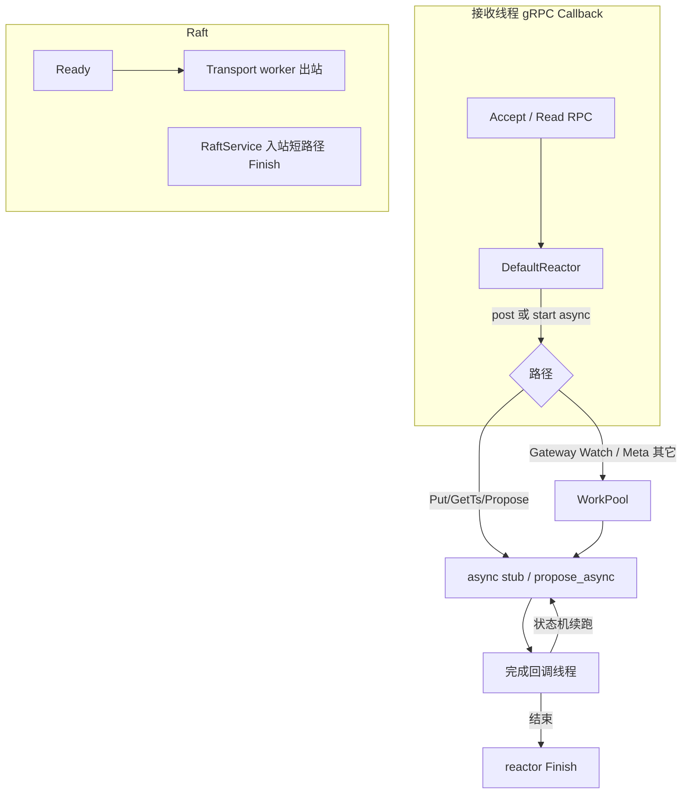

# 全链路异步线程模型（接收线程 + 工作线程）

**状态：** 已实现  
**相关：** [21-async-network](21-async-network.md) · [NETWORKING](../NETWORKING.md) · [18-cpp-gateway](18-cpp-gateway.md)

## 选型结论

1. **协议栈**：继续 gRPC，全面采用 **CallbackService + ServerUnaryReactor**（reaction 内禁止同步 RPC / 等 CV）。
2. **线程角色**：  
   - **接收线程** = gRPC callback/CQ 线程（只投递 / 发起 async / `Finish`）  
   - **工作线程** = `WorkPool`（Gateway Watch / Meta 非热路径）+ BatchSystem / Transport worker  
   - **完成回调** = client async / `ProposalQueue::invoke`（续跑状态机）
3. **热路径零同步等待**：接收线程与 gRPC reaction 上禁止 `stub->Foo()`、`future.get()`、`wait_apply`；下游一律 async stub 或 `propose_async`→`wait_async`。

## 目标

网络路径上 **禁止同步阻塞等待**（禁止在 gRPC 接收回调里 `stub->Foo()` / `wait_apply` / `future.get()`）。

统一两层线程：

| 角色 | 谁 | 允许做什么 | 禁止做什么 |
|------|-----|------------|------------|
| **接收线程** | gRPC Callback CQ / reactor 回调 | 解析请求、发起 async stub、必要时 `WorkPool::post`、`Finish` | 等 Raft apply、等下游 RPC、睡 CV |
| **工作线程** | `openkv::WorkPool`（Gateway/Meta） | 卸阻塞/长等：Watch sleep、Meta `handle_line`、WATCH_ROUTE | 热路径同步 gRPC stub |
| **完成回调** | client async / apply `invoke` | 续跑状态机、再投递或 `Finish` | — |

Raft 出站另有 **Transport worker**（已有），不占用 BatchSystem / 接收线程。Storage **不再建 WorkPool**。

## 各节点

### Gateway

- 入站：`KVService` / `DSService` → **CallbackService**（已实现）
- 热路径 Put/Delete/Get：接收线程 `alloc_async`（本地 TSO 批缓存）→ `store_propose_onepc_async` / `store_get_async`
- `WorkPool`（`SKV_GATEWAY_WORKERS`，默认 32）：仅 Watch 间隔 sleep / `write_ev`（勿堵 CQ）

### Meta

- 入站：`MetaService` → **CallbackService**（已实现）
- Finish@apply（不经池）：`GetTs` / `REGISTER` / `ReportMin` / Split·Merge·Place / Drain·Offline·Kick / BumpRoute / AdvanceSafePoint
- `reply` 内联：`HEARTBEAT`、廉价读、ScaleOut/Balance/Migrate 等内存调度（禁止等 apply / CV / 出站 RPC）
- WorkPool（`defer`/`post`）：WATCH_ROUTE、GetScale、Activate/Join（出站 Ping）
- Raft 入站保持短路径同步 Finish；出站 Transport worker
- `SKV_META_GRPC_WORKERS`（默认 16）

### Storage

- 入站：`Store`/`Admin` **CallbackService**；`Raft` 短路径
- `Propose`：`propose_async`（Raw 非 CAS 无 latch；其余 `lock_key_async`）→ `wait_async` → `Finish`；Latch **仅** `lock_async`（已无阻塞 `Latches::lock`）
- `propose_async` 回调只持 `StorageNode&` + `shared_ptr<RegionMetrics>`，禁止捕获临时 `StoreFacade*`（txn GC 栈上 facade 火后即毁）
- Admin 类型化 RPC（Ensure/Place/Split/…/`Stats`/`Ping`）；无 `ExecLineHandler`
- **无 WorkPool** / 已废 `SKV_STORAGE_GRPC_WORKERS`；日志 `callback`（无 `workers=`）

## 验收

| ID | 标准 | 结果 |
|----|------|------|
| T1 | 设计本文 + ARCHITECTURE / 21 文档交叉引用 | **PASS** |
| T2 | Gateway/Meta/Storage 热路径代码无同步 stub wait / `promise.get` 等 apply | **PASS** |
| T3 | `ctest -R 'ProposalQueue\|OnePc\|TsoTest\|RouterTest\|StoreFacade'` PASS | **PASS** |
| T4 | put bench fail=0；Storage 日志 `callback`；Gateway/Meta 仍可见 `workers=` | **PASS**（2026-11-14：`callback`；`-mode all` exit 0） |

## 失败与回滚

- apply / 下游超时：业务 error 字段或 gRPC status；reactor 必须 Finish
- 回滚单节点改回 `::Service` 会重新堵接收线程，不推荐
