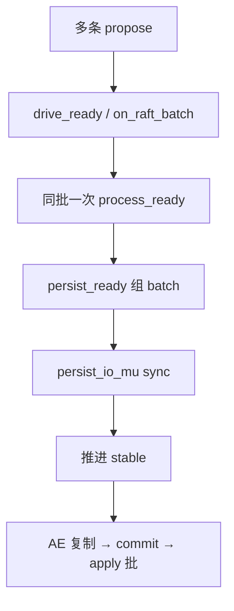

# 写路径批处理（Ready · apply · 多 Region）

**状态：** 已实现  
**相关：** [01-write-put](01-write-put.md) · [19-architecture-hardening](19-architecture-hardening.md) · [17-gateway-api-bench](17-gateway-api-bench.md) · [COMPONENT_MAP](../architecture/COMPONENT_MAP.md)

---

## 问题

单 Region 下 Put 吞吐曾受限于：

1. 每条 propose 后立刻全表 Tick / 多次 `process_ready` → **约 1 Put / 1 Raft sync**  
2. `persist_ready` 持 Raft 锁做 fsync → 堵住后续 propose，Ready 批难长大  
3. apply 逐条 `Put`，且旧默认对 RocksDB 也 sync → **双 fsync**  
4. 压测若不拆 Region，永远测单管道  

**默认耐久（2026-11-11）**：`persist_sync=data` = Raft log sync + **KV apply 异步**（不再双 sync）。需要 KV 也 sync 时用 `all`。

---

## 当前行为

### Ready group commit + fsync 解锁

| 改动 | 行为 |
|------|------|
| `Store::drive_ready` | 只对本 Region 投 `kWake`；BatchSystem 未起时同步 `process_ready` |
| `Store::request_ready` | propose 热路径攒批（`SKV_READY_COALESCE_*`）后再 `drive_ready`；见 [25](25-write-path-knives.md) |
| `Store::on_raft_batch` | 同批 Tick/Wake/Msg **只 `process_ready` 一次** |
| `BatchSystem` schedule | Router 投递唤醒 worker + drain-until-empty；见 [26](26-raftstore-schedule-pipeline.md) |
| `RaftKV::async_write` | propose 后 `request_ready`；`flush_ready` 仍强制 `drive_ready` |
| `RaftNode::persist_ready` | 持锁组 batch；`persist_io_mu_` 下 consume/sync；再推进 `stable_*`（只前进） |

`data` 下 Raft Ready 仍 sync；KV 不 sync。目标是 **多数派 + Raft sync 摊销**，崩溃用日志重放，而不是每笔 apply 再 fsync。  
Group commit **不在** Raft sync 前 ACK；客户端仍等 apply（内存可见）。



### apply WriteBatch

| 改动 | 行为 |
|------|------|
| `Store::ApplyBatchFn` | 同 Region 一批 committed entries |
| `StorageNode::on_apply_entries` | 无 CAS 的 ONEPC/Put/Delete 累加后一次 `write_batch`（含 watch meta）；其余退回 `on_apply` |
| `WatchLog::trim` | 批写后统一裁剪 |

### 多 Region 压测

```bash
# 宿主机访问 k3s 时需 port-forward，并设 SKV_STORAGES
SKV_META=127.0.0.1:18500 SKV_STORAGES=127.0.0.1:19100 \
  bash scripts/bench-multi-region.sh bench-mr 4 200
# 再跑 examples/bench -prefix bench-mr ...
```

连续多次 split 后若 `key_not_in_region`，重启 Storage 触发 `recover_local_regions_from_meta`。

---

## 边界与回滚

- 改默认 `persist_sync` 前须单独 RFC + 故障演练  
- 回滚：`flush_ready` 恢复 `mark_hot+schedule_tick`；`persist_ready` 恢复持锁 `engine_flush_locked`；去掉 `ApplyBatchFn`

---

## 验收

| ID | 标准 | 怎么跑 |
|----|------|--------|
| W1 | `RaftstoreTest.DriveReadyCoalescesPersist` PASS | gtest |
| W2 | `StoreFacadeTest.ApplyEntriesBatchesPutAndOnePc` PASS | gtest |
| W3 | `bench-multi-region.sh` 后 route region 数 ≥ 目标 | 脚本 + `skv route` |
| W4 | 多 Region put 相对单 Region 基线不回退 | `examples/bench`；记 TEST_CASES |

**结果（2026-11-11）：** W1–W4 PASS。单 Region put w8 ≈56.5 ops/s；多 Region put w4 ≈62 ops/s fail=0。详见 [TEST_CASES](../test/TEST_CASES.md)。
