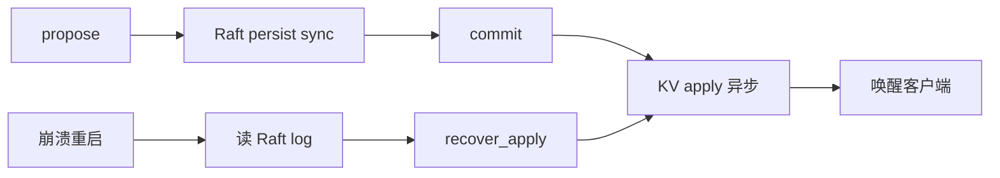

# 耐久模型：Raft log sync + KV apply 异步

**状态：** 默认行为（2026-11-11）  
**相关：** [01-write-put](01-write-put.md) · [23-write-path-batching](23-write-path-batching.md) · [STORE_PRODUCTION](../production/STORE_PRODUCTION.md)

---

## 问题

旧默认 `persist_sync=data` 对 **Raft 日志与 RocksDB apply 都 sync**，本机 Put p50 明显高于「只 durable Raft」的实现对齐压测；对照实验见 [TEST_CASES](../test/TEST_CASES.md)（none vs data）。

## 方案

| `SKV_PERSIST_SYNC` | Raft log | RocksDB `WriteOptions.sync` | 用途 |
|--------------------|----------|-------------------------------|------|
| **`data`（默认）** | sync（fdatasync） | **否** | 生产默认：耐久靠日志；apply 异步 |
| `all` | sync | 是（+ `use_fsync`） | 最强耐久 / 排障 |
| `none` | 否 | 否 | 压测上限 / 开发 |

崩溃恢复：重启后 `load_from_disk` + `recover_apply`，把 `last_applied → commit` 缺口重放到 RocksDB。

## 边界

- 客户端仍等 **apply 完成** 才 ACK（线性可见），不是「sync 前返回」。  
- `data` 下掉电可能丢 **未 sync 进 RocksDB、但已在 Raft log** 的 apply；重启重放补齐。  
- 若要求 KV 介质也同步落盘，显式设 `all`。

## 验收

| ID | 标准 |
|----|------|
| P1 | `KvEngineTest.SyncModeAligned`：`kData` → `rocks_write_sync()==false`；`kAll` → true |
| P2 | 默认/`data` 集群 put w8 相对旧双 sync 明显下降 p50（记 TEST_CASES） |
| P3 | 本文 + STORE / MULTI_RAFT / flows 索引一致 |
