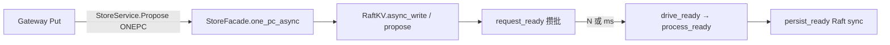

# 写路径三刀（Ready 攒批 · 二进制 ONEPC · workers）

**状态：** 已实现  
**相关：** [01-write-put](01-write-put.md) · [23-write-path-batching](23-write-path-batching.md) · [24-persist-raft-vs-kv](24-persist-raft-vs-kv.md) · [17-gateway-api-bench](17-gateway-api-bench.md)

---

## 问题

在默认 `persist_sync=data`（Raft sync + KV 异步）之后，短 Put 仍受三处限制：

1. **每条 propose 立刻 `drive_ready`** → Ready 难攒大，Raft sync 摊销不足  
2. **Gateway→Storage 走 Admin `ExecLine` + hex** → CPU/分配与解析开销大  
3. **BatchSystem 默认 2/2 workers** → 多 Region / 高并发时 Raft/apply 管道偏窄  

---

## 方案

| 刀 | 改动 | 配置 |
|----|------|------|
| 1 Ready group commit | `RaftKV::async_write` → `Store::request_ready`；按条数/时限再 `drive_ready` | `SKV_READY_COALESCE_N`（默认 32，≤1 关计数）、`SKV_READY_COALESCE_MS`（默认 1） |
| 2 二进制 ONEPC | `ProposeRequest.op=ONEPC`；Gateway `store_propose_onepc_async`；Storage `StoreFacade::one_pc_async` | 无开关；Admin ExecLine ONEPC 仍保留给运维/兼容 |
| 3 workers | BatchSystem / MultiRaft 默认 **8/8**；Helm 可配 | `SKV_RAFT_WORKERS` / `SKV_APPLY_WORKERS` |

### 边界

- `flush_ready` / 显式 `drive_ready` **不走攒批**（强制冲刷；stop 时冲残留）。  
- 攒批只推迟 Ready，**不推迟客户端 ACK** 语义之外的可见性：ACK 仍在 apply 后。  
- `ready_coalesce_n≤1` 且 `ready_coalesce_ms=0` → 立即 `drive_ready`（单测 / 低延迟）。  
- 多 key Txn / DS 仍可用 ExecLine；短 Put/Delete 热路径用二进制 Propose。

### 失败与回滚

- 关闭攒批：`SKV_READY_COALESCE_N=1 SKV_READY_COALESCE_MS=0`  
- workers 调回：`SKV_RAFT_WORKERS=2 SKV_APPLY_WORKERS=2`  
- 二进制 ONEPC 异常时可临时改 Gateway 回 ExecLine（源码路径仍保留 Admin ONEPC）

---

## 与现有组件关系

| 组件 | 关系 |
|------|------|
| [23](23-write-path-batching.md) | 批内合并 Ready；本刀在 propose→Wake 前再攒一层 |
| [24](24-persist-raft-vs-kv.md) | 耐久不变；只提高 sync 摊销与管道宽度 |
| Helm `values.yaml` | `raftWorkers` / `applyWorkers` / `readyCoalesceN` / `readyCoalesceMs` |

---

## 验收

| ID | 命令 / 期望 |
|----|-------------|
| K1 | `ctest -R 'RaftstoreTest.RequestReadyCoalescesByCount\|RaftstoreTest.DriveReadyCoalescesPersist\|StoreFacade\|OnePc' --output-on-failure` PASS |
| K2 | 重建镜像并 `helm upgrade` 后 Storage 环境含 `SKV_READY_COALESCE_*` / `SKV_*_WORKERS` |
| K3 | 集群 `examples/bench` 短 Put：`fail=0`；吞吐相对三刀前有提升或持平（记 TEST_CASES） |

结果记入 [TEST_CASES.md](../test/TEST_CASES.md)。
