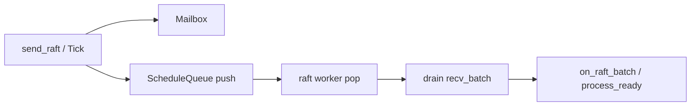

# Raftstore schedule 流水线

**状态：** 已实现  
**相关：** [23-write-path-batching](23-write-path-batching.md) · [25-write-path-knives](25-write-path-knives.md) · [20-next-optimizations](20-next-optimizations.md)

---

## 问题

BatchSystem 旧循环每轮 `peer_regions()` **扫全表**，再对空闲 mailbox `recv_batch` 盲等：

1. Region 多时 CPU/锁开销随 N 线性涨  
2. Worker 卡在「某个空 mailbox 的 wait」时，**其它 Region 有消息也醒不来**（假空闲）  
3. 缺少「只调度有活的 peer + drain」模型：空闲 mailbox 盲等会饿死其它 Region  

Ready 攒批（25）解决的是 propose→Wake 频率；本刀解决的是 **worker 调度模型**。

---

## 方案

| 组件 | 行为 |
|------|------|
| `ScheduleQueue` | 每 worker 一条；`push(region_id)` 去重；CV 等待 |
| `Router::send_raft/send_apply` | try_send 成功后 `raft_notify_` / `apply_notify_` |
| `broadcast_tick` | 每个 peer Tick 成功后同样 notify |
| `BatchSystem` worker | `pop` 出 region → mailbox **drain-until-empty**（多批 `recv_batch`） |
| 默认 `batch_size` | **256**（原 64） |

### 边界

- 未 `start()` 的 Store 仍走同步 `drive_ready`（单测）。  
- schedule 去重：同 Region 连续投递只占队一项，drain 时一次取光。  
- 回滚：恢复扫表 worker（git）；或临时不设 notify（勿在生产关）。

### 与现有关系

- [23](23-write-path-batching.md)：批内一次 Ready；本刀保证 Wake 更快进批。  
- [25](25-write-path-knives.md)：`request_ready` 攒批后 `drive_ready`→`send_raft(kWake)`→schedule。  

---

## 验收

| ID | 命令 / 期望 |
|----|-------------|
| P1 | `ctest -R 'ScheduleQueueTest\|BatchSystemTest\|RaftstoreTest' --output-on-failure` PASS |
| P2 | 集群 put w8 `fail=0`；相对 schedule 前吞吐不回退（记 TEST_CASES） |

结果记入 [TEST_CASES.md](../test/TEST_CASES.md)。
