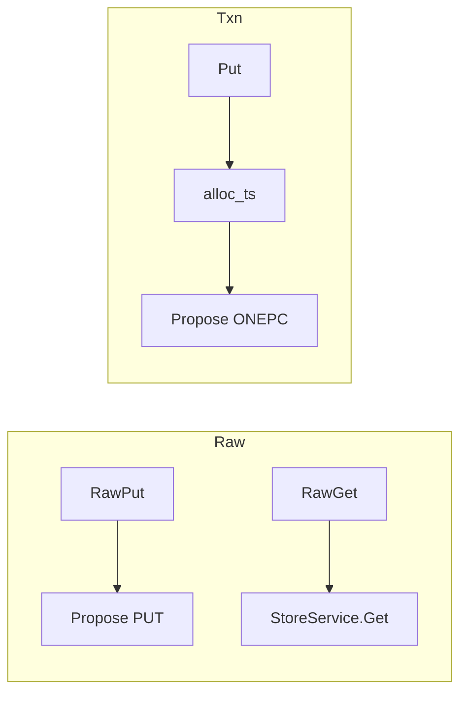

# 有事务 / 无事务双模式（Raw vs Txn）

**状态：** 已实现  
**相关：** [01-write-put](01-write-put.md) · [13-version-cas](13-version-cas.md) · [02-read-get](02-read-get.md)

---

## 决策

双平面约定：

| | 无事务 Raw* | 事务 Put/Get / Txn* |
|--|-------------|---------------------|
| API | `RawPut` / `RawGet` / `RawDelete` | 现有 `Put`/`Get`/`Delete`/`Txn*` |
| TSO | 无 | 有（Gateway 批缓存） |
| 落盘 | plain `KvRecord` | MVCC data + write（ONEPC 或 2PC） |
| revision | Raft apply index | commit_ts |
| 隔离 | **同一用户 key 空间**；**禁止混用同 key**（未定义，可能互相覆盖） |

本期不做 RawScan / RawWatch；Scan/Watch 仍走事务平面。

---

## 关键代码

| 层 | 符号 |
|----|------|
| Proto | `kv.v1.KVService.RawPut/RawGet/RawDelete` |
| Gateway | `raw_put_async` / `raw_get_async` / `store_propose_plain_async` |
| Storage | `StoreFacade::propose`（kPut/kDelete）· `StoreFacade::get` |
| SDK | Go/Rust/Java/TS：`Raw*` / `raw_*`（见 [15-multi-client-sdk](15-multi-client-sdk.md)） |

---

## 边界

- Raw CAS：`cas` + `expected_revision` 校验 **KvRecord.revision**（见 [13](13-version-cas.md)）。  
- Raw TTL：相对 `ttl_ms`，Storage `stamp_expire_at_ms`。  
- 混用同 key：文档禁止；不做物理 CF / 前缀硬隔离（同 key 空间，应用勿混用）。

---

## 验收

| ID | 命令 / 期望 |
|----|-------------|
| R1 | `./build/tests/openkv_unit_tests --gtest_filter='StoreFacadeTest.RawPlane*:StoreFacadeTest.PutGet*:StoreFacadeTest.Delete*:StoreFacadeTest.OnePc*'` → PASS |
| R2 | 集群 `kv-bench -mode put,rawput -workers 8 -duration 8s` → 均 `fail=0`；Raw 吞吐与 Put 同量级 |

**2026-11-11 实测：** R1 4/4 PASS；R2 isolated rawput **243.6** / put **250.1** ops/s，`fail=0`。详见 [TEST_CASES](../test/TEST_CASES.md)。
