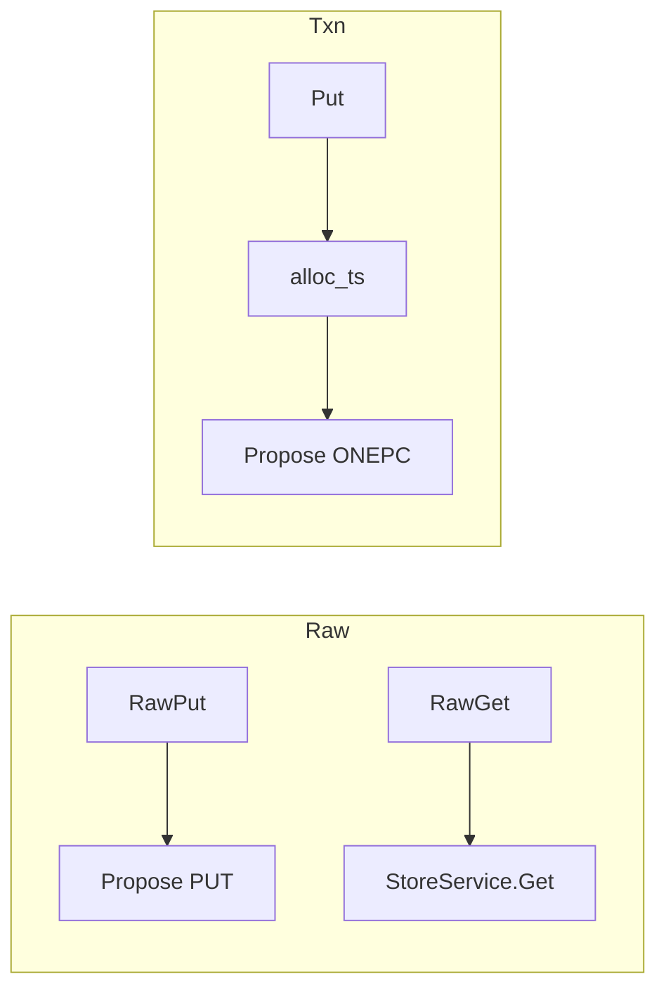

# 有事务 / 无事务双模式（Raw vs Txn）

**状态：** 已实现  
**相关：** [01-write-put](01-write-put.md) · [13-version-cas](13-version-cas.md) · [02-read-get](02-read-get.md)

---

## 决策

双平面约定：

| | 无事务 Raw* | 事务 Put/Get / Txn* |
|--|-------------|---------------------|
| API | `RawPut` / `RawGet` / `RawDelete` | 现有 `Put`/`Get`/`Delete`/`Txn*` |
| TSO | 无 | 有（Gateway 批缓存） |
| 落盘 | plain `KvRecord`（**不写 WatchLog**） | MVCC data + write（ONEPC 或 2PC）+ WatchLog |
| revision | Raft apply index | commit_ts |
| epoch | Gateway 带 Region epoch | 同 |
| 隔离 | **同一用户 key 空间**；**禁止混用同 key**（未定义，可能互相覆盖） |

本期不做 RawScan / RawWatch；Scan/Watch 仍走事务平面。Raw 路径与 Put 同为 **异步 Propose → apply 回调**；耐久仍受 Raft log `persist_sync` 约束（两边一样）。

### Propose latch（CQ 零同步）

| 命令 | Latch |
|------|--------|
| 非 CAS `kPut` / `kDelete`（Raw 热路径） | **跳过**：Raft apply 已串行，LWW 无需 propose 前互斥 |
| CAS / ONEPC / 2PC | `lock_key_async`：可占则同步回调；冲突入队，`unlock` 时续跑（**不**在 Propose CQ 上 `cv.wait`） |

---

## 关键代码

| 层 | 符号 |
|----|------|
| Proto | `kv.v1.KVService.RawPut/RawGet/RawDelete` |
| Gateway | `raw_put_async` / `raw_get_async` / `store_propose_plain_async` |
| Storage | `StoreFacade::propose`（kPut/kDelete）· `StoreFacade::get` |
| SDK | Go：`Raw*`（见 [15-multi-client-sdk](15-multi-client-sdk.md)） |

---

## 边界

- Raw CAS：`cas` + `expected_revision` 校验 **KvRecord.revision**（见 [13](13-version-cas.md)）。  
- Raw TTL：相对 `ttl_ms`，Storage `stamp_expire_at_ms`。  
- 混用同 key：文档禁止；不做物理 CF / 前缀硬隔离（同 key 空间，应用勿混用）。

---

## 验收

| ID | 命令 / 期望 |
|----|-------------|
| R1 | `./build/tests/openkv_unit_tests --gtest_filter='StoreFacadeTest.RawPlane*:WatchLogTest.OnePcWatch*'` → PASS；Raw 无 WatchLog、ONEPC 有 |
| R2 | 集群 **隔离** `-mode put` 与 `-mode rawput`（各 w8 / 8s）→ 均 `fail=0`；**rawput ops/s ≥ put** |
| R3 | `ctest -R 'SchedulerTest.LatchAsync\|SchedulerTest.LatchHold\|StoreFacadeTest.RawPlane'` PASS |

**2026-11-12 实测（跳过 Raw latch + lock_async）：** R2 隔离 put **227.1** / rawput **343.7** ops/s，p50 **7.8ms / 4.0ms**，`fail=0`。详见 [TEST_CASES](../test/TEST_CASES.md)。
