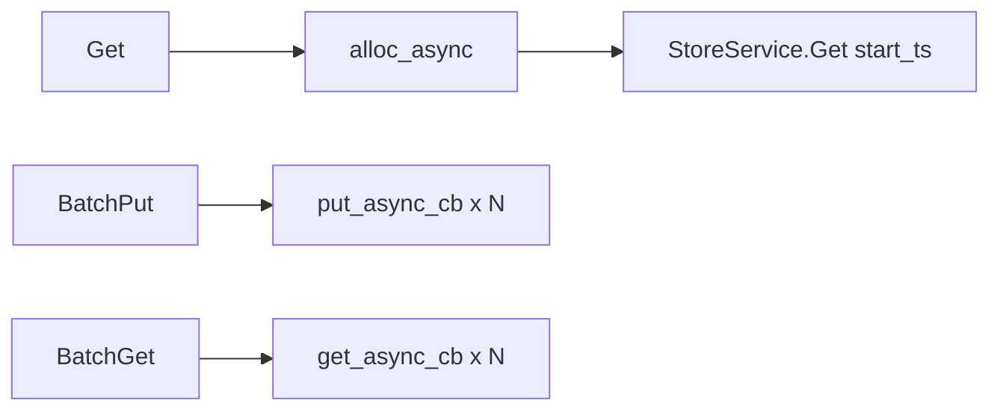

# Compute 网络优化一期+二期

**状态：** 已实现  
**相关：** [21-async-network](21-async-network.md) · [22-async-threading-model](22-async-threading-model.md) · [20-next-optimizations](20-next-optimizations.md) · [27-raw-vs-txn](27-raw-vs-txn.md)

---

## 问题

1. 线性 Get 曾走 Admin 行协议 + hex，相对 Put/Raw 的二进制 Propose/Get 偏慢。  
2. 出站每次 `NewStub`；TSO 缓存 miss 在 CQ 上同步打 Meta。  
3. BatchPut/BatchGet 占 WorkPool + `std::async` / 串行同步 Body，拖满线程。

跨请求 batch propose（N5 余量）**本期不做**。

---

## 方案

| 项 | 行为 |
|----|------|
| `StoreGetRequest.start_ts` | `0` = plain Get（Raw）；`>0` = MVCC `txn_get` |
| Gateway `get_async` | `alloc_async` → `store_get_async(..., start_ts)` |
| Stub 缓存 | `grpc_channel`：按 addr 缓存 Store/Admin/Meta stub；`drop_cached_channel` 同清 |
| `TSOracle::alloc_async` | 无锁环 CAS take；剩余&lt;2000 异步 push GetTs(5000)；硬 miss 锁 waiters |
| BatchPut/Get | CQ fan-in，窗口 ≤16，复用 `put_async_cb` / `get_async_cb` |

---

## 边界

- Compute 出站已收口为 StoreService / AdminService / MetaService（见 [30](30-unified-async-store.md) / [29](29-compute-code-map.md)）。  
- 公开 `ExecLine` 已删除；运维走类型化 Admin/Meta（含 `Stats` / `GetTs.count`）。  
- TSO 批不足时部分 waiter 可能 `RESOURCE_EXHAUSTED`（极少）；可再触发补货。

---

## 验收

| ID | 命令 / 期望 |
|----|-------------|
| C1 | `./build/tests/openkv_unit_tests --gtest_filter='StoreFacadeTest.OnePc*:StoreFacadeTest.RawPlane*:Tso*'` PASS |
| C2 | 集群 `kv-bench -mode get,put,batch_put -workers 8 -duration 8s` 均 `fail=0` |

**2026-11-11 实测：** C1 5/5 PASS；C2 get **2293.9** / put **317.0** / batch_put **71.9** ops/s，`fail=0`。详见 [TEST_CASES](../test/TEST_CASES.md)。
