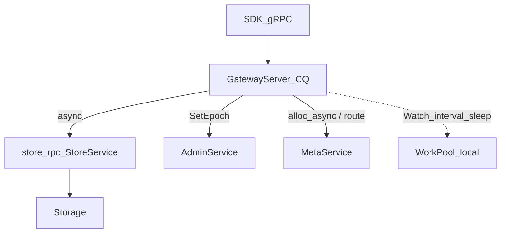

# Compute 代码地图与粗糙点

**状态：** Gateway 出站已统一为类型化 gRPC（`StoreService` / `AdminService` / `MetaService`）；`exec_line` 生产路径已删除  
**相关：** [18-cpp-gateway](18-cpp-gateway.md) · [22-async-threading-model](22-async-threading-model.md) · [27-raw-vs-txn](27-raw-vs-txn.md) · [28-compute-net-opt](28-compute-net-opt.md) · [30-unified-async-store](30-unified-async-store.md)  
**代码：** `compute/` → 生产二进制 `gateway_node`

---

## 结论

生产路径只有 **`gateway_node` → `GatewayServer`**。出站一律 CQ 回调 + 类型化 gRPC：

- **StoreService**：Propose / Get / Scan / Ttl / CheckTxnStatus / Watch*
- **AdminService**：Ping（就绪）、SetEpoch（路由 epoch 同步）
- **MetaService**：GetTs / GetRoutingTable / WatchRoutingTable / ReportMinStartTs

公开 `ExecLine` 已从 proto / 服务端删除；运维与 Gateway 一律类型化 RPC。

---

## 组件

| 组件 | 路径 | 职责 |
|------|------|------|
| 入口 | `gateway_main.cpp` | `--listen` / `--metas` / `--storages`；HTTP `/stats`；`store_admin_ping` 就绪 |
| GatewayServer | `gateway_server.*` + `gateway_{txn,ds,watch,scan_ttl}.cpp` | KV / Raw / Txn / Scan / TTL / Watch / DS |
| Router | `router.*` | Key→Region、epoch、leader 优先 replicas |
| Meta | `meta_client.*` | GetRoutingTable / WatchRoutingTable / GetTs / ReportMinStartTs |
| TSO | `tso.*` | 批缓存；`alloc` / `alloc_async` → Meta GetTs |
| store_rpc | `store_rpc.*` | StoreService async + Admin Ping/SetEpoch |
| grpc_channel | `grpc_channel.*` | Channel/Stub 缓存、`parse_redirect` |
| ActiveTs | `active_ts.*` | 本进程活跃 start_ts → GC 下界 |
| ds_encode | `ds_encode.*` | Hash/Set/List/ZSet blob |

---

## 路径矩阵

| RPC / 入口 | 调度 | 出站 | 备注 |
|------------|------|------|------|
| Put / Delete | CQ 异步 | `alloc_async` → `store_propose_onepc_async` | 事务 1PC |
| RawPut / RawDelete | CQ 异步 | `store_propose_plain_async` | 无 TSO |
| Get（线性） | CQ 异步 | `alloc_async` → `store_get_async(start_ts)` | |
| Get（stale） | CQ 异步 | `store_get_async(linearizable=false)` | |
| RawGet | CQ 异步 | `store_get_async(start_ts=0)` | |
| BatchPut / BatchGet | CQ fan-in ≤16 | 复用 `put_async_cb` / `get_async_cb` | |
| TxnBegin | CQ 异步 | `alloc_async` only | |
| TxnGet | CQ 异步 | `store_get_async` + resolve 链 | |
| TxnPrewrite / Commit / Rollback / Pessimistic* / ResolveLock | CQ 异步 | `store_*_async` Propose | `with_store_async` 重试 |
| TxnCheckStatus | CQ 异步 | `store_check_txn_status_async` | |
| Scan | CQ 异步 | `store_scan_async` 跨 Region 链式 | |
| TTL | CQ 异步 | `store_ttl_async` | |
| Expire / Persist | CQ 异步 | `get_async_cb` → `put_async_cb` RMW | |
| Watch | WriteReactor + async poll | `store_watch_head/poll_async` | 间隔 sleep 可走 WorkPool |
| DS（HSet…） | CQ 异步 | `ds_load/ds_store` → get/put_async | |
| route sync | bg thread | `AdminService.SetEpoch` via `store_admin_set_epoch_async` | |

同步 `PutBody`/`GetBody`/`StoreClient`/`exec_line` 已删除。`defer_unary` 已移除。

---

## 粗糙点（Top）

1. **God-class**：路由 / TSO / stats / KV / Txn / DS / Watch 挤在 `GatewayServer`。  
2. **重试嵌套**：`with_store_async`(≤4) × Body `attempt`。  
3. **detach**：`sync_epochs_async`、部分 secondary resolve 无 shutdown 汇合。  
4. **字符串错误**：`contains(msg, "locked"|"not_leader"|…)`。  
5. **命名**：`region_of` / Propose `shard_id` 混用（语义均为 RegionId）。  
6. **Watch `wait_drain`**：事件写出仍可能阻塞 WorkPool 线程（已修 cancel UAF：`weak_ptr` + bridge，避免 OnDone 后 SEGV / exit 139）。  
7. ~~**Meta GetTs 无 batch**~~：已支持 `GetTsRequest.count` 一次分配。

---

## 后续里程碑（本轮不做）

| 项 | 目标 |
|----|------|
| M1 | 拆 `GatewayServer`：Routing / AsyncKV / Txn / DS / Watch |
| M3 | typed Propose/Get error（替代 substring） |
| M4 | detach → 可 join 的 bg 任务或 WorkPool |

---

## 验收

| ID | 命令 / 期望 |
|----|-------------|
| M1 | 本文存在；出站描述为 Store/Admin/Meta 类型化 gRPC |
| M2 | `cmake --build build --target gateway_node openkv_compute openkv_unit_tests -j` PASS |
| M3 | `ctest -R 'RouterTest|DsEncodeTest|MetaClientTest|TsoTest|StoreFacadeTest.TxnOpsAsync|GrpcUtilTest|ParseRedirect'` PASS |
| L1 | proto / 服务 / compute / web 无公开 `ExecLine`；`GetTs.count` + `Stats` 可用 |

结果记入 [TEST_CASES](../test/TEST_CASES.md)。
