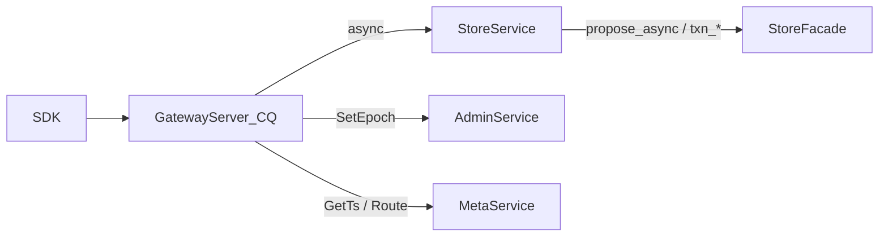

# Gateway 统一异步 + StoreService 二进制扩面

**状态：** Gateway P1+P2 已落地；出站进一步收口为 `store_rpc` / `meta_client` 类型化 gRPC（`exec_line` 已删）  
**相关：** [29-compute-code-map](29-compute-code-map.md) · [21-async-network](21-async-network.md) · [22-async-threading-model](22-async-threading-model.md) · [18-cpp-gateway](18-cpp-gateway.md)  
**代码：** `proto/storage/v1/storage.proto` · `storage/src/grpc_server.cpp` · `storage/src/store_service.*` · `compute/src/store_rpc.*` · `compute/src/meta_client.*` · `compute/src/gateway_*.cpp`

---

## 问题（已解决）

Gateway 曾对 Put/Get/Raw/Batch 走 CQ + `StoreService` async，而 Txn / Scan / TTL / Watch / DS 仍 `defer_unary` → WorkPool → 同步 `AdminService.ExecLine`，导致 CQ/WorkPool 分裂与双份编解码。

目标（已达成）：**出站一律异步类型化 gRPC**；Txn/Scan/Watch/TTL 走 `StoreService`；路由 epoch 走 `AdminService.SetEpoch`；TSO/路由走 `MetaService`；生产路径不再依赖 ExecLine。

---

## 方案

### 阶段顺序（效率合并）

| 阶段 | 目标 | 做法 |
|------|------|------|
| **P1** | CQ 不堵、无 sync Storage RPC | Gateway 全回调；DS/Expire 改 `get_async`/`put_async` |
| **P2** | 退役 Txn/Scan/Watch ExecLine 热依赖 | 扩 `StoreService`；Gateway 直打二进制 async |
| **P3** | 删除 compute `exec_line` | 出站收口 `store_rpc` + `meta_client`；删 `StoreClient` |

### StoreService 扩面

**写（扩 `ProposeRequest.Op`）**

| Op | 对应 Facade |
|----|-------------|
| `PREWRITE` | `prewrite_async` → `propose_async` |
| `COMMIT` / `ROLLBACK` | `commit_async` / `rollback_async` |
| `PESSIMISTIC_LOCK` / `PESSIMISTIC_ROLLBACK` | `*_async` 同名 |
| `RESOLVE_LOCK` | `resolve_lock_async`（`commit_ts==0` 回滚清锁） |

**验收（Storage 侧）：** `cmake --build build -j8 --target openkv_storage storage_node`；`ctest --test-dir build -R StoreFacadeTest.TxnOpsAsync` PASS。

新增字段：`for_update_ts`、`lock_ttl_ms`（悲观锁）。其余复用已有 `start_ts`/`commit_ts`/`primary`/`epoch`/`mvcc_op`/`cas`。

**读 / 订阅（新 RPC）**

| RPC | Facade / 节点 |
|-----|----------------|
| `Scan` | `txn_scan` |
| `Ttl` | `txn_ttl` |
| `CheckTxnStatus` | `check_txn_status` |
| `WatchHead` | Raft `last_applied` |
| `WatchPoll` | WatchLog / WatchHub |

`Get(start_ts>0)` 已覆盖 TXN_GET；响应补 `lock_primary` / `lock_ts` 便于 Gateway resolve。

### Gateway

- Txn* / Scan / TTL / Watch：`store_rpc.hpp` 的 `store_*_async`，入口直接起回调链；redirect 重试在回调内换址。  
- DS / Expire / Persist：`ds_load`/`ds_store` 改 `get_async_cb` / `put_async_cb` 链式 RMW。  
- `TxnBegin`：仅 `alloc_async`，无 Storage。  
- epoch 同步：`store_admin_set_epoch_async`（`AdminService.SetEpoch`）。  
- Meta：`GetTs` / `GetRoutingTable` / `WatchRoutingTable` / `ReportMinStartTs`。  
- **WorkPool**：仅本地 CPU / Watch 短间隔；不出站阻塞。  
- Storage/Meta **已删除**公开 `ExecLine`；运维走 Admin/Meta 类型化 RPC。

---

## 边界与失败

| 情况 | 行为 |
|------|------|
| `not_leader` + `redirect_to` | Gateway 记 hint，换址重试（与现 Put 一致，≤4） |
| `locked` | TxnGet/Get：回 `locked` 或走 `resolve_blocking_lock_async` |
| `cas_failed` | 填 `current_revision`，业务层决定 |
| `epoch_not_match` / `splitting` | 刷路由后重试 |
| Watch 取消 | `ctx->IsCancelled()` 停轮询，不再 detach 失控 |

回滚：勿恢复 ExecLine；类型化 Store/Admin/Meta 为唯一路径。

---

## 验收

| ID | 命令 / 期望 | 结果 |
|----|-------------|------|
| A1 | `cmake --build build -j8 --target gateway_node openkv_compute openkv_unit_tests` | 见 TEST_CASES |
| A2 | `ctest --test-dir build -R 'RouterTest|DsEncodeTest|TsoTest|MetaClientTest|StoreFacadeTest.TxnOpsAsync|GrpcUtilTest|ParseRedirect'` | 见 TEST_CASES |
| A3 | `bash scripts/it-txn.sh` | 需集群；本机未起则跳过 |
| A4 | 生产路径无 `store_exec_line` / compute `exec_line.*` | **PASS**（文件已删） |
| A5 | 更新 [TEST_CASES](../test/TEST_CASES.md) 与 [29](29-compute-code-map.md) | **PASS** |

### Gateway 消费侧要点

- `store_rpc`：`store_propose_op_async` / `store_scan_async` / `store_ttl_async` / `store_check_txn_status_async` / `store_watch_*_async` / `store_admin_set_epoch_async`
- `meta_client`：`fetch_route` / `watch_route` / `alloc_ts_range` / `meta_alloc_ts_range_async` / `report_min_start_ts`
- `GatewayServer::pick_leader_addr` + `with_store_async`（≤4 redirect 重试）
- 无 `StoreClient` 连接池；`storage_addrs_` 仅作 try_order 回退地址串

---

## 非目标（本轮之后）

- 拆分 `GatewayServer` God-class（M1）  
- typed error 替代 substring（M3）  

### 已收口（ExecLine 清退）

- 删除 Storage `ExecLineHandler` 与 Admin/Meta `ExecLine` RPC  
- Meta `GetTs.count` 一次分配连续区间；Compute TSO refill 不再循环 GetTs  
- Meta/Storage `Stats` 类型化；Web / skv / line-rpc 改走 typed gRPC  

