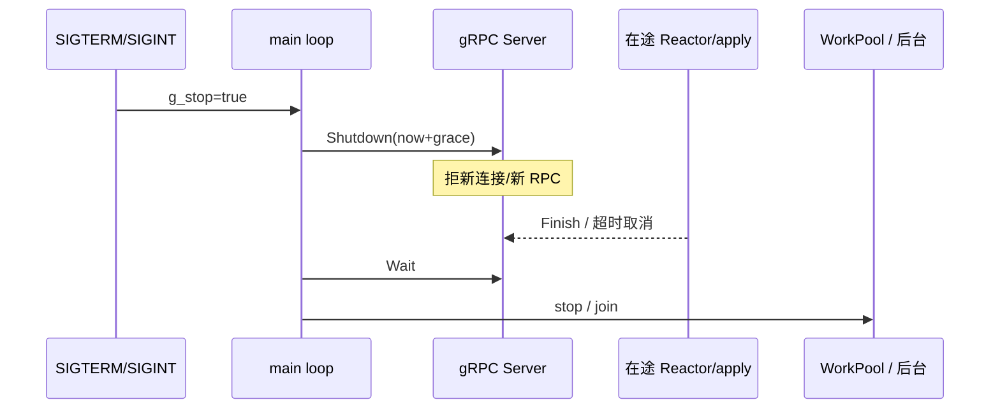

# 进程级优雅关机（拒新请求 + 排空在途）

**状态：** 已实现  
**相关：** [22-async-threading-model](22-async-threading-model.md) · [NETWORKING](../NETWORKING.md) · [DATA_SCALE_IN](../architecture/DATA_SCALE_IN.md)

## 语义（本页范围）

**优雅关机 ≠ 缩容腾空副本。** 本页只保证：

1. **不再接收新 RPC**（gRPC `Server::Shutdown`）
2. **在途请求处理完或宽限到期**（`Shutdown(deadline)` + `Wait`）
3. 再停 WorkPool / 后台线程 / 引擎

整机从集群摘掉（迁光 Region）仍走 [DATA_SCALE_IN](../architecture/DATA_SCALE_IN.md) 的 Draining 路径；Draining 期间勿强杀。

## 实现

| 组件 | 入口 | 行为 |
|------|------|------|
| Storage | `StorageGrpcServer::stop` | `graceful_grpc_shutdown` → 拆 service → `StorageNode::stop`（无 WorkPool） |
| Meta | `MetaGrpcServer::stop` | `graceful_grpc_shutdown` → 拆 service / WorkPool；`MetaNode::stop` 内调 gRPC stop |
| Gateway | `gateway_main` | 停 HTTP → `graceful_grpc_shutdown` → `stop_background`（含 WorkPool） |

公共头：`common/include/openkv/grpc_shutdown.hpp`。

环境变量：`SKV_GRPC_SHUTDOWN_MS`（默认 **15000**；`0` = 立即 `Shutdown()` 不等宽限）。

## 边界

| 情况 | 行为 |
|------|------|
| 在途 apply / 下游 RPC 超过宽限 | deadline 后 gRPC 取消剩余调用；可能客户端见 UNAVAILABLE |
| Callback 热路径挂在 apply 回调 | Wait 期间 BatchSystem（及 Meta/Gateway 的 WorkPool）须仍存活；先 Wait 再拆池/停节点 |
| k8s | 需 `terminationGracePeriodSeconds` ≥ 宽限；无 preStop 则直接 SIGTERM 走本路径 |
| 缩容 | 先 scale-in 迁光，再 SIGTERM |

## 验收

| ID | 标准 |
|----|------|
| G1 | `ctest -R GrpcShutdown` PASS |
| G2 | Storage/Meta/Gateway 源码路径含 `graceful_grpc_shutdown` |
| G3 | 文档本页 + flows 索引挂链 |
