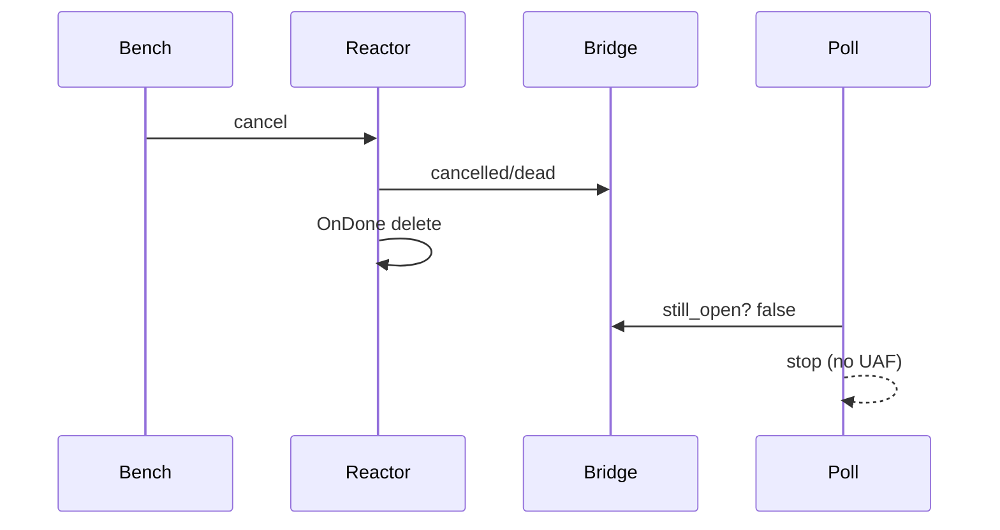

# Gateway Watch 取消 UAF（exit 139）

**状态：** 已修复  
**相关：** [29-compute-code-map](29-compute-code-map.md) · [17-gateway-api-bench](17-gateway-api-bench.md) · [22-async-threading-model](22-async-threading-model.md)

## 问题

`kv-bench -mode all` 跑到 `watch` 时 Gateway 进程 **SIGSEGV（exit 139）** 重启。  
`watch` / 随后 `hset` 出现数十万 fail，实为进程已死或濒死。

根因：`WatchReactor::OnDone` 里 `delete this`，而 `watch_async` 的 poll / WorkPool 回调仍握 **裸 `reactor*`**，取消后继续 `enqueue_or_finish` / `wait_drain` → UAF。次要：`State` 握 `CallbackServerContext*`，Finish 后仍可能 `IsCancelled()`。

## 方案

| 项 | 做法 |
|----|------|
| Reactor 生命周期 | `WatchReactor::New`：`shared_ptr` 无操作 deleter 撑 `weak_ptr`；`OnDone` 先 `bridge->stop` 再 `delete this` |
| 回调 | 只 `weak_ptr.lock()`；失败即停 |
| 取消探测 | `still_open()` 读 bridge 的 `cancelled/dead`，**不再**读 `CallbackServerContext*` |
| 队列 | 事件队列放在 `WatchBridge`（shared），与 reactor 解耦 |

## 边界

- `wait_drain` 仍可能占 WorkPool（粗糙点保留）；本修只消 SEGV。  
- 压测 Watch 短超时仍可能高 fail（打开失败/取消），但 **gateway 不得再崩**。

## 验收

| ID | 标准 |
|----|------|
| W1 | `cmake --build build --target gateway_node` PASS |
| W2 | 部署后 `kv-bench -mode watch -workers 8 -duration 5s`：gateway **Restart=不增加**、无 exit 139 |
| W3 | `./scripts/api-bench-all.sh` 跑完：gateway 存活；watch/hset 可仍弱，但进程不挂 |

结果记 [TEST_CASES](../test/TEST_CASES.md)。
