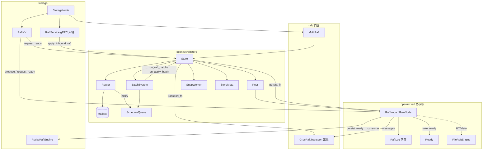
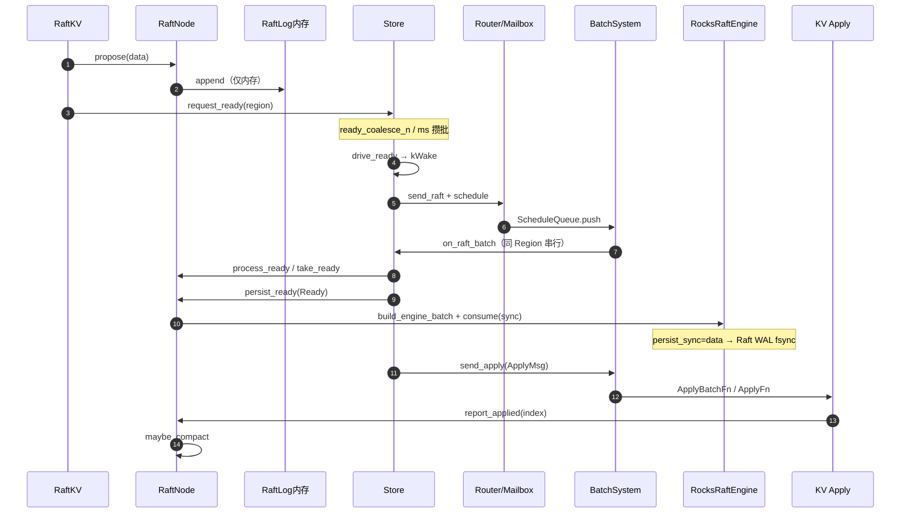
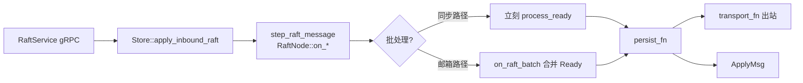
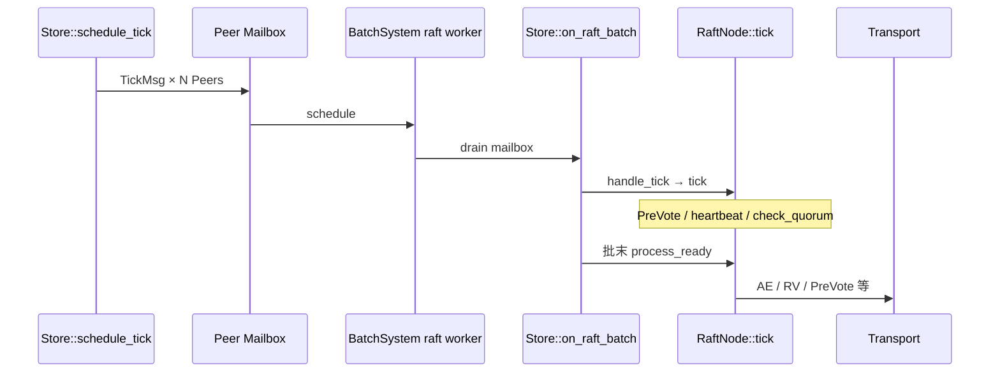
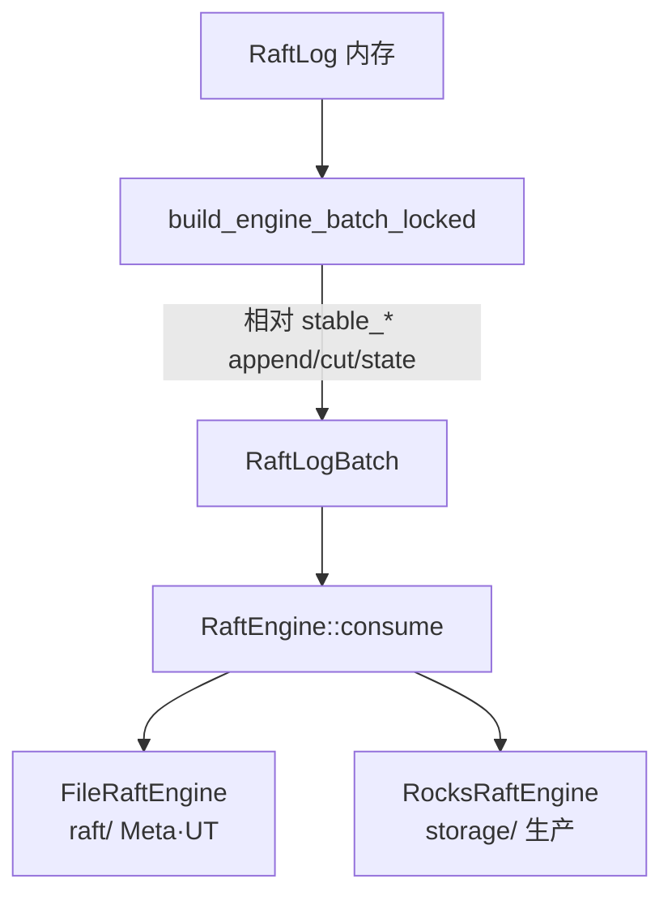

# Raft 模块调用流程（协议核 + raftstore）

**状态：** 与源码对齐（`raft/` · `openkv_raft`）  
**源码地图：** [raft/README.md](../../raft/README.md) · **分层契约：** [raft/ARCHITECTURE.md](../../raft/ARCHITECTURE.md)  
**相关：** [06-raft-election-commit](06-raft-election-commit.md) · [24-persist-raft-vs-kv](24-persist-raft-vs-kv.md) · [26-raftstore-schedule-pipeline](26-raftstore-schedule-pipeline.md) · [MULTI_RAFT_PRODUCTION](../production/MULTI_RAFT_PRODUCTION.md)

## 问题

`raft/` 下同时有 `openkv::raft`（协议）与 `openkv::raftstore`（调度）。需要**调用关系图 + 执行时序图**对照源码，避免把内存 `RaftLog` 误当成落盘层。

---

## 1. 组件调用关系（静态）

谁依赖谁、消息怎么走：

---

## 2. 短写执行流程（Propose → 落盘 → Apply）

客户端 Put/RawPut → Gateway → Storage `StoreService` → `RaftKV::async_write`。

**关键代码**

| 步骤 | 位置 |
|------|------|
| propose + request_ready | `storage/src/raftkv.cpp` · `RaftKV::async_write` |
| 攒批 | `raft/src/raftstore/store.cpp` · `request_ready` / `coalesce_loop` |
| 批末 Ready | `Store::on_raft_batch` → `process_ready_legacy` |
| 落盘 | `raft/src/raft_node.cpp` · `persist_ready` |
| Apply 回告 | `RaftNode::report_applied` |

---

## 3. 入站 Raft RPC

禁止：`RaftService` 直调 `RaftNode::on_*`。  
出站：`GrpcRaftTransport` 或 Store `transport_fn`。

---

## 4. Tick / 选举 / 心跳

Hibernate：Follower 空闲后多数 tick 跳过，仍低频 tick 保选举。

---

## 5. 内存日志 vs 落盘

`RaftLog` **没有**落盘 API；`raft_persist.cpp` 仅旧文本迁移。

File 引擎布局与追加契约见 [ARCHITECTURE.md §5](../../raft/ARCHITECTURE.md)：

- 容器编解码：`raft_log_file`（RLG2）
- 单条记录：`encode_log_entry`（RLE2）
- 纯追加只写 RLE；cut / 冲突 index → 整文件 rewrite

---

## 边界与失败

- 单 Region 热点：固定落在同一 raft/apply worker + 一条 fsync 流水线。
- `persist_sync=data`：Raft Engine sync；业务 KV apply 异步（[24](24-persist-raft-vs-kv.md)）。
- `external_io` 下 propose 不等 apply；可见性靠 Apply / ProposalQueue。

## 验收

| ID | 标准 |
|----|------|
| F1 | 本节图与 `raft/README.md` 文件表一致 |
| F2 | 从 `RaftKV::async_write` 能跳到 `persist_ready` / `consume` |
| F3 | 热路径源码有行内注释 |

未跑 `-mode all`：纯文档。
