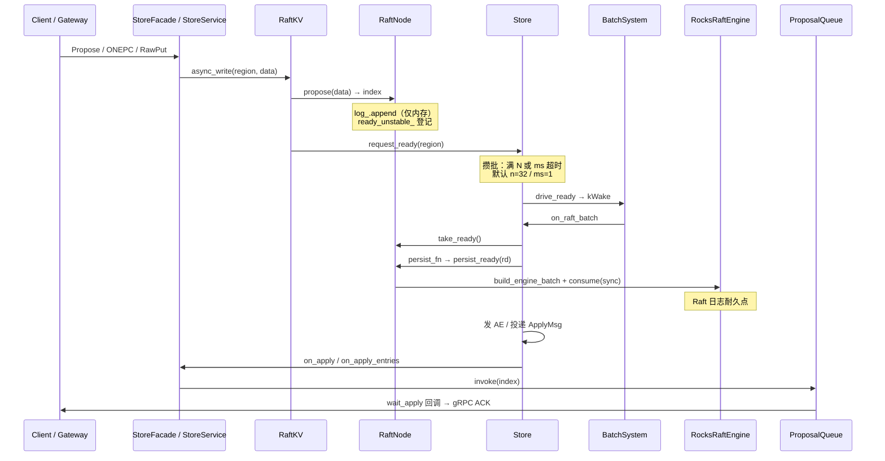

# Propose → ACK：调用链与落盘保证

**状态：** 与源码对齐（`RaftKV` / `Store` / `RaftNode::persist_ready` / `ProposalQueue`）  
**相关：** [01-write-put](01-write-put.md) · [23-write-path-batching](23-write-path-batching.md) · [24-persist-raft-vs-kv](24-persist-raft-vs-kv.md) · [35-raft-module-call-flows](35-raft-module-call-flows.md) · [raft/ARCHITECTURE.md](../../raft/ARCHITECTURE.md)

---

## 问题

`RaftLog::append`（propose）只改内存；Ready 又做 group commit（多条提案合成一次 `Engine::consume`）。需要明确：

1. **客户端 ACK 卡在哪一步**（不是 `propose` 返回）。
2. **为何 ACK 时该提案的 Raft 日志已经要求落盘**。
3. 崩溃窗口里什么会丢、什么不会丢。

---

## 术语

| 词 | 含义 |
|----|------|
| **propose** | Leader 把一条命令追加进本 Group 内存 `RaftLog`，得到 `index` |
| **Ready** | 外提的一批：unstable 日志 / HardState / 待发消息 / committed 条目 |
| **ACK** | 对客户端 gRPC 成功结束（`Finish`）；Storage 侧在 **apply 完成** 后发出 |
| **落盘（本文）** | Raft Engine `consume(sync=true)`（默认 `persist_sync=data`）；不是业务 RocksDB apply sync |

---

## 1. 端到端调用链

生产路径：`external_io=true`，持久化由 Store 驱动。



### 源码锚点

| 步骤 | 位置 |
|------|------|
| 写入口（挂 waiter） | `storage/src/store_service.cpp`：`async_write` 后 `wait_apply_async` |
| propose + 登记 Ready | `storage/src/raftkv.cpp`：`RaftKV::async_write` |
| 内存追加 | `raft/src/raft_node.cpp`：`RaftNode::propose` → `log_.append` |
| 攒批唤醒 | `raft/src/raftstore/store.cpp`：`request_ready` → `drive_ready` |
| 批末 Ready | 同文件：`on_raft_batch` → `process_ready` |
| persist 接线 | `storage/src/storage_node.cpp`：`set_persist_fn` → `persist_ready` |
| 组 batch + 写盘 | `raft/src/raft_node.cpp`：`build_engine_batch_locked` → `engine_->consume` |
| 生产 Engine | `storage/src/rocks_raft_engine.cpp`：`RocksRaftEngine::consume` |
| 唤醒客户端 | `ProposalQueue::invoke` ← apply 路径 |

---

## 2. 如何保证「ACK 时 Raft 已落盘」

核心不是「每次 propose 立刻 fsync」，而是 **ACK 依赖的 apply 一定发生在同批 Ready 的 persist 之后**。

### 2.1 ACK 不在 propose 返回点

```text
async_write 成功  ≠  客户端 ACK
仅表示：内存已 append + 已 request_ready
```

客户端路径：

```text
propose → wait_apply_async(index) → apply 完成 invoke → Finish(ACK)
```

### 2.2 Ready 批内顺序（不变量）

`Store::process_ready` 对每一批 Ready **固定顺序**：

1. **`persist_fn` → `RaftNode::persist_ready` → `Engine::consume(sync)`**
2. 再 `transport_fn`（发 AE 等）
3. 再把 `committed_entries` 投到 Apply 邮箱
4. 最后 `advance`

因此：**投递 apply（进而 ACK）之前，本批 unstable 日志已走完 persist_ready。**

`external_io` 下 `apply_committed` 只把条目放进 `ready_committed_`，**不会**绕过 Ready 直接写 KV / 唤醒 waiter。

### 2.3 sync 何时为 true

`persist_ready` 中：

```text
sync = rd.must_sync || raft_log_sync(persist_sync) || ready_hs_dirty_
```

- 有 unstable 日志时 `take_ready` 置 `must_sync=true`
- 默认 `persist_sync=data` → `raft_log_sync` 为 true  
→ 生产默认对本批做 Raft Engine sync（Rocks WAL fsync / File FULLFSYNC·fdatasync）

### 2.4 Group commit 在说什么

| 说法 | 正确理解 |
|------|----------|
| 「不是每次落盘」 | 多条 propose **共用一次** `consume(sync)`，摊销 fsync |
| 「ACK 前未落盘」 | **错误**；ACK 等的 apply 在该次 sync **之后** |

默认攒批上限：`ready_coalesce_n=32` 或 `ready_coalesce_ms=1`（先到先冲刷）。关闭攒批（`n≤1` 且 `ms=0`）则每次 propose 立刻 `drive_ready`。


---

## 3. 崩溃窗口

| 时机 | 客户端 | Raft 日志 | 说明 |
|------|--------|-----------|------|
| Ready/sync 之前 | 无 ACK / 超时 | 可能丢未 sync 尾部 | 可安全重试 |
| sync 之后、apply/ACK 前 | 无 ACK | 已在 Engine | 重启可重放；客户端重试需幂等 |
| ACK 之后（`persist_sync=data`） | 已成功 | 已 sync | KV apply 可能未 fsync；重启 `recover_apply` 补齐 |
| ACK 之后（`persist_sync=all`） | 已成功 | sync | KV 也 sync，最稳、最慢 |

多数派（RF=3）：提交还需 Follower 复制；Leader 侧 ACK 仍落在「本批已 persist + 已 commit + 已 apply」之后。Follower 自身落盘同样经 Ready → `persist_ready`。

---

## 4. 与内存 `RaftLog` 的关系

```text
entries_（内存）
  └─ build_engine_batch_locked：按 stable_* 抠增量
       └─ batch->append → Engine::consume   ← 耐久副本
崩溃恢复：Engine → load_group_from_engine → log_.load
```

`RaftLog` 是协议工作集；**耐久副本在 `RaftEngine`**。详见 [ARCHITECTURE §4–5](../../raft/ARCHITECTURE.md)。

---

## 5. 反例（不要当成 ACK）

| API / 返回点 | 是否保证 Raft 已 sync |
|--------------|----------------------|
| `RaftNode::propose` 返回 true | 否（仅内存 + 脏标记） |
| `RaftKV::async_write` 返回 true | 否（已 request_ready，未等 Ready） |
| `ProposalQueue` / `wait_apply*` 成功 | **是**（apply 在 persist 之后） |
| gRPC Propose/Put 成功 Finish | **是**（挂在 wait_apply 上） |

---

## 边界与已知缺口

- `persist_ready` 若 `consume` 失败仍可能继续后续逻辑（调用方应视日志 / 监控）；正常路径依赖 Engine 写成功。
- `persist_sync=none` 压测模式：**故意**不 sync，ACK 不代表介质耐久。
- 本文保证的是 **Raft 日志**；业务 KV 介质 sync 见 [24](24-persist-raft-vs-kv.md)。

---

## 验收

| ID | 标准 |
|----|------|
| D1 | 从 `StoreFacade`/`StoreService` 能追到 `wait_apply*`，且 ACK 不在 `async_write` 返回点 |
| D2 | `process_ready` 源码顺序为 persist → transport → apply |
| D3 | `persist_ready` 在默认 `data` 下对含 unstable 的 Ready 调用 `consume(..., true)` |
| D4 | 本文与 [23](23-write-path-batching.md) / [24](24-persist-raft-vs-kv.md) / [35](35-raft-module-call-flows.md) 无矛盾 |

**本地核对：** 阅读上述锚点文件；单元侧 `RaftEngineTest` / `RaftstoreTest.DriveReadyCoalescesPersist` 覆盖 Engine 与攒批，不替代本不变量阅读。

未跑 `-mode all`：纯文档。
