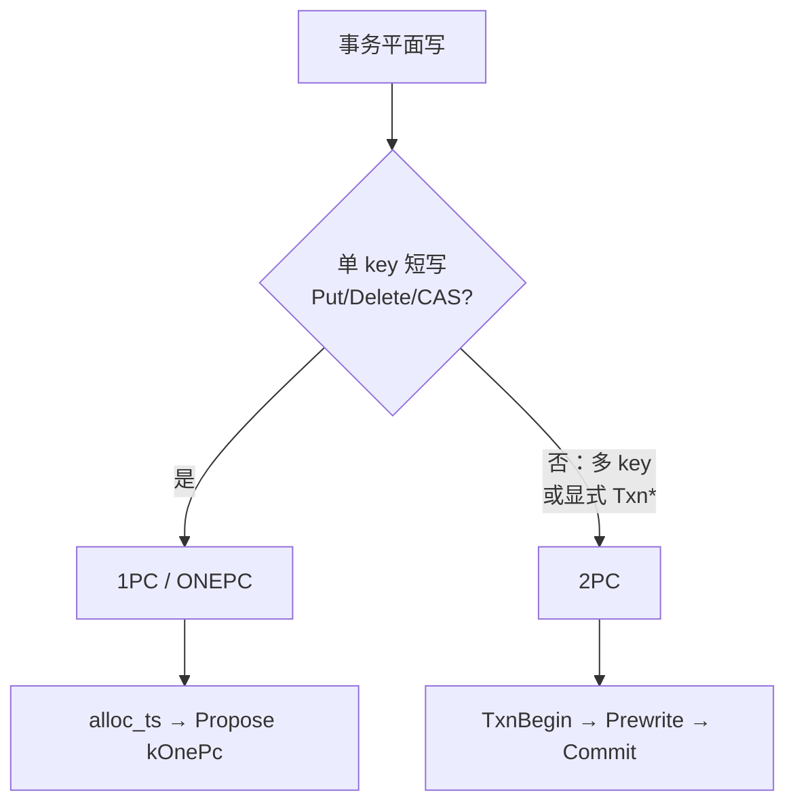
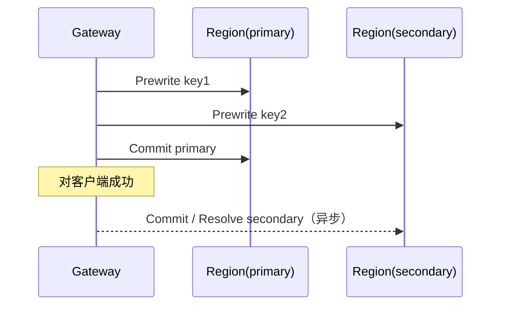

# 事务平面：1PC（ONEPC）与 2PC

**状态：** 与源码对齐（Gateway `Put`/`Txn*` · Storage `CmdOp::kOnePc` / `kPrewrite` / `kCommit`）  
**相关：** [01-write-put](01-write-put.md) · [27-raw-vs-txn](27-raw-vs-txn.md) · [13-version-cas](13-version-cas.md) · [36-propose-ack-durability](36-propose-ack-durability.md)

---

## 问题

OpenKV 事务平面有两条写路径，容易混：

- 短 Put/Delete 叫 **ONEPC / 1PC**（一次 Raft Propose）
- 多 key / 显式事务叫 **2PC**（Prewrite → Commit）

本文固定术语、何时走哪条、各自落什么、跨 Region 怎么做。

---

## 术语

| 说法 | 含义 |
|------|------|
| **1PC / ONEPC** | One-Phase Commit：单次 Propose 内完成「可提交」写（data + write），**不留**事务锁 |
| **2PC** | 两阶段：先 Prewrite（锁 + 可选 data），再 Commit（write + 清锁） |
| **事务平面** | 带 TSO / MVCC 的 `Put`/`Get`/`Txn*`（与 Raw 平面区分，见 [27](27-raw-vs-txn.md)） |

RawPut/RawDelete **不是** 1PC/2PC；无 TSO、plain 记录。

---

## 怎么选



| 场景 | 路径 | Raft Propose（典型） |
|------|------|----------------------|
| `Put` / `Delete`（单 key） | **1PC** | **1** |
| `PutCAS` / `DeleteCAS` | **1PC**（带 cas） | **1** |
| `TxnBegin` + 多 mutation | **2PC** | Prewrite×N + Commit（primary + secondary） |
| DS（HSet 等 blob RMW） | **2PC** | 同 Txn |
| `RawPut` / `RawDelete` | Raw 平面 | 1（无 MVCC 锁协议） |

**单 key 普通事务写不需要 2PC**；只有多 key 原子提交或显式 `Txn*` 才走 2PC。

---

## 1PC（ONEPC）

### 调用链

```text
Client Put/Delete
  → Gateway：alloc_ts(2)（start/commit 语义由 ONEPC 一次吃掉）
  → Locate Region → StoreService.Propose(op=ONEPC)
  → RaftKV::async_write → … → apply
  → MvccStore：写 data + write（同一次 apply）
  → ProposalQueue → ACK
```

源码锚点：

| 层 | 位置 |
|----|------|
| Gateway | `gateway_server.cpp`：`put_async` / ONEPC Propose |
| Storage 命令 | `CmdOp::kOnePc`（`store_service.hpp`） |
| Apply | `storage_node.cpp`：`kOnePc` 分支 |
| Latch | `lock_key_async` 持到 apply（CAS/ONEPC）；见 [19](19-architecture-hardening.md) |

### MVCC 结果

| 记录 | 1PC 行为 |
|------|----------|
| `D`（data） | Put 写入 |
| `W`（write @ commit_ts） | **同批写入** |
| `L`（lock） | **不留下**（apply 内校验冲突后直接提交） |

CAS：apply 内按可见版本校验，失败返回 `cas_failed`，不写成功版本。

### 语义要点

- 对客户端仍是「事务平面」写（有 TSO、可读到 commit_ts）。
- 相对 2PC：少一轮 Prewrite，无跨 key 原子性需求时走这条。
- 耐久 / ACK：与其它 Propose 相同，见 [36](36-propose-ack-durability.md)。

---

## 2PC（Prewrite → Commit）

### 调用链（多 key）

```text
TxnBegin
  → alloc start_ts

TxnPrewrite(mutations[], primary, start_ts)
  → 按 key 串行：
       region_of(key) → Propose(PREWRITE)
       apply：put_lock [+ put_data]   // 尚无 W

TxnCommit(keys[], primary, start_ts)
  → alloc commit_ts
  → ① 同步 Commit primary（必须成功）
       apply：put_write + clear_lock
  → ② 异步 Commit / ResolveLock 各 secondary
  → primary 成功则对客户端 ok

（失败）TxnRollback → 按 key 清 L（及对应 D）
```

源码锚点：

| 层 | 位置 |
|----|------|
| Gateway 编排 | `compute/src/gateway_txn.cpp`：`txn_prewrite_async` / `txn_commit_async` |
| Store RPC | `compute/src/store_rpc.cpp`：`store_prewrite_async` / `store_commit_async` |
| 命令 | `CmdOp::kPrewrite` / `kCommit` / `kRollback` |
| MVCC | `mvcc.cpp`：`put_lock` / `put_data` / `put_write` / `clear_lock` |
| 锁恢复 | `resolve_blocking_lock_async`：`CheckTxnStatus` → `ResolveLock` |

可选悲观：`TxnPessimisticLock` 先占锁，再 Prewrite 升级，再 Commit。

### MVCC 两阶段

| 阶段 | `L` | `D` | `W` |
|------|-----|-----|-----|
| Prewrite | 写入（含 `primary`、`start_ts`） | Put 时写入 `@start_ts` | 无 |
| Commit | 清除 | 保留（读经 W→D） | 写入 `@commit_ts` |
| Rollback | 清除 | Put 时清除 | 无 |

冲突：

| 现象 | 错误 |
|------|------|
| 其它事务持锁 | `locked` |
| 已有更新的 commit | `write_conflict` |
| CAS 不匹配 | `cas_failed` |

读到锁：Gateway 查 primary 的 `CheckTxnStatus`，再 `ResolveLock`（提交或回滚），然后重试。

### 跨 Region

- **不是**「一次 Raft 批处理所有 key」。
- Prewrite / Rollback：每个 key 独立 Locate + Propose，可跨多个 Region。
- Commit：**primary 同步成功** 才返回成功；secondary **异步补齐**，读路径可惰性 resolve。
- 当前无「按 Region 聚合 mutation 一批 Prewrite」；完整 secondary 列表挂在 primary 上等硬化项见生产 backlog（`STORE_PRODUCTION`）。



---

## 对照表

| | 1PC（ONEPC） | 2PC |
|--|-------------|-----|
| API | `Put` / `Delete` / CAS | `TxnBegin` / `Prewrite` / `Commit` / `Rollback` |
| 典型 key 数 | 1 | ≥1（多 key 必用） |
| Raft 次数 | 1 | Prewrite×keys + Commit… |
| 是否留锁 | 否 | Prewrite 后至 Commit/Rollback |
| 跨 Region 原子编排 | 不适用（单 key） | Gateway 编排；primary 定成败 |
| Latch | 是（持到 apply） | 是 |

---

## 验收

| ID | 标准 |
|----|------|
| T1 | 单 key `Put` 路径落 `kOnePc`，不经 `TxnPrewrite` |
| T2 | 多 key `TxnPrewrite`+`TxnCommit` 路径落 `kPrewrite`/`kCommit`；primary 失败则客户端非 ok |
| T3 | Prewrite 后可见 `L`；Commit 后无 `L` 且有 `W` |
| T4 | 本文与 [01](01-write-put.md) / [27](27-raw-vs-txn.md) 表一致 |

**命令示例：**

```bash
./build/tests/openkv_unit_tests --gtest_filter='*OnePc*:*TxnOps*:*Prewrite*'
# 或 make it-txn（多 key 提交/回滚场景）
```

未跑 `-mode all`：纯文档。
