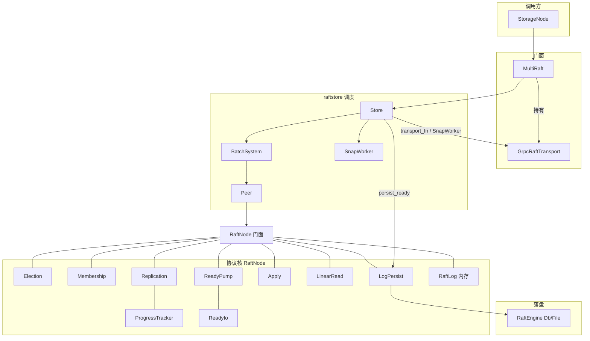
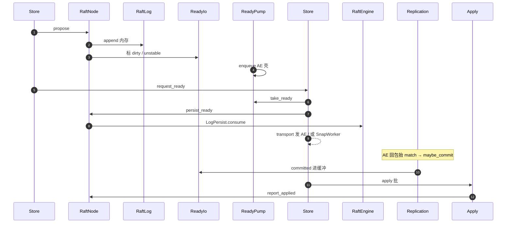
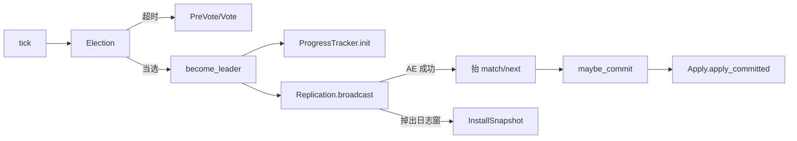

# RaftNode 协作类

**状态：** 已落地  
**相关：** [raft/ARCHITECTURE.md](../../raft/ARCHITECTURE.md) · [raft/README.md](../../raft/README.md) · [35-raft-module-call-flows](35-raft-module-call-flows.md)

## 问题

`raft_node.cpp` 曾堆选举、成员、复制、落盘于一身，难读难改。

## 方案

对外仍只暴露 `RaftNode`。内部协作类（均持 `RaftNode&`、`friend`、**不含锁**，由 `RaftNode::mu_` 保护）：

| 协作类 | 头文件 | 管什么（白话） | 详解 |
|--------|--------|----------------|------|
| `Election` | `core/election.hpp` | 谁当家、PreVote/Vote、CheckQuorum | [44](44-election.md) |
| `Membership` | `core/membership.hpp` | 谁有投票权、Joint、加删 peer | [45](45-membership.md) |
| `Replication` | `core/replication.hpp` | AE/空 AE/快照推送、抬 commit | [46](46-replication.md) |
| `ProgressTracker` | `core/progress_tracker.hpp` | 每个 peer 的 next/match/inflight | [43](43-progress-tracker.md) |
| `LogPersist` | `core/log_persist.hpp` | HardState+日志怎么写进 `RaftEngine` | [47](47-log-persist.md) |
| `Apply` | `core/apply.hpp` | 提交后灌状态机、compact、本地 FSM 快照 | [48](48-apply.md) |
| `LinearRead` | `core/linear_read.hpp` | Leader lease + ReadIndex 多数派 ACK | [49](49-linear-read.md) |
| `ReadyPump` | `core/ready_pump.hpp` | 出站消息攒批、`take_ready`、叫醒 Store | [50](50-ready-pump.md) |
| `ReadyIo` | `core/ready_io.hpp` | external_io 下待外提的 HS/unstable/committed/snap 缓冲 | [51](51-ready-io.md) |
| `Ready` | `core/ready.hpp` | 一拍外提批次的数据结构 | [52](52-ready.md) |

门面：`RaftNode`（`core/raft_node.hpp`）只做 propose/tick 编排与对外 API；多 Group 由 `MultiRaft`（`core/multi_raft.hpp`）委托 `raftstore::Store`，并**持有** `GrpcRaftTransport`（构造时接到 Store 出站）。

---

## 分层交互（谁跟谁说话）

---

## 写路径交互（一拍 Ready）

**一句话：** 协议只改内存并往 `ReadyIo` 塞活；Store 拉 Ready → 先落盘再发网 → commit 后再 apply。

---

## 选举 / 复制谁动谁

---

## 头文件地图（`include/openkv/raft/`）

| 目录 | 文件 | 作用 |
|------|------|------|
| `core/` | `raft_node.hpp` | 单 Group 门面；持锁；friend 协作类 |
| | `multi_raft.hpp` | 本机多 Group；委托 Store |
| | `election.hpp` | 角色、投票、法定人数存活 |
| | `membership.hpp` | Joint / ConfChange / 多数派 |
| | `replication.hpp` | AE、commit、快照入出站 |
| | `progress_tracker.hpp` | peer 复制水位与在途配额 |
| | `log_persist.hpp` | 组 batch、刷引擎、Ready persist |
| | `apply.hpp` | 状态机推进、compact、FSM snap |
| | `linear_read.hpp` | 租约读 / ReadIndex |
| | `ready_pump.hpp` | 出站 + Ready 外提泵 |
| | `ready_io.hpp` | Ready 侧缓冲字段 |
| | `ready.hpp` | Ready / SoftState / SnapshotMeta 等类型 |
| | `types.hpp` | Peer、Role、LogEntry、ConfChange… |
| `log/` | `raft_log.hpp` | 内存日志窗口（first/last/snapshot_term）→ [53](53-raft-log-window.md) |
| | `raft_log_file.hpp` | 文件形态辅助（与 File 引擎配合） |
| `engine/` | `raft_engine.hpp` | 落盘抽象 |
| | `db_raft_engine.hpp` | 生产：Rocks 上的 Raft WAL |
| | `file_raft_engine.hpp` | Meta/UT：目录文件 |
| | `raft_wire.hpp` | RLG/RLS/RLE/FSN 魔数 |
| | `sync_mode.hpp` | 耐久档位 |
| `net/` | `grpc_transport.hpp` | 出站 Raft RPC（含快照分片） |
| `util/` | `snap_stream.hpp` | 入站快照拼包 |
| | `raft_frame.hpp` / `raft_fault_inject.hpp` | 帧编解码；故障注入 |

调度侧（同库、另一命名空间）在 `include/openkv/raftstore/`：`Store` / `Router` / `BatchSystem` / `Peer` / `SnapWorker` / `Mailbox`… —— 管线程与邮箱，不解析 RLG。

## 边界

- 对外 API / ConfChange 线协议不变。
- 不加测试专用双轨路径。
- 协作类**自己不加锁**；持锁约定写在各 hpp 注释里。

## 验收

| ID | 标准 |
|----|------|
| C1 | `core/` 有 election…apply / linear_read / ready_pump |
| C2 | `--gtest_filter='Raft*:DbRaft*'` 全绿 |
| C3 | 全量 `openkv_unit_tests` 全绿 |

未跑 `-mode all`：热路径语义未改，仅拆协作类 / 文档。
