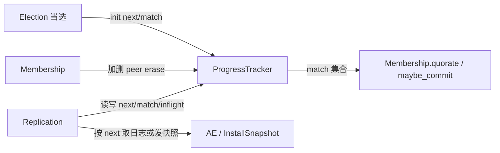

# ProgressTracker：Leader 复制进度表

**状态：** 已落地（说明文档）  
**头文件：** `raft/include/openkv/raft/core/progress_tracker.hpp`  
**相关：** [39-raft-node-collaborators](39-raft-node-collaborators.md) · [35-raft-module-call-flows](35-raft-module-call-flows.md) · [06-raft-election-commit](06-raft-election-commit.md) · [42-massive-snapshot-migration](42-massive-snapshot-migration.md)

---

## 1. 一句话

`ProgressTracker` 是 **Leader 脑子里「每个副本抄到哪了」的记事本**：记下每人下一步该发哪条日志、已经确认到哪、路上还有几封信。Follower 不当家时基本不用它来决策。

不含锁；读写都在 `RaftNode::mu_` 下，和 `Election` / `Replication` / `Membership` 一样。

---

## 2. 为什么需要它

没有 per-peer 进度，Leader 只能瞎广播或全量重传。有了：

- **增量追赶**：从每人的 `next_index` 往后发 AE；
- **抬 commit**：用大家的 `match_index` 算多数派；
- **限流**：`inflight` / 快照与 probe 在途标记，避免打爆慢 peer 或网络。

协议权威（term、整本日志）仍在 `RaftNode` / `RaftLog`；本类只记**对着 peer 的复制视图**。

---

## 3. 字段（白话）

| 字段 | 类型直觉 | 白话 | 丢了/错了会怎样 |
|------|----------|------|-----------------|
| `next_index_` | peer → index | 下一步要给此人发的日志下标；AE 从这里取 | 发错位置 → 对端拒绝 → 回退重试；太乐观会多走冲突 |
| `match_index_` | peer → index | 对方已对上、确认过的最高 index | 无法正确 `maybe_commit`；转主「追平」判断失真 |
| `inflight_` | peer → 计数 | 已发未回的 AE 条数；上限 `max_inflight_msgs` | 满了还发 → 管道爆；不减则永远发不出 |
| `snap_inflight_` | peer 集合 | 正在给谁发 InstallSnapshot | 重复狂发大快照，内存/带宽顶穿 |
| `probe_inflight_` | peer 集合 | 空 AE「探一下」是否在途 | 空心跳刷爆；或探不到真实 next |
| `peer_send_blocked_` | peer 集合 | 本轮因配额满等发不出去的 peer | 仅本拍跳过；下轮 `broadcast` 开头会 clear |

辅助方法：`clear` / `init_leader` / `erase` / `match_of` / `try_inc_inflight` / `dec_inflight`。字段目前多为协作类直接读写（同属 `RaftNode` 好友路径）。

---

## 4. 和谁配合



| 组件 | 怎么用 ProgressTracker |
|------|------------------------|
| `Election::become_leader` | 清空在途；每人 `next=last+1`、`match=0`；自己 `match=last` |
| `Replication::broadcast_replicate` | `next < first` → 快照；否则从 `next` 发 AE / probe；维护 inflight |
| `Replication` AE/快照回包 | 成功抬 `match/next`；失败 `next--` 或置 0；`dec_inflight` |
| `Membership` | `quorate_at` 读各 voter 的 `match`；加删 peer 时 `erase`/置 0 |
| `RaftNode::propose` | Leader 本地 `match_index_[self]=新 idx` |

---

## 5. 生命周期（何时动）

### 5.1 当上 Leader

```text
clear 在途集合
对每个 peer: next = last_index+1, match = 0
对自己: match = last_index
```

乐观假设别人也跟上；AE 对不上再往回探（`next--`）。

### 5.2 广播一轮

```text
peer_send_blocked_.clear()
对每个非 self peer:
  if next < log.first_index → InstallSnapshot（记 snap_inflight_）
  else 从 next 取条目发 AE；空则 probe（记 probe_inflight_）
  发前 try_inc_inflight；满则 peer_send_blocked_
```

### 5.3 回包

| 结果 | 动作 |
|------|------|
| AE 成功 | `match=回包 index`，`next=match+1` → `maybe_commit` → 可能继续广播 |
| AE 失败 | `next--`（若 >0），再广播重试 |
| 快照成功 | 同 AE 成功抬 match/next |
| 快照失败 | `next=0`，逼下一轮重新决策 |

### 5.4 成员变更 / 退位

加 peer：进度置 0，迫使先 probe/快照追赶。  
删 peer：`erase` 清掉所有 map/set。  
退成 Follower：在途集合清空，避免带着旧 Leader 状态。

---

## 6. 和 SoftState / 指标的关系

`SoftState` 里可能带汇总指标（如 snapshot 发送次数在 `Replication`）；**权威的 per-peer next/match 只在 `ProgressTracker`**。重启后若未当选 Leader，这些 map 不参与复制决策；再次当选会重新 `init`。

---

## 7. 代码锚点

| 行为 | 位置 |
|------|------|
| 类型定义 | `raft/include/openkv/raft/core/progress_tracker.hpp` |
| 当选 init | `raft/src/core/election.cpp` `become_leader` |
| 广播 / 回包 | `raft/src/core/replication.cpp` |
| 多数派 / 加删 | `raft/src/core/membership.cpp` |
| propose 抬 self match | `raft/src/core/raft_node.cpp` `propose` |

---

## 8. 验收（行为回归，非新功能）

| ID | 命令 / 期望 |
|----|-------------|
| P1 | `--gtest_filter='Raft*'` 含复制、commit、快照追赶相关用例 PASS |
| P2 | 三副本：Follower 落后再追平后 Leader `match` 对齐，`commit` 可前进 |
| P3 | 慢 peer：`max_inflight` 生效时不无限堆积 AE（可用日志 / SoftState 观察） |

本文为说明文档；热路径未改。未跑 `-mode all`：无代码变更。
