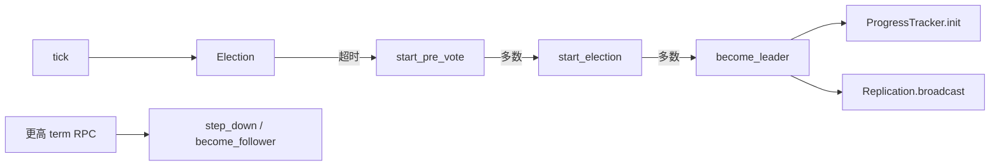

# Election：选举与角色

**状态：** 已落地（说明文档）  
**头文件：** `raft/include/openkv/raft/core/election.hpp`  
**相关：** [39](39-raft-node-collaborators.md) · [06-raft-election-commit](06-raft-election-commit.md) · [43-progress-tracker](43-progress-tracker.md)

---

## 1. 一句话

`Election` 管 **谁当家、怎么选、多数派还活着没**：角色切换、PreVote/Vote、CheckQuorum、选举超时计数。不含锁，由 `RaftNode::mu_` 保护。

---

## 2. 为什么需要它

把「超时→竞选→收票→当选/退位」从 `RaftNode` 大文件里拆出，和复制、落盘解耦。丢了正确选举：可能双主、或长期无主。

---

## 3. 字段（白话）

| 字段 | 白话 | 丢了/错了会怎样 |
|------|------|-----------------|
| `votes_` | 正式选举收票（peer→granted） | 凑不齐多数 / 误当选 |
| `pre_votes_` | PreVote 收票 | 分区节点瞎抬 term 打断集群 |
| `in_pre_vote_` | 正在 PreVote 轮 | 和正式票搅在一起 |
| `peer_quiet_ticks_` | Leader：距该 voter 上次成功响应过了多少 tick | CheckQuorum 误判「还活着」 |
| `election_elapsed_` | Follower 多久没听到 Leader | 该选不选 / 乱选 |
| `heartbeat_elapsed_` | Leader 距该发心跳多久 | 心跳稀疏，别人超时抢主 |
| `election_timeout_ticks_` | 多少次 tick 算选举超时 | 抖动过大过小 |
| `leader_quorum_grace_ticks_` | 当选后前几拍跳过 CheckQuorum | 首轮心跳未回就自废武功 |
| `election_count_` | 选举次数计数（观测） | 仅指标 |

---

## 4. 和谁配合

| 组件 | 关系 |
|------|------|
| `Membership` | `votes_won` / CheckQuorum 用 voter 集合；Joint 要双多数 |
| `ProgressTracker` | 当选时 init next/match；退位清在途 |
| `Replication` | 当选后立刻广播；`note_peer_progress` 清 quiet ticks |
| `ReadyPump` | 投票/心跳消息 `enqueue` |

---

## 5. 生命周期

1. **Follower**：`election_elapsed_++`，超时 → PreVote（若开启）或直接 Vote。  
2. **PreVote**：不抬本机 term，试探「下一任」能不能选；够票再 `start_election`。  
3. **Candidate**：`term++`，投自己，广播 RequestVote；够票 → `become_leader`。  
4. **Leader**：心跳计时；`maybe_check_quorum` 看 voter 是否长期安静，不够则主动退位。  
5. **任意角色**：收到更高 term → `step_down_if_stale` / `become_follower`。

投票规则要点：对方日志不够新（last_term/index）不给票；本任期已投别人不改口。

---

## 6. 代码锚点

| 行为 | 位置 |
|------|------|
| 实现 | `raft/src/core/election.cpp` |
| tick 编排 | `raft/src/core/raft_node.cpp` `tick` |
| 入站转发 | `RaftNode::on_request_vote*` |

---

## 7. 验收

| ID | 期望 |
|----|------|
| E1 | `--gtest_filter='Raft*Elect*'` 等选举相关 PASS |
| E2 | 杀 Leader 后能在超时内选出新主，无长期双主 |
| E3 | PreVote 开启时，分区节点恢复不无故抬高集群 term |

本文说明文档；热路径未改。未跑 `-mode all`。
