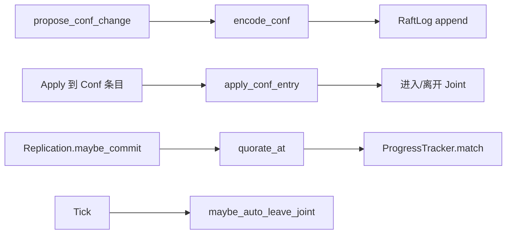

# Membership：成员与 Joint

**状态：** 已落地（说明文档）  
**头文件：** `raft/include/openkv/raft/core/membership.hpp`  
**相关：** [39](39-raft-node-collaborators.md) · [06](06-raft-election-commit.md) · [43](43-progress-tracker.md)

---

## 1. 一句话

`Membership` 管 **谁有投票权、Joint 新旧两套配置、加删 peer、ConfChange 编解码与 apply**。不含锁，由 `RaftNode::mu_` 保护。

---

## 2. 为什么需要它

扩容/缩容不能「突然换成员表」，要用 Joint（新旧双多数）过渡，否则选举/commit 会裂。成员逻辑从复制路径拆出，避免和 AE 搅在一起。

---

## 3. 字段（白话）

| 字段 | 白话 | 丢了/错了会怎样 |
|------|------|-----------------|
| `in_joint_` | 是否在 Joint 过渡期 | 多数派算法用错集合 |
| `joint_old_voters_` | Joint 旧投票人 | 旧多数算错 |
| `joint_new_voters_` | Joint 新投票人 | 新多数算错 |
| `auto_leave_pending_` | 稳定后应自动 LeaveJoint | 卡在 Joint 太久 |
| `leave_joint_inflight_` | 已 propose Leave、等 apply | 每 tick 重复 append Leave |

成员列表本体在 `RaftNode::opts_.peers`（含 learner 标记）；本类算「谁算票」和 Joint 状态。

---

## 4. 和谁配合

| 组件 | 关系 |
|------|------|
| `ProgressTracker` | `quorate_at` 读 match；加删 peer 时 erase/置 0 |
| `Replication` | commit 在 Joint 时要新旧双多数都过 |
| `Election` | 选票多数、CheckQuorum 用 `voter_ids` |
| `Apply` | Conf 条目走 `apply_conf_entry`，不进业务 KV |

---

## 5. 生命周期

1. **Add/Remove**：编码为 ConfChange 日志，多数提交后 apply 改 `peers`。  
2. **进 Joint**：新旧 voter 列表同时生效；选举与 commit 都要双多数。  
3. **稳定**：新配置已提交且复制够 → `maybe_auto_leave_joint` propose LeaveJoint。  
4. **出 Joint**：apply Leave 后 `in_joint_=false`，只留新配置。  
5. **Learner**：在 peers 里但无投票权；常靠快照/AE 追平后再提权。

---

## 6. 代码锚点

| 行为 | 位置 |
|------|------|
| 实现 | `raft/src/core/membership.cpp` |
| 对外 API | `RaftNode::add_peer` / `remove_peer` / `propose_conf_change` |

---

## 7. 验收

| ID | 期望 |
|----|------|
| M1 | Joint / ConfChange 相关 gtest PASS |
| M2 | 加节点：先 Joint 再 Leave，期间写不丢、能选主 |
| M3 | Learner 无投票；提权后进入 voter 集合 |

本文说明文档；热路径未改。未跑 `-mode all`。
