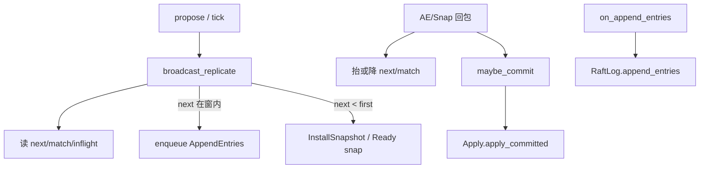

# Replication：复制、commit、快照

**状态：** 已落地（说明文档）  
**头文件：** `raft/include/openkv/raft/core/replication.hpp`  
**相关：** [39](39-raft-node-collaborators.md) · [43](43-progress-tracker.md) · [42](42-massive-snapshot-migration.md) · [53-raft-log-window](53-raft-log-window.md) · [04](04-fault-recovery.md)

---

## 1. 一句话

`Replication` 管 **日志怎么同步给别人、commit 怎么抬、落后了怎么发快照**：`broadcast_replicate`（AE/空 AE/快照）、入站处理、`maybe_commit`。不含锁，由 `RaftNode::mu_` 保护。

---

## 2. 为什么需要它

Leader 要把内存日志推到多数派才能提交；Follower 要对齐 prev 再 append。进度细节在 `ProgressTracker`，**发什么、何时抬 commit、何时改发快照**在本类。

---

## 3. 字段（白话）

| 字段 | 白话 | 丢了/错了会怎样 |
|------|------|-----------------|
| `need_replicate_` | 有人请求尽快再推一轮复制 | 回包后不追发，副本卡住 |
| `last_snap_sent_` | 每 peer 上次发快照时间 | 无视 `snapshot_min_interval` 狂发 |
| `snapshot_send_count_` | 发快照次数（观测） | 仅指标 |

在途配额等在 `ProgressTracker`（`inflight_` / `snap_inflight_`…）。

---

## 4. 和谁配合

| 组件 | 关系 |
|------|------|
| `ProgressTracker` | 复制游标与限流 |
| `Membership` | Joint 下双多数才 commit |
| `ReadyPump` / `ReadyIo` | 出站消息与 snap meta 外提 |
| `LogPersist` | 入站成功后 `persist_locked` |
| `Apply` | commit 抬升后推进状态机 |
| `Election` | 认 Leader、`note_peer_progress` |

---

## 5. 生命周期

1. **广播**：对每个 peer，按 `next` 发 AE；掉出日志窗 → 快照（窗定义见 [53](53-raft-log-window.md)）。  
2. **入站 AE**：校验 term/prev → 合并日志 → 跟 Leader commit → 回 match。  
3. **回包成功**：抬 match/next → `maybe_commit`（只提交本任期且多数复制的条目）→ apply。  
4. **回包失败**：`next--` 或快照失败置 0 → 再广播。  
5. **快照入站**：`snap_applier` 灌状态机 → `log.compact_to` → 抬 applied/commit。

大快照体积问题见 [42](42-massive-snapshot-migration.md)。

---

## 6. 代码锚点

| 行为 | 位置 |
|------|------|
| 实现 | `raft/src/core/replication.cpp` |
| Store 入站 | `raftstore/store.cpp` 解 AE/SNAP |
| 出站快照 | SnapWorker → Store 拼 `InstallSnapshot` → `transport_fn_` |

---

## 7. 验收

| ID | 期望 |
|----|------|
| R1 | 复制 / 快照相关 gtest PASS |
| R2 | 杀 Follower 再启：AE 或快照追平后读写一致 |
| R3 | 仅本任期条目可被 commit（经典 Raft 安全） |

本文说明文档；热路径未改。未跑 `-mode all`。
