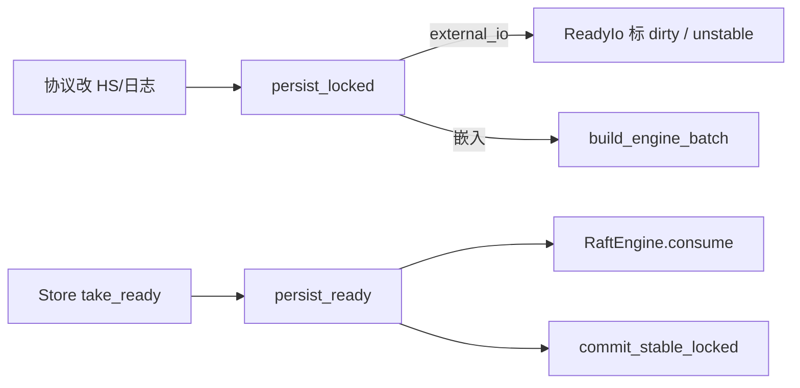

# LogPersist：协议状态落盘

**状态：** 已落地（说明文档）  
**头文件：** `raft/include/openkv/raft/core/log_persist.hpp`  
**相关：** [39](39-raft-node-collaborators.md) · [24-persist-raft-vs-kv](24-persist-raft-vs-kv.md) · [36-propose-ack-durability](36-propose-ack-durability.md)

---

## 1. 一句话

`LogPersist` 管 **HardState + 日志怎么写进 `RaftEngine`**：组 batch、刷盘、Ready 路径的 `persist_ready`。协议锁策略见实现；写盘另有 `persist_io_mu_`，允许与 propose 重叠。

---

## 2. 为什么需要它

内存 `RaftLog` 不是 WAL。崩溃恢复只认引擎里的 HardState/日志。把「怎么组批、增量 flush、Ready 外提落盘」集中一处，避免复制路径直接碰 Rocks/文件格式。

---

## 3. 字段（白话）

| 字段 | 白话 | 丢了/错了会怎样 |
|------|------|-----------------|
| `persist_pending_` | 攒了多少条/次待刷（嵌入路径） | 该刷不刷或刷太勤 |
| `persist_dirty_` | 有未刷脏数据 | 丢 HardState/日志 |
| `stable_first_index_` | 已稳定落盘窗口下限 | 增量 flush 基准错，重复写或漏写 |
| `stable_last_index_` | 已稳定落盘窗口上限 | 同上 |
| `persist_io_mu_` | 串行化 `engine_->consume` | 并发写盘打坏引擎 |

---

## 4. 和谁配合

| 组件 | 关系 |
|------|------|
| `ReadyIo` / `ReadyPump` | external_io：本类只脏标记，真正 consume 在 Store `persist_ready` |
| `RaftEngine` | File（Meta/UT）或 Db（生产 Storage） |
| `Apply` | compact 后常再 persist |
| `Replication` | 入站成功后 persist |

---

## 5. 生命周期

1. **协议侧改动**（propose、投票、AE…）→ `persist_locked`。  
2. **`external_io=true`（生产）**：HardState/新条目进 Ready 缓冲；Store 拉 Ready 后调 `persist_ready` → `consume(sync)`。  
3. **嵌入路径**：可按 `persist_batch_n` 攒批后本进程直接刷引擎。  
4. **成功**：推进 `stable_*`；失败不得假装已持久化（返回 0 / 抛错语义见架构契约）。

耐久档位：`SyncMode`（默认 data=Raft sync、KV 异步）见 [24](24-persist-raft-vs-kv.md)。

---

## 6. 代码锚点

| 行为 | 位置 |
|------|------|
| 实现 | `raft/src/core/log_persist.cpp` |
| Store 调用 | `raftstore/store.cpp` persist 管道 |
| 引擎 | `engine/db_raft_engine.*` / `file_raft_engine.*` |

---

## 7. 验收

| ID | 期望 |
|----|------|
| L1 | Persist / DbRaft / File 相关 gtest PASS |
| L2 | kill -9 后重启：term/vote/commit/日志可恢复 |
| L3 | Ready 批：persist 成功前不 advance 当已耐久 |

本文说明文档；热路径未改。未跑 `-mode all`。
