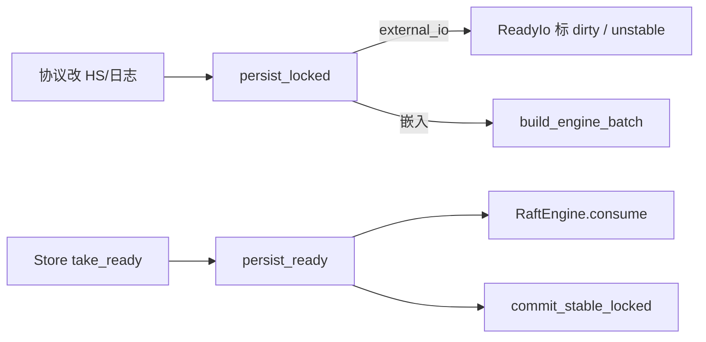

# LogPersist：协议状态落盘

**状态：** 已落地（说明文档）  
**头文件：** `raft/include/openkv/raft/core/log_persist.hpp`  
**相关：** [39](39-raft-node-collaborators.md) · [24-persist-raft-vs-kv](24-persist-raft-vs-kv.md) · [36-propose-ack-durability](36-propose-ack-durability.md)

---

## 1. 一句话

`LogPersist` 管 **HardState + 日志怎么写进 `RaftEngine`**：组 batch、刷盘、Ready 路径的 `persist_ready`。协议锁策略见实现；写盘另有 `persist_io_mu_`，允许与 propose 重叠。

---

## 2. 为什么需要它

内存 `RaftLog` 不是 WAL。崩溃恢复只认引擎里的 HardState/日志。把「怎么组批、增量 flush、Ready 外提落盘」集中一处，避免复制路径直接碰 Rocks/文件格式。

---

## 3. 字段（白话）

| 字段 | 白话 | 丢了/错了会怎样 |
|------|------|-----------------|
| `persist_pending_` | 攒了多少条/次待刷（嵌入路径） | 该刷不刷或刷太勤 |
| `persist_dirty_` | 有未刷脏数据 | 丢 HardState/日志 |
| `stable_first_index_` | 已稳定落盘窗口下限 | 增量 flush 基准错，重复写或漏写 |
| `stable_last_index_` | 已稳定落盘窗口上限 | 同上 |
| `persist_io_mu_` | 串行化 `engine_->consume` | 并发写盘打坏引擎 |

---

## 4. 和谁配合



| 组件 | 关系 |
|------|------|
| `ReadyIo` / `ReadyPump` | external_io：本类只脏标记，真正 consume 在 Store `persist_ready` |
| `RaftEngine` | File（Meta/UT）或 Db（生产 Storage） |
| `Apply` | compact 后常再 persist |
| `Replication` | 入站成功后 persist |

---

## 5. 生命周期

1. **协议侧改动**（propose、投票、AE…）→ `persist_locked`。  
2. **`external_io=true`（生产）**：HardState/新条目进 Ready 缓冲；Store 拉 Ready 后调 `persist_ready` → `consume(sync)`。  
3. **嵌入路径**：可按 `persist_batch_n` 攒批后本进程直接刷引擎。  
4. **成功**：推进 `stable_*`；失败不得假装已持久化（返回 0 / 抛错语义见架构契约）。

耐久档位：`SyncMode`（默认 data=Raft sync、KV 异步）见 [24](24-persist-raft-vs-kv.md)。

---

## 5.1 `persist_locked` 到底干什么（易混）

调用约定：必须已持 `RaftNode::mu_`。它表示「协议状态有变更，需要持久化」，**不等于**这一行就完成了 WAL fsync。

| `external_io` | `persist_locked` 实际做的事 | 真写盘在哪 |
|---------------|-----------------------------|------------|
| **true（Storage 生产）** | 把 HardState（term / vote / commit）标脏进 `ReadyIo`；**不**调用 `consume` | Store `process_ready` → `persist_ready` → `engine_->consume` |
| **false（Meta 嵌入）** | 标 `persist_dirty_`，按 `persist_batch_n` 可能当场 `engine_flush_locked` → `consume` | 同进程内，仍在 `LogPersist` |

所以 propose 里出现的 `persist_locked()`：在 Storage 上多半是「登记要外提落盘」；在 Meta 上才更接近「可能马上刷引擎」。

和 `persist_ready` 的分工：

```text
persist_locked   → 协议侧记账 / 标脏（或嵌入路径攒刷）
persist_ready    → Store 拉完 Ready 后，组 batch + consume（生产 WAL 真实写入点）
```

---

## 5.2 生产顺序：先本机 WAL，再发 AE

Storage Ready 管道（`Store::process_ready`）固定为：

1. **persist**（`persist_ready` / PersistWorker）  
2. **发网**（AE / Vote / Snap…）  
3. **投递 apply**  
4. **advance**

因此：

- **不是**「等 Follower 回 AE 之后 Leader 才落盘」；  
- **是**「Leader 本机先把本批 unstable 日志（及脏 HardState）写入 RaftEngine，再出站 AE」；  
- Follower 的 AE 回包只影响对方 `match_index` 与能否抬 `commit_index`，不决定本机是否已经 `consume`。

异步 `persist_workers>0` 时同样：IO 线程 `consume` 完成后发 `kPersistDone`，再 `dispatch_ready_after_persist` 发网。

---

## 5.3 和内存 append、复制进度的关系

| 步骤 | API / 字段 | 白话 |
|------|------------|------|
| 内存记账 | `RaftLog::append` | 只进 `entries_`，分配 index；**不是 WAL** |
| 自己算已对齐 | `match_index_[self] = idx` | 复制进度：自己日志已有这条；**不是** apply 水位 |
| 标要落盘 | `persist_locked` | 见上表 |
| 真写 WAL | `persist_ready` → `consume` | 崩溃恢复认的是这里 |
| 推给 Follower | AE（AppendEntries） | 在 persist 之后（生产 Ready 序） |
| 多数派提交 | `commit_index` | 自己 + 他人 match 够多数 |
| 业务可见 | apply / IndexWaiter | commit 之后；客户端 ACK 卡在这 |

`last_applied` 与 `match_index[self]` 不要混：前者是状态机执行到哪，后者是日志对齐到哪。

---

## 6. 代码锚点

| 行为 | 位置 |
|------|------|
| 实现 | `raft/src/core/log_persist.cpp`（`persist_locked` / `persist_ready`） |
| propose 调 persist_locked | `raft/src/core/raft_node.cpp`：`RaftNode::propose` |
| Store：先 persist 再发网 | `raft/src/raftstore/store.cpp`：`process_ready` → `dispatch_ready_after_persist` |
| 引擎 | `engine/db_raft_engine.*` / `file_raft_engine.*` |

---

## 7. 验收

| ID | 期望 |
|----|------|
| L1 | Persist / DbRaft / File 相关 gtest PASS |
| L2 | kill -9 后重启：term/vote/commit/日志可恢复 |
| L3 | Ready 批：persist 成功前不 advance 当已耐久 |
| L4 | 对照源码：`external_io` 下 `persist_locked` 无 `consume`；`process_ready` 先 `persist_ready` 再 `transport_fn_` |

本文说明文档；热路径未改。未跑 `-mode all`。
