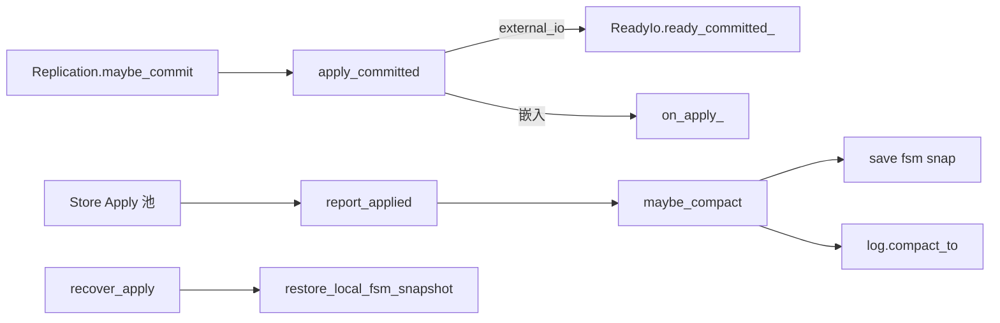

# Apply：状态机推进与本地 FSM 快照

**状态：** 已落地（说明文档）  
**头文件：** `raft/include/openkv/raft/core/apply.hpp`  
**相关：** [39](39-raft-node-collaborators.md) · [53-raft-log-window](53-raft-log-window.md) · [20 N1b](20-next-optimizations.md) · [36](36-propose-ack-durability.md)

---

## 1. 一句话

`Apply` 管 **提交水位之后怎么落到状态机、何时砍日志、本地 FSM 快照**：`apply_committed`、`report_applied`、`wait_applied`、compact。  
锁约定：`apply_committed` / compact / 写快照须已持 `mu_`；`report_applied` / `wait_applied` 自己抢锁。

---

## 2. 为什么需要它

`commit_index` 只表示「多数派已持久化可提交」；业务 KV / ClusterState 还要 apply。客户端 ACK 等 `last_applied`。compact 前要有可恢复的 FSM 快照，否则砍日志后重启回不去。

---

## 3. 字段 / 协作状态（白话）

| 名字 | 在哪 | 白话 |
|------|------|------|
| `applied_cv_` | Apply | `wait_applied` 等抬升 |
| `last_applied_` / `apply_scheduled_` | RaftNode | 已应用到哪；外提路径已调度到哪 |
| `on_apply_` | RaftNode | 业务回调（嵌入）；Store 路径常走 apply_fn |
| `in_on_apply_` | RaftNode | 挡住 apply 里重入 recover |
| `fsm_<gid>.snap` | 磁盘 | 本地 FSM 快照文件（单文件覆盖，见 N1b） |

---

## 4. 和谁配合

| 组件 | 关系 |
|------|------|
| `Replication` | 抬 commit 后触发 apply |
| `Membership` | Conf 条目 apply 改成员，不进 KV |
| `LogPersist` | compact 后落盘 |
| `ReadyIo` | 外提 committed 给 Store Apply |
| Storage `apply_fn` | 真正写 Rocks/MVCC |

---

## 5. 生命周期

1. **commit 前进** → `apply_committed`：从 `apply_scheduled_` 推到 `commit_index_`。  
2. **嵌入**：同步 `on_apply`；**external_io**：条目进 Ready，Store Apply 池执行后再 `report_applied`。  
3. **每 32 条 / compact 前**：`snap_provider` 写本地 `fsm_*.snap`。  
4. **compact**：applied 超过阈值 → 快照后 `log.compact_to`。  
5. **启动**：优先装 FSM 文件；没有则按日志回放到 `last_applied`。

---

## 6. 代码锚点

| 行为 | 位置 |
|------|------|
| 实现 | `raft/src/core/apply.cpp` |
| 回告 | `RaftNode::report_applied` |
| Store | `send_apply` / `on_apply_batch` |

---

## 7. 验收

| ID | 期望 |
|----|------|
| A1 | Apply / FsmSnap / MetaFsm 相关 gtest PASS |
| A2 | put 后 `wait_applied` 返回；重启后数据仍在 |
| A3 | compact 后仍能靠快照或剩余日志恢复 |

本文说明文档；热路径未改。未跑 `-mode all`。
