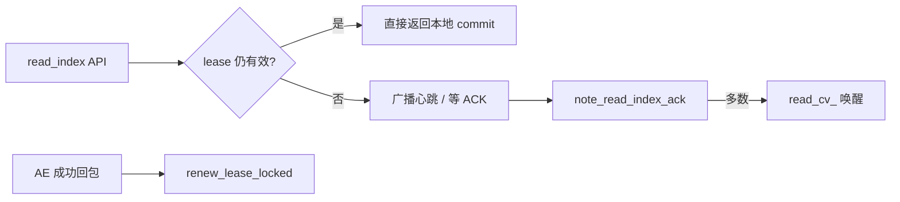

# LinearRead：租约读与 ReadIndex

**状态：** 已落地（说明文档）  
**头文件：** `raft/include/openkv/raft/core/linear_read.hpp`  
**相关：** [39](39-raft-node-collaborators.md) · [06](06-raft-election-commit.md)

---

## 1. 一句话

`LinearRead` 管 **读能不能在本 Leader 本地确认，还是要等多数派心跳 ACK**：Leader lease + ReadIndex。不含锁（CV 等待时会放锁），由 `RaftNode::mu_` 与调用约定配合。

---

## 2. 为什么需要它

只读本地 `commit` 可能读到「已过期 Leader」眼里的提交（别人已经另选主）。线性读要保证：读到的提交水位，在集群语义下不会被更新的 Leader 否定。

---

## 3. 字段（白话）

| 字段 | 白话 | 丢了/错了会怎样 |
|------|------|-----------------|
| `lease_expire_` | 租约过期时刻 | 过期仍本地读 → 线性读破坏 |
| `read_index_gen_` | 每次发起 ReadIndex +1 | 代次乱，ACK 对错轮 |
| `pending_read_gen_` | 正在等的那一轮；0=没有 | 误唤醒 / 永远等 |
| `pending_read_commit_` | 发起时冻结的可读 commit | 读到错误水位 |
| `read_index_acks_` | 本轮已 ACK 的 peer | 多数判断错 |
| `read_cv_` | 多数达成或超时醒来 | 调用方卡死 |

选项：`enable_lease_read`、`leader_lease_ms`。

---

## 4. 和谁配合

| 组件 | 关系 |
|------|------|
| `Replication` | 心跳/AE 回包刷新租约；ReadIndex 靠多数 ACK |
| `Election` | 仅 Leader 做线性读；退位后租约作废 |
| `Membership` | 多数派人数 |

---

## 5. 生命周期

1. **Leader 且租约有效**：`read_index` 可直接返回当前 commit（快路径）。  
2. **租约过期**：发起一轮 ReadIndex（记 gen + 冻结 commit），发心跳，收 follower ACK。  
3. **ACK 达多数**：唤醒等待者，返回冻结的 `read_commit`。  
4. **超时 / 失去领导**：失败返回。  
5. **AE 成功回包**：`renew_lease_locked` 延长租约窗。

---

## 6. 代码锚点

| 行为 | 位置 |
|------|------|
| 实现 | `raft/src/core/linear_read.cpp` |
| API | `RaftNode::read_index` |

---

## 7. 验收

| ID | 期望 |
|----|------|
| LR1 | 线性读相关 gtest（若有）PASS |
| LR2 | Leader 租约内读与多数确认读水位一致 |
| LR3 | 旧 Leader 隔离后不应再对外宣称线性读成功 |

本文说明文档；热路径未改。未跑 `-mode all`。
