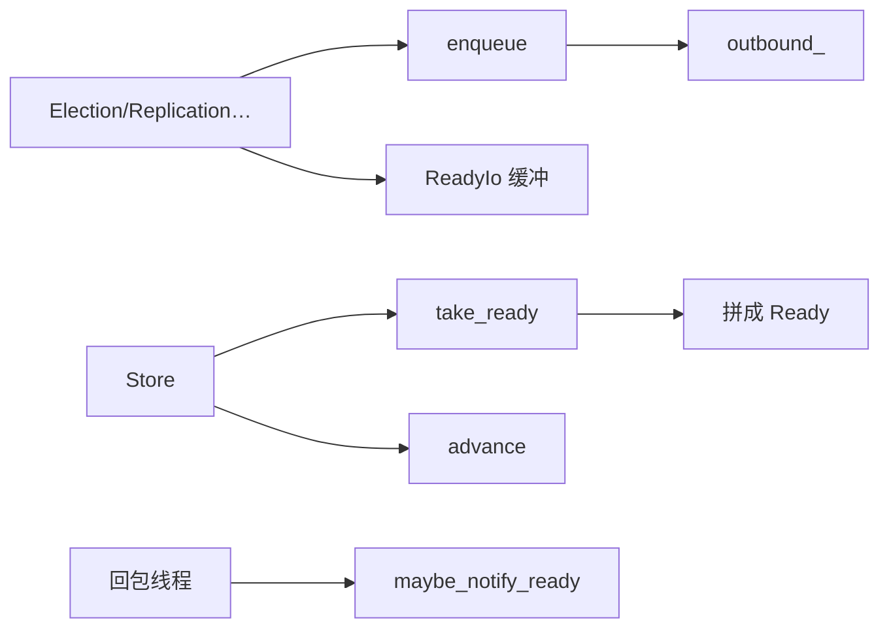

# ReadyPump：Ready 外提与出站泵

**状态：** 已落地（说明文档）  
**头文件：** `raft/include/openkv/raft/core/ready_pump.hpp`  
**相关：** [39](39-raft-node-collaborators.md) · [51-ready-io](51-ready-io.md) · [52-ready](52-ready.md) · [26](26-raftstore-schedule-pipeline.md)

---

## 1. 一句话

`ReadyPump` 管 **协议产出怎么交给 Store**：攒出站消息、`has/take_ready`、`advance`、叫醒 Store。  
锁约定：`enqueue` 须已持 `mu_`；`take_ready` / `flush_transport` / `advance` 自己抢锁。

---

## 2. 为什么需要它

生产路径 `external_io=true`：协议线程不直接写盘、不直接发 gRPC，只产出 `Ready`；Store 按 **persist → 发网 → apply → advance** 执行。本类是协议侧「泵」与嵌入路径的 `flush_transport`。

---

## 3. 字段（白话）

| 字段 | 白话 | 丢了/错了会怎样 |
|------|------|-----------------|
| `outbound_` | 待发消息队列（to/type/payload） | 丢 RPC；或重复发 |
| `ready_notify_` | Ready 有货时回调（常 `mark_hot`） | Store 干等 tick，延迟大 |

组装观测：`soft_state_locked()`（不含完整 replication_lag 计算时的细节见实现）。

---

## 4. 和谁配合

| 组件 | 关系 |
|------|------|
| `ReadyIo` | HardState/unstable/committed/snap 数据源 |
| `Store` | `take_ready` → persist → transport → apply → `advance` |
| 嵌入 `send_` | `flush_transport` 直接 `TransportSend` |
| 协作类 | 一律 `enqueue` 出站，不自己发网 |

---

## 5. 生命周期

1. 协议事件 → `enqueue` 消息；同时可能改 `ReadyIo`。  
2. `has_ready` 真 → Store / 测试拉 `take_ready`（搬空缓冲 + outbound）。  
3. Store 落盘并发网后 `advance`（清本批相关状态）。  
4. 回包路径 `maybe_notify_ready`：有货立刻唤醒，不等心跳 tick。  
5. 嵌入模式：`flush_transport` 把 `outbound_` 经 `send_` 发出；`take_ready` 可为空壳用途减弱。

---

## 6. 代码锚点

| 行为 | 位置 |
|------|------|
| 实现 | `raft/src/core/ready_pump.cpp` |
| 唤醒 | `StorageNode` 设 `set_ready_notify` → `store.mark_hot` |

---

## 7. 验收

| ID | 期望 |
|----|------|
| RP1 | `RaftNodeReady*` gtest PASS |
| RP2 | propose 后无需傻等 tick 即可出现 Ready / 发 AE |
| RP3 | advance 前重复 take 不应丢耐久顺序（persist 先于发网） |

本文说明文档；热路径未改。未跑 `-mode all`。
