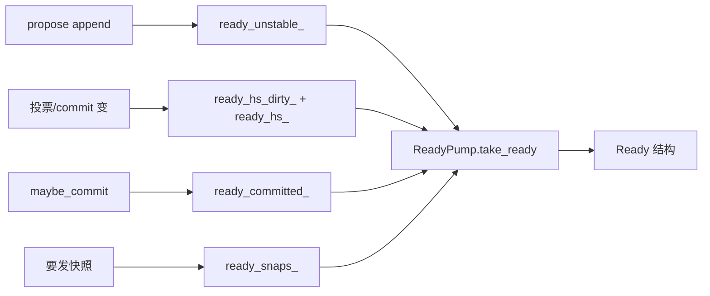

# ReadyIo：Ready 侧缓冲字段

**状态：** 已落地（说明文档）  
**头文件：** `raft/include/openkv/raft/core/ready_io.hpp`  
**相关：** [39](39-raft-node-collaborators.md) · [50-ready-pump](50-ready-pump.md) · [52-ready](52-ready.md) · [43](43-progress-tracker.md)

---

## 1. 一句话

`ReadyIo` 是 **`external_io` 下协议核攒批、等 Store `take_ready` 外提的缓冲区**（结构体，不是带行为的大类）。不含锁，挂在 `RaftNode` 上由 `mu_` 保护。

它**不是**第二本日志：权威日志仍在 `RaftLog`；这里只是「下一拍要交给 Store 的那一摞」。

---

## 2. 为什么需要它

协议一步可能同时弄脏 HardState、追加 unstable、抬 commit、要发快照。先塞进缓冲，Store 一次 `take_ready` 打包成 `Ready`，再按序 persist/发网/apply，避免协议线程做 IO。

---

## 3. 字段（白话）

| 字段 | 白话 | 丢了/错了会怎样 |
|------|------|-----------------|
| `ready_hs_dirty_` | HardState 有变更、尚未放进 Ready | 漏持久化 term/vote/commit |
| `ready_hs_` | 待外提的最新 HardState 快照 | 落盘内容旧 |
| `ready_unstable_` | 新 append、待写 WAL 的条目 | 崩溃丢未落盘日志 |
| `ready_committed_` | 已 commit、待 apply 的条目 | Store Apply 拿不到活 |
| `ready_snaps_` | 待发快照元数据（blob 外提后拉） | 落后 peer 不发快照 |
| `ready_applied_watermark_` | Ready 侧已报告的 apply 水位 | 重复 apply / 水位错乱 |

`clear_batch()` / `empty()`：take 后清空；判断有无货。

---

## 4. 和谁配合

| 组件 | 关系 |
|------|------|
| `RaftLog` | unstable 从 log 拷/搬一份进缓冲 |
| `LogPersist` | external_io 时 persist_locked 主要标脏 |
| `ReadyPump` | `take_ready` 读本结构 + `outbound_` |
| `Replication` | 快照 meta 推进 `ready_snaps_` |

---

## 5. 生命周期

1. 协议改动写入对应缓冲字段。  
2. `take_ready` 组装 `Ready` 并 `clear_batch`（outbound 一并搬走）。  
3. Store 处理完 `advance`。  
4. 下一轮协议再脏再填。  
5. `load_hard_state` / 角色大变时可能整批 `clear_batch`。

---

## 6. 代码锚点

| 行为 | 位置 |
|------|------|
| 定义 | `ready_io.hpp` |
| 写入例 | `raft_node.cpp` propose → `ready_unstable_.push_back` |
| 读出 | `ready_pump.cpp` `take_ready` |

---

## 7. 验收

| ID | 期望 |
|----|------|
| RI1 | Ready 外提相关 gtest PASS |
| RI2 | propose 后 Ready.entries 含新日志；persist 后 stable 窗口前进 |
| RI3 | take 后 `empty()` 为真，无重复外提同一批 |

本文说明文档；热路径未改。未跑 `-mode all`。
