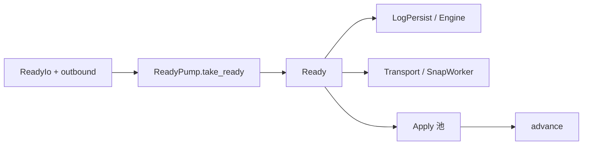

# Ready：一轮协议输出结构

**状态：** 已落地（说明文档）  
**头文件：** `raft/include/openkv/raft/core/ready.hpp`  
**相关：** [39](39-raft-node-collaborators.md) · [50](50-ready-pump.md) · [51](51-ready-io.md) · [35](35-raft-module-call-flows.md) · [raft/ARCHITECTURE.md](../../raft/ARCHITECTURE.md)

---

## 1. 一句话

`ready.hpp` 定义 **协议一轮输出的数据结构**（HardState / Message / Ready / SnapshotMeta），**不含任何 IO**。  
`RaftNode(external_io)` 产出 `Ready`；`raftstore::Store` 负责 persist + 发网 + apply。

---

## 2. 为什么需要它

把「协议算完了要外界干什么」收成一份契约，避免 Store 和协议核互相扒私有字段。顺序写死：**persist → 发网 → apply → advance**（`must_sync` 时 durable 后再 advance）。

---

## 3. 类型（白话）

### HardState

必须落盘的协议元状态（重启靠它恢复选举/提交水位）。

| 字段 | 白话 |
|------|------|
| `term` | 当前任期 |
| `vote` | 本任期投票对象（voted_for） |
| `commit` | 已提交最大 index |

与 SoftState 不同：SoftState 可丢、仅观测；HardState 丢了会乱投票或丢 commit。

### Message

待发送的 Raft RPC（to / type / payload）。type 如 AppendEntries、RequestVote、RequestPreVote、InstallSnapshot。

### SnapshotMeta

| 字段 | 白话 |
|------|------|
| `index` / `term` | 快照覆盖到的最后日志 |
| `to` | 目标 peer；空表示本地安装语义 |
| `conf_state` | 当时成员表 CSV；防 compact 吞掉 ConfChange 后 Learner 丢失 |

blob 由外层 SnapshotProvider / SnapWorker 填充。

### Ready（一批）

| 字段 | 白话 |
|------|------|
| `hard_state` | 若有：本批需落盘的 HS |
| `entries` | 需追加到 WAL 的新日志（unstable，可尚未 commit） |
| `committed_entries` | 已提交、待 apply |
| `messages` | 落盘后再发 |
| `snapshot` | 需对该 peer 发起 InstallSnapshot |
| `must_sync` | 是否要求 sync 落盘后再 advance |
| `soft_state` | 附带观测快照（非持久化载荷） |

---

## 4. 和谁配合

---

## 5. 生命周期（Store 视角）

1. `has_ready` → `take_ready` 拿到本批。  
2. 若有 HS/entries：`persist_ready` → Engine `consume`。  
3. 发 `messages`；InstallSnapshot 壳走 SnapWorker 拉数据。  
4. `committed_entries` 送 Apply。  
5. `advance(rd)` 让协议确认本批已交接。

---

## 6. 代码锚点

| 行为 | 位置 |
|------|------|
| 类型 | `raft/include/openkv/raft/core/ready.hpp` |
| 组装 | `ready_pump.cpp` |
| 消费 | `raftstore/store.cpp` `dispatch_ready_after_persist` |

---

## 7. 验收

| ID | 期望 |
|----|------|
| Rd1 | Ready 路径 gtest PASS |
| Rd2 | 批内顺序：WAL 先于 AE 出站可观测（日志/故障注入） |
| Rd3 | `must_sync` 批在 sync 失败时不 advance |

本文说明文档；热路径未改。未跑 `-mode all`。
