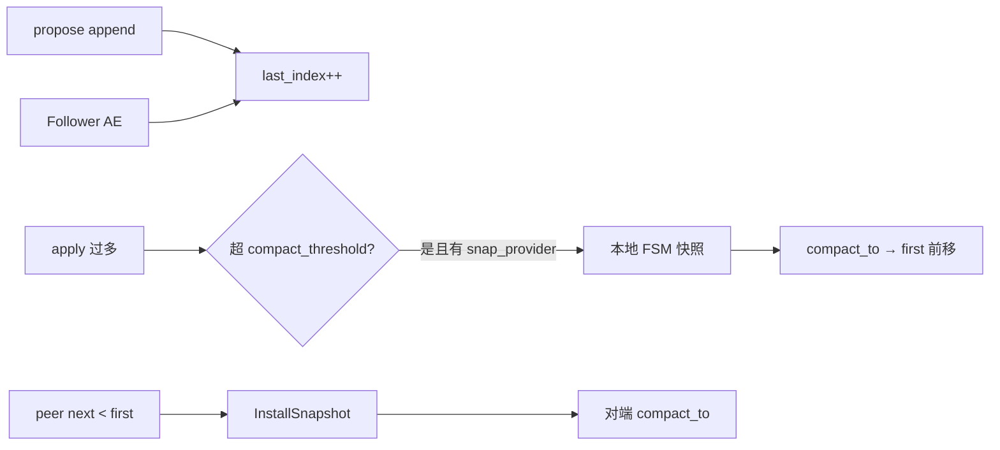

# Raft 内存日志窗（条件与限制）

**状态：** 已落地（说明文档）  
**头文件：** `raft/include/openkv/raft/log/raft_log.hpp`  
**相关：** [46-replication](46-replication.md) · [48-apply](48-apply.md) · [42-massive-snapshot-migration](42-massive-snapshot-migration.md) · [43-progress-tracker](43-progress-tracker.md) · [topology/RAFT_DATA_TOPOLOGY](../topology/RAFT_DATA_TOPOLOGY.md)

---

## 1. 一句话

「日志窗」= 内存 `RaftLog` 里**还能按 index 取出实体条目**的连续区间 `[first_index, last_index]`。  
窗左边靠 compact/装快照前移，右边靠 propose/AE append 增长；peer 的 `next_index` 掉到 `first_index` 左边就只能走 InstallSnapshot。

`RaftLog` **不落盘**；盘上权威在 `RaftEngine`。

---

## 2. 窗口长什么样

```text
          snapshot 边界              实体日志（连续）
               │
  …(已砍掉)…  first-1 │ first_index  ……  last_index
               │         ↑                    ↑
         只有 snapshot_term            append 往后涨
         没有 LogEntry 实体            compact 把 first 右移
```

| 字段 | 白话 |
|------|------|
| `first_index_` | 窗左端：最早还能给 AE 用的 index |
| `last_index()` | 窗右端；空日志时 = `first_index - 1`（与论文一致） |
| `snapshot_term_` | 左边界外侧「虚拟 prev」（index=`first-1`）的 term |
| `entries_` | 连续存放，下标换算：`entries_[index - first_index_]` |

`entry(i)`：仅当 `first_index ≤ i ≤ last_index` 有值，否则 `nullopt`。

---

## 3. 条件与限制一览

### 3.1 掉窗判定（复制）

```text
next_index[peer] < first_index  →  无法 AE 对齐 → InstallSnapshot
next_index[peer] ≥ first_index  →  从 next 取条目发 AppendEntries
```

代码：`Replication::broadcast_replicate` 分支 A/B。

### 3.2 何时砍窗（compact）— `Apply::maybe_compact`

须**同时**满足才会 `compact_to(last_applied)`：

| 条件 | 默认/说明 |
|------|-----------|
| `compact_threshold != 0` | `0` = 永不砍 |
| 有 `snap_provider_` | 没快照能力就砍 = 丢状态机历史 |
| `last_applied ≥ first_index` | 窗内确实有已 apply 的前缀 |
| `last_applied - first + 1 > compact_threshold` | 默认阈值 **256**（Storage 部分路径曾用 128，以 Options 为准） |

砍之前先写本地 FSM 快照（`fsm_<gid>.snap`），再推进 `first_index`，并 `persist`。

装对端快照时：`on_install_snapshot` 里也会 `log.compact_to(last_index, last_term)`。

### 3.3 单次 AE 批量（不是窗大小，是每包上限）

| Options | 默认 | 作用 |
|---------|------|------|
| `max_ae_entries` | 64 | 一包最多几条 |
| `max_ae_bytes` | 256 KiB | 一包 data 累计上限 |

`entries_from(next, limit, max_bytes)` 受这两项约束。

### 3.4 连续性与冲突

- 窗内 index **必须连续**。  
- Follower `append_entries`：prev 对不上 → 失败；中部 term 冲突 → `truncate_from` 再追加。  
- Leader 本地 `append`：只在右端追加，`index = last_index + 1`。

### 3.5 与 Progress / 落盘的关系

| 概念 | 关系 |
|------|------|
| `ProgressTracker.next_index` | 相对本机日志窗；掉窗改快照 |
| `LogPersist.stable_*` | 已写入 Engine 的稳定窗；可与内存窗短暂不一致，consume 后对齐 |
| Ready `unstable` | 新 append、待进 WAL 的右端增量 |

---

## 4. 生命周期简图



---

## 5. 代码锚点

| 行为 | 位置 |
|------|------|
| 窗口类型 | `raft/log/raft_log.hpp` · `raft_log.cpp` |
| 掉窗发快照 | `replication.cpp` `broadcast_replicate` |
| compact 条件 | `apply.cpp` `maybe_compact` |
| Options | `raft_node.hpp`：`compact_threshold` / `max_ae_*` |
| 拓扑字段表 | [RAFT_DATA_TOPOLOGY](../topology/RAFT_DATA_TOPOLOGY.md) |

---

## 6. 验收（说明文档）

| ID | 期望 |
|----|------|
| W1 | compact 后 `first_index` 前进；落后 peer 走快照而非 AE |
| W2 | `compact_threshold=0` 或不设 snap_provider 时不砍前缀 |
| W3 | AE 单包不超过 `max_ae_entries` / `max_ae_bytes` |

本文说明文档；热路径未改。未跑 `-mode all`。
