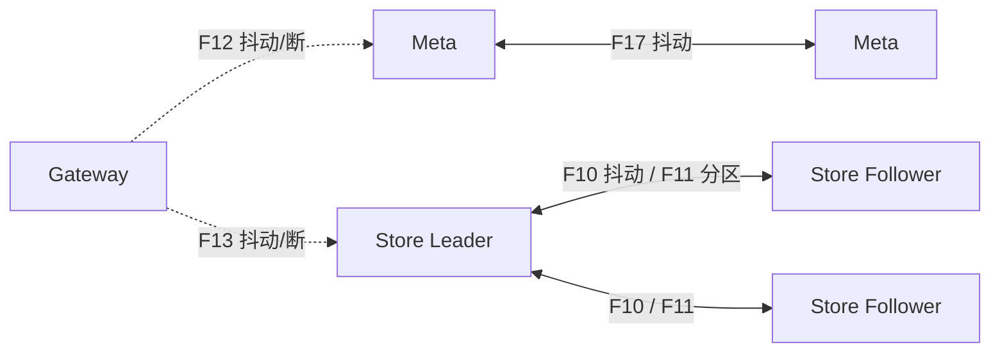

# 故障演练计划

验证 OpenKV 在上下线、进程崩溃、网络抖动、磁盘类故障下能否**自动恢复服务**（Raft 选主 / 追赶 / Gateway 重试），以及运维侧如何拉起进程。

- **设计总览：** [DATA_HA.md](../architecture/DATA_HA.md)（数据面 RF=3 + Meta×3、边界与验收 ID）
- 实现流程：[flows/04-fault-recovery.md](../flows/04-fault-recovery.md)（WAL / AE / Snapshot）· [05-meta-ha.md](../flows/05-meta-ha.md)
- 脚本入口：`make fault-drill` → `[scripts/fault-drill.sh](../../scripts/fault-drill.sh)`
- 运维 CLI：[SKV_CLI.md](SKV_CLI.md)
- 发版集成门禁：[INTEGRATION_TEST.md](../test/INTEGRATION_TEST.md)

## 假设拓扑


| 角色      | 数量  | 端口        | 说明                         |
| ------- | --- | --------- | -------------------------- |
| Meta    | 3   | 8500–8502 | 管控面 / TSO / 路由             |
| Storage | 6   | 9100–9105 | Region RF=3；可 place 到不同节点组 |
| Gateway | 2   | 19000 / 19002 | 客户端入口（`19001` 留给 stats） |
| Web     | 可选  | 19100     | 运维台；演练可用 `skv` / 脚本代替      |


数据目录：`./data/storage-N`（含 RocksDB + `raft_shard_*`）。  
后台负载：`make fault-drill` 启动时自动拉起全程 `kv-chaos`（`-duration 0`，多 worker Put/Get，直到演练结束）。  
也可单独：`./.run/kv-chaos -addr 127.0.0.1:19000 -duration 0 -workers 4 -qps 40`。  
判定：**写可用性 / 读可用性分开看**（`kv-chaos` 输出 `write_success` / `read_success`；`overall_success` 仅作汇总）。  
另看路由可达、日志 `recovered term=` / `installed snapshot`。

> **注意**：当前 `fault-drill.sh` 默认按 **Storage×3（9100–9102）** 启停；6 Store 场景请先 `python3 scripts/daemon_cluster.py`（或等价）再按本手册手工跑 F2/F3/F9 等。


## 「自动恢复」边界


| 能力                              | 是否自动  | 说明                                                                    |
| ------------------------------- | ----- | --------------------------------------------------------------------- |
| Raft 选主、Follower AE/Snapshot 追赶 | 是     | 进程仍在多数派内时                                                             |
| Gateway `not_leader` 刷路由重试      | 是     | [flows/08-not-leader-redirect.md](../flows/08-not-leader-redirect.md) |
| 进程被 kill 后自动拉起                  | **否** | `skv restart` / 演练脚本 / 运维台                                            |
| 丢 2/3 副本后仍可写                    | **否** | 预期不可用，恢复多数派后恢复                                                        |


## 按组件：能杀几个还可用

默认本地/发版拓扑：**Store×3（Region RF=3）· Meta×3 · Gateway×2**。  
「可用」指对应面仍能对外服务；**多数派 = ⌊N/2⌋+1**（RF=3 → 至少活 2）。Gateway 无状态，客户端多地址换入口。

| 组件 | 部署 | 最多可同时挂 | 挂了还怎样 | 再多挂一台 | 演练 |
|------|------|--------------|------------|------------|------|
| **Store（同 Region 副本）** | RF=3 | **1** | 写/读都仍可用（Follower 宕 → 写=读=100%；Leader 宕 → 短暂选主后恢复） | **2**：Region **不可写**（F3；读另记） | F1 / F2 / F3 / F4 |
| **Store（滚动）** | RF=3 | 任意多台，**每次只下 1** | 始终保多数派 → 写=读=**100%** | 同刻下 2 台 = 等同 F3 | F4 |
| **Meta** | ×3 | **1** | 管控面仍服务；数据面写=读=**100%** | **2**：管控不可用（新路由/TSO 挂；已缓存路由可读一阵） | F5 / F6 / F7 |
| **Gateway** | ×2（无状态） | **1** | 客户端换另一台 → 写=读=**100%** | **2**：入口全断；**不丢**盘上数据 | F8 |
| **Web / 管控台** | 可选 | 不影响数据面 | 仅运维 UI | — | F9 |

跨组件同时挂（默认拓扑下仍可用的组合）：

| 同时挂 | 数据面 | 管控面 | 说明 |
|--------|--------|--------|------|
| 1 Store + 1 Meta | ✅ | ✅ | 两面各自仍有多数派 |
| 1 Store + 1 Gateway | ✅ | ✅ | 入口还有另一台 Gateway |
| 2 Store 或 2 Meta 或 2 Gateway | ❌ | 见上 | 同组件丢多数/全灭 |

能力边界一句话：

- Store / Meta：**扛 1 挂**；**不扛 2 挂**（同组）。
- Gateway×2：**扛 1 挂**（`Dial("gw0,gw1")` 传输失败换台）；两台都挂则客户端进不去。
- 滚动重启 Store：可以滚完所有人，但**任意时刻同 Region 只能少 1 副本**。

设计总览见 [DATA_HA.md](../architecture/DATA_HA.md)。

---

## 场景总表（按 ID）

判定口径：`kv-chaos` 的 **write_success / read_success** 分开卡；`overall_success` 只作汇总。丢多数派时以**写不可用**为 PASS（F3）。

| ID | 组件 | 场景 | 故障中 **写** | 故障中 **读** | 恢复后（写/读） | 自动化 |
| --- | ---- | ---- | ------------- | ------------- | ---------------- | ------ |
| F1 | Store | 杀 1 Follower | **100%** | **100%** | 均 ≥100% | `fault-drill` |
| F2 | Store | 杀 Region Leader | 短暂下降后可写 | 短暂下降后可读 | 均 ≥85%；新 `*L` | `fault-drill` |
| F3 | Store | 杀同 Region 2 副本 | **≈0（PASS=正确降级）** | 可能仍高（勿用 overall） | 均 ≥60%→再追齐 | `it-partition` |
| F4 | Store | 滚动重启（每次 1 台） | **100%** | **100%** | 均 ≥100% | `fault-drill` |
| F5 | Meta | 杀 1 Meta | **100%**（数据面） | **100%** | Meta 重加入 | `fault-drill` |
| F6 | Meta | 杀 Meta Leader | 选主后恢复 | 同左 | 正常 | 手册 |
| F7 | Meta | 杀 2 Meta | 新路由/TSO 挂 | 已缓存路由可读 | 恢复多数派 | 手册 |
| F8 | Gateway | 杀 1/2 Gateway | 多地址 **100%** | 多地址 **100%** | 双入口恢复 | `fault-drill` |
| F9 | Web | Web 上下线 | 不影响数据面 | 同左 | 节点回集群 | 手册 |
| F10 | Store↔Store | AE 抖动 | ≥20%（不归零） | ≥40% | 均 ≥85% | `fault-drill` · `it-net-jitter` |
| F11 | Store↔Store | 分区/冻结 | 冻 1：≥40%；冻 2：**写降级** | 冻 1：≥40%；冻 2：另记 | 均 ≥70% | `it-partition` |
| F12 | Gateway↔Meta | 断连 | 已有路由或许可写 | 已有路由可读 | 恢复 | 手册 |
| F13 | Gateway↔Store | 断部分副本 | 走 Leader | 走存活副本 | 恢复 | 手册 |
| F14 | Store 磁盘 | 只读/满盘 | 多数派仍可写 | 多数派仍可读 | 追赶 | 手册 |
| F15 | Store 磁盘 | 损坏后重启 | 多数派仍可写 | 同左 | snapshot/DESTROY | 手册 |
| F16 | 各组件 | `kill -9` | 同对应角色 | 同对应角色 | WAL 装载 | `skv kill` |
| F17 | Meta↔Meta | Raft 出站抖动 | 数据面写 ≥55% | 数据面读 ≥80% | 均 ≥85% | `it-net-jitter` |


## 执行节奏


| 频率   | 范围                     | 命令                      |
| ---- | ---------------------- | ----------------------- |
| 发版前  | F1、**F2**、F4、F5、F8、F10 | `make fault-drill`      |
| 周跑   | + F3/F11 近似、F14、F6、F16、**网络抖动 NJ1–NJ4** | `make integ-extra`（含 `it-net-jitter`） |
| 人工专项 | F7、F9、F12–F13、F15 强毁   | 按手册操作，填「结果记录」           |


---


## 通用前置

```bash
cd "$SKV_ROOT"   # 仓库根
cmake --build build -j --target meta_server storage_node skv
(cd client/go && go build -o .run/kv-chaos ./examples/chaos \
  && go build -o .run/kv-example ./examples/basic)

# 推荐 6 Store 拓扑（手工场景）
python3 scripts/daemon_cluster.py
./build/tools/skv status
./build/tools/skv route          # 记 Region peers 与 *L
./build/tools/skv who-leader     # Meta Leader
```

辅助：


| 目的              | 命令                                                           |
| --------------- | ------------------------------------------------------------ |
| 找 Region Leader | `skv route` → 副本名带 `*L`                                      |
| 找 Meta Leader   | `skv who-leader`                                             |
| 强杀              | `skv kill storage-N` / `meta-N` / `gateway`                  |
| 拉起              | `skv restart <name>`                                         |
| 短冒烟             | `./.run/kv-chaos -addr 127.0.0.1:19000 -duration 3s -qps 40` |
| 看恢复日志           | `grep -E 'recovered term=                                    |


---


## 已脚本覆盖（F1 / **F2** / F4 / F5 / F8 / F10 / F16；另见 `it-disk-fault` / `it-partition`）

`scripts/fault-drill.sh` 顺序：

1. 基线 **写≥95% 且 读≥95%**
2. **F2**：杀 Region Leader → 新 Leader + `skv get` 种子可读 → restart → 写/读均 ≥85%
3. **F1**：从 route 挑 **Follower** 杀掉 → 暂停 bg、稳态 **写=读=100%** → restart → 写=读=100%
4. **F5**：杀 `meta-1` → 数据面 **写=读=100%** + `GET_ROUTE`（meta-1 延后到步末重加入）
5. **F8**：双 Gateway；杀 `gateway`(19000) → 单地址不可达 + 多地址稳态 **写=读=100%** → 拉起
6. **F4**：滚动重启 storage-0..2（优先 Follower；动 Leader 前先转主；每台宕机稳态 **写=读=100%** 再拉起）
7. **F10**：AE 丢包/延迟 → 写≥20% / 读≥40% → 清除后写/读均 ≥85%
8. Watch + stale_read 冒烟
9. meta-1 重加入（写/读≥85%）+ 全程 `kv-chaos` 累计 **写/读** 成功率

`skv put/get/del` 走 **Gateway gRPC**（`SKV_GATEWAY`，默认 `127.0.0.1:19000`），不再打 Storage 行协议。  
`skv kill` 使用 SIGKILL，覆盖 **F16** 进程侧。

日志：`./.run/fault-drill.log`。

### Gateway 杀主后仍可用（与 F1/F2 相关）

Leader 进程被杀时，Gateway 对旧地址的 gRPC 会 `Unavailable` / `connection refused`。  
`with_store_async` 须：`store_skip_err` → 清 `leader_hint` → 跳过死人 → 换副本重试（≤4）；`not_leader` 的 redirect 须在 clear 之后再 `remember_leader`（否则 redirect 会被抹掉）。  
Put/Get/RawGet 热路径须走该换副本逻辑（此前仅 Txn 辅助路径用 `with_store_async`，Get 粘死旧 Leader 会直接打回客户端）。

**验收（2026-11-15）：** `FAULT_DRILL_FRESH=1 make fault-drill` → **passed=21 failed=0**。

---


## F2 — 杀 Region Leader Store

**目的**：验证选主 + Gateway `not_leader` 重试，数据不丢。

### 步骤

1. `skv route`，记下目标 Region（通常 `0`）的 Leader，例如 `storage-0@…*L`。
2. 种子：`skv put f2key f2v`；`skv get f2key` 确认。
3. 启动负载：`kv-chaos … -duration 25s -qps 40`（后台）。
4. `skv kill storage-0`（换成实际 Leader 名）。
5. 等待 8–15s（选主窗口）。
6. `skv route`：原节点不再是 `*L`，另有副本带 `*L`。
7. `skv get f2key` 成功且值为 `f2v`；chaos 后半段成功率回升。
8. `skv restart storage-0`；检查追赶日志；最终 smoke ≥90%。


### 通过标准


| 项   | 标准                                   |
| --- | ------------------------------------ |
| 选主  | 故障后 ≤15s 出现新 `*L`                    |
| 读   | `f2key` 可读且值正确                       |
| 写   | 选主后 Put 成功（允许短暂 not_leader）          |
| 追赶  | 旧 Leader 重启后有 recover/AE/snapshot 痕迹 |


### 失败常见原因

- Gateway 未重试 / 路由缓存过期不刷新 → 见 flows/08。
- 杀的是 Follower 而非 Leader → 改杀 `*L` 重跑。

---


## F3 — 杀同 Region 2 副本（预期不可用）

**目的**：确认多数派丢失时正确降级，**不得**误报 PASS。

### 步骤

1. `skv route` 取 Region 0 的三个 peers，记为 A/B/C（含 Leader）。
2. 基线 smoke ≥95%。
3. `skv kill A`；`skv kill B`（保留 C）。
4. 立即 smoke：看 **write_success≈0**（`skv put f3k v` 也应失败）；读可另记（线性读常一并挂）。
5. `skv restart A`（恢复多数派 2/3）；等待追赶 10–20s。
6. write/read 均 ≥60%→再追齐；`skv put/get f3k` 成功。
7. `skv restart B`；三副本对齐。

### 通过标准


| 阶段       | 标准                                    |
| -------- | ------------------------------------- |
| 2 副本挂掉   | **必须**写失败 / `write_success`≈0（PASS = 正确降级；勿用 overall 混过） |
| 恢复 1 副本后 | 写/读恢复；数据与故障前一致或仅丢失未提交                  |
| 禁止       | 2 副本挂着写仍「全绿」却标 PASS                    |


---


## F6 — 杀 Meta Leader


### 步骤

1. `skv who-leader` → 例如 `meta-0` / 地址 `127.0.0.1:8500`。
2. 数据面负载后台跑。
3. `skv kill meta-0`（实际 Leader）。
4. 5–10s 内：`skv who-leader` 指向另一节点；`skv route` / `GET_TS`（或 `skv put` 需 TSO 的路径）恢复。
5. 数据面 smoke 应仍 ≥90%（存算分离）。
6. `skv restart meta-0`。


### 通过标准

- 新 Meta Leader 选出；`GET_ROUTE` / `who-leader` 成功。
- 数据面不因 Meta 换主而长期中断。

---


## F7 — 杀 2 个 Meta（管控面不可用）


### 步骤

1. `skv who-leader`；记下三个 meta。
2. `skv kill` 其中两个（含原 Leader）。
3. **管控面**：`skv route` / `who-leader` / 新 Locate **期望失败**。
4. **数据面**：若 Gateway 仍有 Region 路由缓存，已有 key 的 Get/Put 可能仍成功；无缓存的新 Locate 失败。分别记录。
5. `skv restart` 被杀的两个 meta；等多数派；`skv route` 恢复。
6. smoke ≥90%。


### 通过标准


| 阶段       | 标准                 |
| -------- | ------------------ |
| 仅 1 Meta | 管控命令失败 = PASS（预期）  |
| 恢复后      | route / TSO / 写读正常 |


---


## F9 — Web 运维台上下线

前置：Web 监听 `19100`，`-run-dir .run`。

### 步骤

1. `GET /api/overview` → storage_up 齐全。
2. 经 UI 或 `POST` 等价 API stop 一个 Store（或 `skv kill storage-2` + 刷新）。
3. `/api/topology` / `/api/nodes`：该节点 DOWN；筛选/软刷新不丢状态。
4. start / `skv restart storage-2`。
5. overview 中该节点回 UP；Region 副本探测正常。


### 通过标准

- 探测状态与真实端口一致；无空白页 / 筛选被重置（软刷新）。

---


## 网络抖动分类（节点间）

按**链路**拆开测：延迟、丢包、断连是三种形态；抖动 = 延迟和/或丢包（链路还通），分区 = 断连（F11）。



| 子 ID | 链路 | 形态 | 注入方式 | 故障中写 / 读 | 恢复后（写/读） | 自动化 |
|-------|------|------|----------|---------------|------------------|--------|
| **NJ1 / F10-delay** | Store↔Store（Leader 出站 AE） | 延迟 | `SKV_FAULT_DELAY_AE_MS` | 写≥30% / 读≥50% | 均 ≥85% | `it-net-jitter` |
| **NJ2 / F10-drop** | 同上 | 丢包 | `SKV_FAULT_DROP_AE_PCT` | 写≥20% / 读≥40% | 均 ≥85% | `it-net-jitter` |
| **NJ3 / F10-mix** | 同上 | 延迟+丢包 | 两变量同开 | 写≥20% / 读≥40% | 均 ≥85% | `fault-drill` + `it-net-jitter` |
| **NJ4 / F17** | Meta↔Meta | Raft 出站延迟 | `SKV_FAULT_DELAY_RAFT_MS` | 写≥55% / 读≥80% | 均 ≥85% | `it-net-jitter` |
| **F11** | Store↔Store | 断连/冻结 | `kill -STOP` / pf | 冻 1：写读≥40%；冻 2：**写降级** | 均 ≥70% | `it-partition` |
| **F12** | Gateway↔Meta | 断连/高延迟 | STOP Meta / 阻端口 | 已有路由可读；刷路由失败 | 恢复 | 手册 |
| **F13** | Gateway↔Store | 断部分副本 | STOP Follower/Leader | 断 Follower 无感；断 Leader 重试 | 恢复 | 手册 |

**环境变量**（进程启动时由 `GrpcRaftTransport` 读一次；默认全 0 = 关闭）：

| 变量 | 作用 |
|------|------|
| `SKV_FAULT_DROP_AE_PCT` | 出站 AppendEntries 丢弃概率 0–100 |
| `SKV_FAULT_DELAY_AE_MS` | 出站 AppendEntries 发送前额外睡眠 |
| `SKV_FAULT_DROP_RAFT_PCT` | 全部出站 Raft（Vote/AE/Snap）丢弃概率 |
| `SKV_FAULT_DELAY_RAFT_MS` | 全部出站 Raft 额外睡眠 |

丢包时走 `on_rpc_transport_fail`，等同对端短暂不可达。只对**被重启并带上 env 的那一个进程**出站生效；应打在 **Region Leader**（AE 从 Leader 发出）。

```bash
# 例：给当前 Leader 加 30% AE 丢包 + 20ms 延迟
./build/tools/skv kill storage-0
SKV_FAULT_DROP_AE_PCT=30 SKV_FAULT_DELAY_AE_MS=20 \
  ./build/storage/storage_node conf/storage.conf >.run/storage-0.log 2>&1 &
# 测完清注入：无 env 再拉起
./build/tools/skv kill storage-0 && ./build/tools/skv restart storage-0
```

一键：`make it-net-jitter`（NJ1–NJ4）。

### 通过标准（抖动类）

- 注入期间：**非永久 0**；阈值见上表（复制变慢允许掉吞吐）。
- 清除注入并等选主/追赶后：smoke ≥85%。
- 日志可见 `GrpcRaftTransport fault inject ON ...`（开注入时）。

---

## F10 — Store↔Store AE 抖动（细节）

见上表 NJ1–NJ3。`fault-drill.sh` step7 仍跑 **NJ3 混合**（DROP=30 + DELAY=20）；更细的 delay/drop 分测走 `it-net-jitter`。

---

## F17 — Meta↔Meta Raft 抖动

**目的**：管控面复制变慢时，**数据面**（已有路由 + 本地 TSO 缓存）仍应大部分可用。

### 步骤

1. 基线 smoke ≥80%。
2. `kill` meta-1，以 `SKV_FAULT_DELAY_RAFT_MS=20`（或 `DROP_RAFT_PCT=20`）重启；等管控面稳住再测。
3. 数据面 chaos：写≥55% / 读≥80%（TSO 走 Meta Raft，出站延迟会挤占写窗口，不要求像稳态那么高）。
4. 无 env 重启 meta-1；smoke ≥85%；`GET_ROUTE` 可达。

### 通过标准

- 数据面不因单 Meta 出站变慢而归零。
- 清除后管控面+数据面恢复。

---

## F11 — Store↔Store 网络分区

**目的**：一侧仍具多数派时可服务；愈合后日志对齐。

macOS 本机可用 `pf`（需 root）或临时用 **进程暂停** 近似：`kill -STOP <pid>` / `kill -CONT <pid>`（非真实分区，但可验证「少一票」行为）。

### 推荐步骤（STOP 近似）

1. Region peers = S0,S1,S2；Leader=S0。
2. `kill -STOP $(cat .run/storage-2.pid)`（冻结一个 Follower）。
3. smoke：仍应可用（2/3）。
4. `kill -STOP $(cat .run/storage-1.pid)`（再冻一个 → 仅 Leader）：**期望写失败**（同 F3）。
5. `kill -CONT` 两者；追赶后 smoke ≥90%。


### 真实分区（Linux / 有 pf 时）

- 阻断 `9100↔9102` 双向 TCP（保留 Gateway↔Leader）。
- 断言同 STOP 方案；愈合后 `recovered` / AE 追赶。


### 通过标准

- 仅冻/隔 1 副本：可写。
- 冻/隔 2 副本：不可写。
- CONT/通网后三副本 commit 对齐。

---


## F12 — Gateway↔Meta 网络中断


### 步骤

1. 确认 Gateway 已拉取过 route（先成功 `put/get`）。
2. 阻断 Gateway 到 8500–8502（或 `kill -STOP` 全部 meta 进程作近似——注意与 F7 重叠；更净：仅 STOP meta，不杀）。
3. **已缓存 Region**：Put/Get 可能仍成功。
4. **强制刷新路由**：重启 Gateway 或清缓存后再写 → 期望失败。
5. 恢复 Meta；Gateway 重试 / 重启后 route 恢复；smoke ≥90%。


### 通过标准

- 无 Meta 时新路由不可得；恢复后管控面+数据面正常。

---


## F13 — Gateway↔部分 Store 中断


### 步骤

1. `skv route` 记 Leader 与 Follower 端口。
2. 阻断 Gateway→某个 **Follower** 端口（或 STOP 该 storage）：线性读/写应仍走 Leader 成功。
3. 阻断 Gateway→**Leader** 端口：期望 not_leader / 重试到新 Leader 或短暂失败后恢复（若仅断网未杀进程，选主可能不发生——此时应改杀 Leader 或同时 STOP Leader 以触发选举）。
4. 恢复连通；smoke ≥90%。


### 通过标准

- 断 Follower：业务几乎无感。
- 断 Leader：重试或选主后恢复；无永久挂死。

---


## F14 — 磁盘满 / 数据目录只读

**警告**：在临时副本目录演练；勿对唯一生产数据做不可逆操作。

### 步骤（只读目录）

1. `skv kill storage-1`。
2. `chmod a-w data/storage-1`（或对其父目录）。
3. `skv restart storage-1` → 期望该节点日志报错 / 无法正常 apply；**不要**让它单独组成「假健康」。
4. 对 Region 多数派（0+2）smoke：应仍 ≥70%。
5. `skv kill storage-1`；`chmod u+w data/storage-1`；再 restart；追赶；smoke ≥90%。


### 步骤（磁盘满近似）

```bash
# 在 data/storage-1 下填满一块配额盘或用用户配额；演示可用巨大文件占满测试分区
dd if=/dev/zero of=data/storage-1/FILL bs=1m count=…   # 按测试盘大小调整
```

写失败后删 `FILL`，重启追赶。

### 通过标准

- 坏盘节点退出服务能力；集群靠多数派继续。
- 修复权限/空间后该节点可追赶，不污染已提交数据。

---


## F15 — 损坏 Raft / Rocks 后重启

对齐 [flows/04-fault-recovery.md](../flows/04-fault-recovery.md)。

### 步骤（落后窗口内 — 可 AE 追赶）

1. 负载写入期间 `skv kill storage-1`。
2. 继续写入 5–10s（拉大落后）。
3. `skv restart storage-1` → 日志 `recovered term=` + AE 追赶；smoke ≥90%。


### 步骤（破坏日志，逼 Snapshot）

1. `skv kill storage-1`。
2. 删除或截断 `data/storage-1/raft_shard_*/` 下部分 `log.entries` / 状态文件（**仅演练环境**）。
3. `skv restart storage-1`。
4. 期望：Leader `InstallSnapshot` → Follower `installed snapshot` / `apply_snapshot`；或节点无法恢复需 **DESTROY + 重新加入**（记录实际路径）。
5. 确认多数派始终可服务；修复后三副本可读一致。


### 通过标准


| 结果                    | 判定             |
| --------------------- | -------------- |
| Snapshot 追赶上且数据一致     | PASS           |
| 需 DESTROY 重建且文档/手册有步骤 | PASS（记入手册缺口跟踪） |
| 静默数据错乱 / 无日志          | FAIL           |


---


## F4 扩展 — 6 Store 滚动

脚本目前只滚 0–2。手工全量：

```bash
for i in 0 1 2 3 4 5; do
  ./build/tools/skv kill storage-$i
  sleep 2
  ./build/tools/skv restart storage-$i
  sleep 3
done
```

若 Region 经 scatter 落在 3/4/5，滚动必须覆盖这些节点，否则演练无效。

---


## 结果记录模板

每次专项演练复制填写：

```text
日期:
拓扑: meta=3 storage=6/3 gateway=2
场景 ID:
操作摘要:
故障中指标: write_success=% read_success=% / 错误样例=
恢复后指标: write_success=% read_success=%
日志关键行: (recovered / snapshot / not_leader)
结论: PASS | FAIL | XFAIL(原因)
执行人:
```

建议归档：`./.run/fault-drill-records/YYYYMMDD-Fxx.txt`。

---


## 通过标准（汇总）

1. 脚本场景：以 `fault-drill.sh` 阈值为准；详情进 `./.run/fault-drill.log`。
2. 预期降级场景（F3/F7/F11 双冻结）：以**写不可用**为 PASS，写仍可用反而要查；读单独记。
3. Storage 重启：尽量见到 `recovered term=` 或 snapshot 相关行。
4. 发版：至少 `make fault-drill` 全绿（读写门槛都过）；周跑补 `it-partition` / `it-net-jitter`。


## 脚本与文档对照


| 文档 ID   | `fault-drill.sh`             | 手册本节         |
| ------- | ---------------------------- | ------------ |
| F1      | ✓ 杀 storage-1                | —            |
| F2      | ✓（解析 `*L` / Web route）       | ✓            |
| F3      | ✗                            | ✓            |
| F4      | ✓ 滚 0–2                      | ✓ 6 Store 扩展 |
| F5      | ✓ 杀 meta-1 + step9 热重加入 ≥85% | —            |
| F6      | ✗                            | ✓            |
| F7      | ✗                            | ✓            |
| F8      | ✓                            | —            |
| F9      | ✗                            | ✓            |
| F10     | ✓（NJ3 混合）                    | ✓ + `it-net-jitter` NJ1–NJ3 |
| F11–F15 | F11≈`it-partition`；其余手册      | ✓            |
| F16     | ✓（kill -9）                   | —            |
| F17     | ✗（走 `it-net-jitter` NJ4）     | ✓            |


### Meta 从节点重加入（已修复）

**原根因**：compact 开着但无 `ClusterState` 快照 / `RAFT_SNAP` → `bytes=0` 风暴 → TSO `not_leader`。

**已落地**：

1. Meta `data_dir` + `persist_dir=…/raft`（配置见 `conf/bootstrap.conf` / `meta-*.conf`）
2. `ClusterState::serialize` / `load_snapshot` + Meta `snap_provider`/`snap_applier` + `RAFT_SNAP` 处理；`raft_compact_threshold=256`
3. Raft：无 provider 不发/不 compact；有 provider 时 snapshot **限流**（默认 1s）；`snap_applier` 失败则拒绝安装
4. `fault-drill` step9：**要求** meta-1 rejoin 后 success ≥85%

后续若落地 `make fault-drill-full`，应按上表把手册步骤自动化，而不是删减断言。