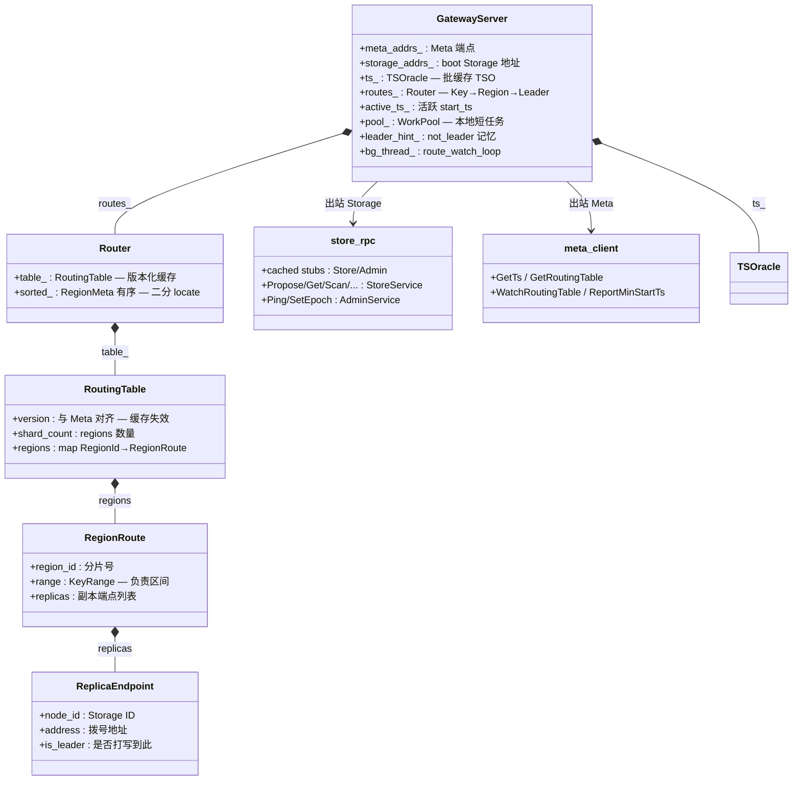
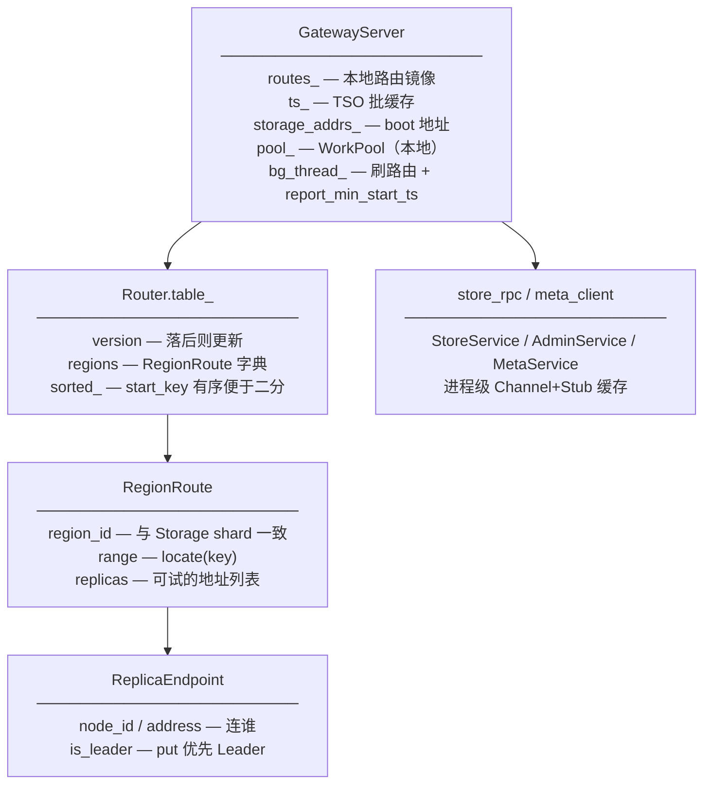
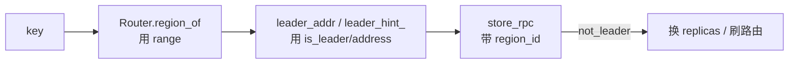

# Compute 数据拓扑结构

无状态计算层：缓存 Meta 路由 + 代理 Storage RPC。  
图例：`字段 — 含义 / 作用`  
代码：`compute/include/openkv/compute/*.hpp`  
生产入口：C++ `gateway_node` → `GatewayServer`（见 [flows/18-cpp-gateway.md](../flows/18-cpp-gateway.md) · [flows/29-compute-code-map.md](../flows/29-compute-code-map.md)）。

---

## 1. 总图（字段 + 含义）

---

## 2. 包含关系展开

---

## 3. 字段词典

### `ReplicaEndpoint` / `RegionRoute` / `RoutingTable`

| 字段 | 含义 | 作用 |
|------|------|------|
| `node_id` | Storage 节点 ID | 日志/调试 |
| `address` | `host:port` | RPC 目标 |
| `is_leader` | Leader 标记 | 写路径优先 |
| `region_id` | Region 号 | 请求带 shard |
| `range` | key 区间 | `region_of(key)` |
| `replicas` | 副本列表 | 重试候选 |
| `version` | 路由版本 | 与 Meta `route_ver` 对齐 |
| `shard_count` | Region 个数 | 兼容字段 |
| `regions` | 全表 | 缓存主体 |

### `Router`

| 字段 | 含义 | 作用 |
|------|------|------|
| `table_` | 路由表 | update 后对外查询 |
| `sorted_` | 有序 RegionMeta | 二分定位 key |
| `mu_` | 锁 | 并发 update/读 |

### `GatewayServer`（核心成员）

| 字段 | 含义 | 作用 |
|------|------|------|
| `routes_` | Router | key → region / leader |
| `ts_` | TSOracle | 事务时间戳 |
| `storage_addrs_` | boot 地址串 | try_order 回退 |
| `pool_` | WorkPool | Watch 间隔等本地任务 |
| `leader_hint_` | region→addr | not_leader 后优先打 |
| `bg_thread_` | 后台 | WatchRoutingTable + active_ts 上报 |

---

## 4. 请求路径与字段流

出站一律类型化 gRPC（StoreService / AdminService / MetaService）。详见 [29-compute-code-map](../flows/29-compute-code-map.md)。

---

## 相关

- [META_DATA_TOPOLOGY.md](META_DATA_TOPOLOGY.md) — 权威路由在 Meta  
- [DATA_TOPOLOGY_INDEX.md](DATA_TOPOLOGY_INDEX.md)  
