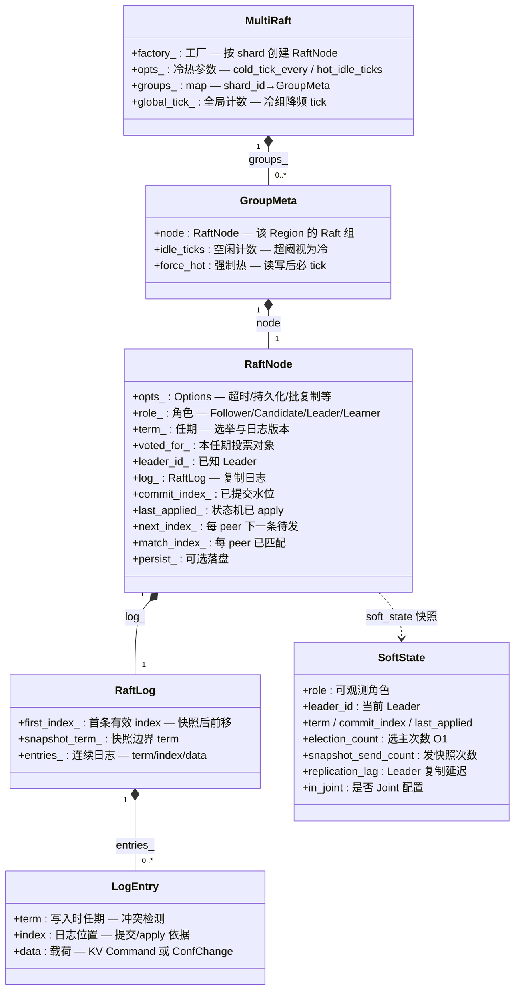
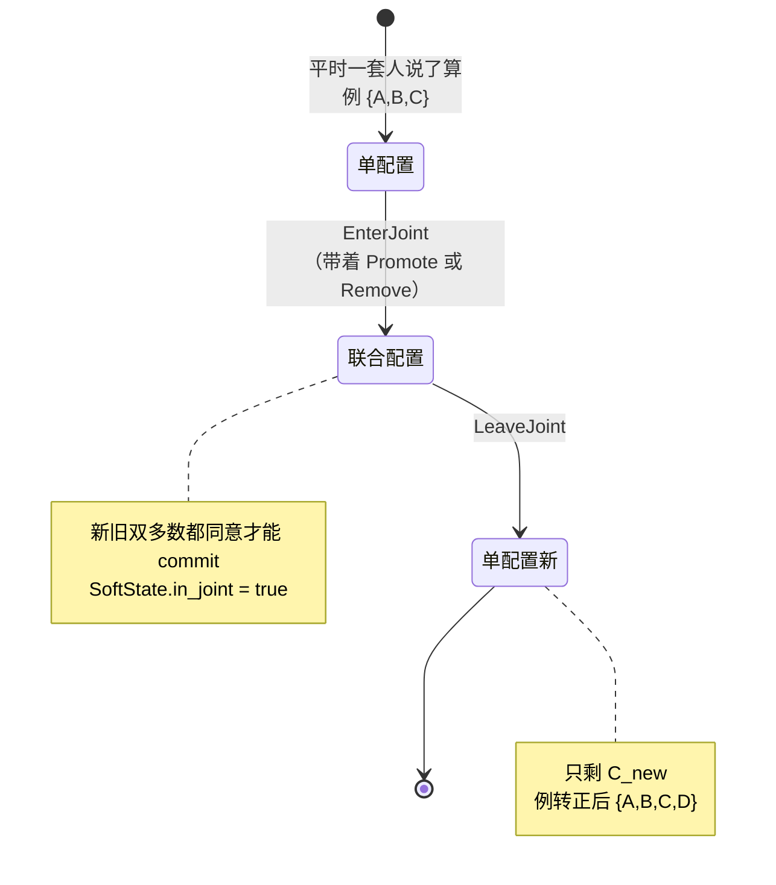
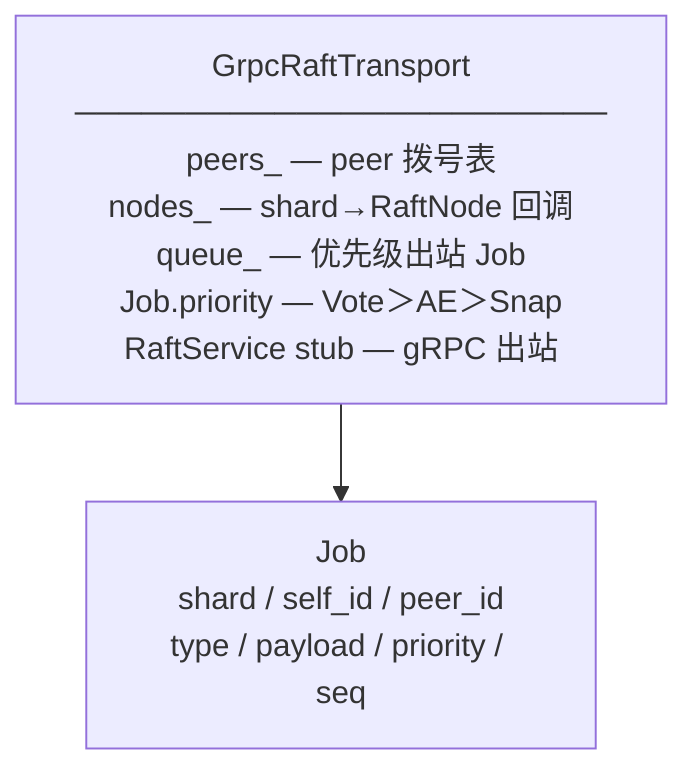
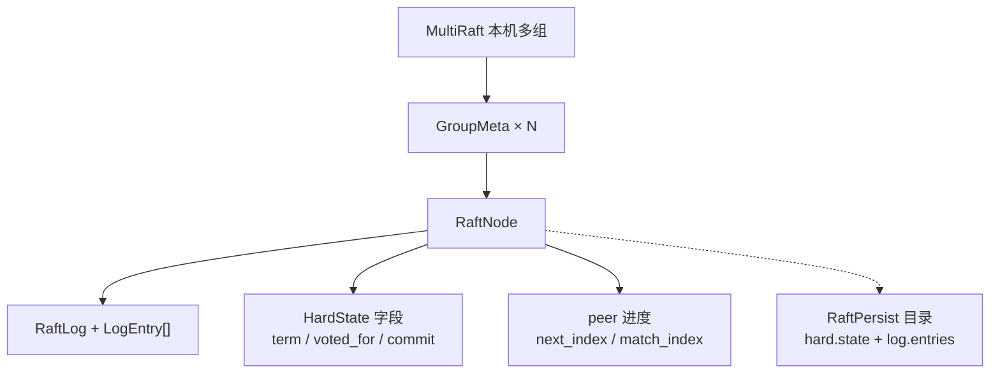

# Raft 数据拓扑结构

单分片 `RaftNode` + 本机 `MultiRaft` + 持久化 / 传输。  
图例：`字段 — 含义 / 作用`  
代码：`raft/include/openkv/raft/*.hpp`

---

## 1. 总图（字段 + 含义）



---

## 2. 状态分层（先分清这四类）

很多人把属性搅在一起，按**是否落盘 / 谁消费**分四层：

```text
┌─────────────────────────────────────────────────────────────┐
│ SoftState          观测快照（role/leader/指标…）可不落盘      │
├─────────────────────────────────────────────────────────────┤
│ HardState          必须落盘：term / vote / commit             │
├─────────────────────────────────────────────────────────────┤
│ RaftLog + LogEntry 复制日志（propose append → WAL → apply）   │
├─────────────────────────────────────────────────────────────┤
│ Ready 缓冲         external_io 下外提批次：HS/日志/消息/快照   │
│   ready_hs_dirty_  「HardState 脏了等 take_ready」的布尔标记  │
└─────────────────────────────────────────────────────────────┘
```

| 概念 | 是什么 | 作用 | 默认/注意 |
|------|--------|------|-----------|
| **HardState** | `term` + `vote` + `commit` | 重启恢复选举与提交水位 | 经 Ready → PersistWorker 写 WAL |
| **SoftState** | role、leader、last_applied、指标等 | redirect、metrics、调试 | **不**当持久化源；可含 term/commit 只读拷贝 |
| **LogEntry** | 一条日志 `term/index/data` | 复制与状态机输入 | `data` 由上层解成 Command/ConfChange |
| **Ready** | 一轮协议输出批次 | Store：persist → 发网 → apply → advance | 生产路径主单位 |
| **`external_io`** | Options：I/O 是否外提 | `true`：协议不写盘不发网；`false`：嵌入自管盘/网 + 同步 on_apply | **默认 true**；Meta 显式 false |
| **`ready_hs_dirty_`** | 运行时脏标记 | HardState 有改且未进 Ready | 初始 **false**；与 external_io 默认无关 |
| **`ready_hs_`** | 待外提的 HardState 内容 | dirty 时被 `take_ready` 拷进 `Ready.hard_state` | |
| **`ready_unstable_`** | 新 append 未 durable 的条目 | → `Ready.entries` → WAL | |
| **`ready_committed_`** | 已 commit 待 apply | → `Ready.committed_entries` → Apply worker | |
| **`persist_dirty_`** | 嵌入模式落盘脏标记 | `external_io=false` 时 `persist_locked` 用 | 生产 Ready 路径基本不用 |

**HardState vs SoftState（易混）：**

| | HardState | SoftState |
|--|-----------|-----------|
| 落盘 | 要 | 不要 |
| 字段 | term / vote / commit | role / leader / term* / commit* / last_applied / 指标… |
| 谁填 | `persist_locked` → `ready_hs_` | `soft_state()` 只读组装 |
| 丢了 | 选举/提交水位错乱 | 仅观测短暂不准 |

\* SoftState 里的 term/commit 是**方便读的拷贝**，权威持久化仍是 HardState。

**Apply 只有两条正路（协议核不再内嵌异步队列）：**

| 模式 | 谁执行业务日志 | 说明 |
|------|----------------|------|
| `external_io=true`（Store） | Store Apply worker | 条目进 `ready_committed_`，核内只处理 ConfChange |
| `external_io=false`（Meta） | 持锁同步 `on_apply` | 无队列、无背压 break；简单可预期 |

**本地 FSM 快照（Meta）：** 现单文件覆盖 `fsm_<gid>.snap`。多份保留 + 坏文件回退 → 待重新设计，见 [20-next-optimizations N1b](../flows/20-next-optimizations.md#n1b本地-fsm-快照多份保留待重新设计)。

### HardState 三字段（说人话）

| 字段 | 白话 | 为什么要落盘 |
|------|------|--------------|
| **term（当前任期）** | Raft 的「第几轮选举 / 谁在当家」的逻辑时钟，单调递增的整数。**不只选举时变**：① 本节点 `become_candidate` 时 `term++`；② 收到别人更高 term 的 AE/Vote 等 → `step_down` / `become_follower` 跟到对方 term（旧 Leader 也会因此退位）。同一 term 最多一位 Leader；比自己小的消息不当真。**PreVote 不抬高**本机 term（只试探「下一任」能不能选）。 | 重启后若忘了，可能拿过期身份再选一次，破坏一致性。 |
| **vote（voted_for）** | 「这一任我把票投给了谁」。一个 term 内最多投一票；空 = 本任期还没投。 | 防同一任期投两次，导致双主。 |
| **commit（commit_index）** | 「多数派已经确认、可以交给状态机执行的最大日志下标」。还没 apply 的也会先记在这里。 | 重启后知道哪些日志已经安全，避免重复提交或漏 apply 边界错乱。 |

**和 SoftState 里同名数字的关系：** SoftState 也会带 term / commit_index，那只是给 metrics、redirect 看的快照；盘上认的只有 HardState。

**写路径（external_io）与这些字段的关系：**

```text
propose → log_.append → ready_unstable_
       → persist_locked → ready_hs_dirty_ + ready_hs_
Store take_ready → Ready{hard_state, entries, …}
PersistWorker → WAL
dispatch → AE 消息 / Apply → report_applied
```

---

## 3. 核心类型字段词典

### `Peer` / `LogEntry` / `ConfChange`（成员变更提案）

代码里叫 `ConfChange`（行业行话 Configuration Change），白话就是**成员变更提案**——不是 Leader/Follower 那种「角色」，而是「对成员名单做什么」。经日志 commit 后 apply 才改配置。

**配置里的两种人（别和选举角色混）：**


| 结构.字段 | 白话 | 作用 |
|-----------|------|------|
| `Peer.id` / `address` | 谁、怎么连 | 成员标识与拨号 |
| `Peer.learner` | 是不是学习者 | 不投票、不算 quorum |
| `LogEntry.term/index/data` | 一条日志 | 复制与 apply；`data` 可为业务或 ConfChange |
| `ConfChange.type` | 变更种类 | 见下表 |
| `ConfChange.peer` | 对谁动手 | 目标节点 |
| `ConfChange.joint_change` | Joint 里真正要做的事 | 通常 Promote / Remove |

**`ConfChange.Type`（说人话）：**

| 枚举 | 白话 | 图上干什么 |
|------|------|------------|
| `kAddLearner` | 加旁听生 | 进学习圈，还不投票 |
| `kPromoteLearner` | 旁听生转正 | 改投票名单 → 安全路径包进 EnterJoint |
| `kRemoveNode` | 踢人 | 常包进 EnterJoint |
| `kAddNode` | 直接加投票人 | 一步加 voter（少用） |
| `kEnterJoint` | 进入联合配置 | 新旧两套人一起说了算 |
| `kLeaveJoint` | 退出联合 | 只留新名单 C_new |

**转正 / 删节点安全路径（Joint 两阶段）：**



加学习者常一步 `AddLearner` 即可；`Promote`/`Remove` 由 `propose_conf_change` 自动改成 `EnterJoint` + 稍后 `LeaveJoint`。

### `RaftLog`

| 字段 | 含义 | 作用 |
|------|------|------|
| `first_index_` | 首条有效 index | compact/快照后丢弃更早日志 |
| `snapshot_term_` | 快照处 term | match(prev) 边界校验 |
| `entries_` | 内存连续日志 | 复制与本地 propose |

### `RaftNode`（关键状态）

| 字段 | 含义 | 作用 |
|------|------|------|
| `role_` | 当前角色 | 决定能否 propose / 选举 |
| `term_` | 当前任期 | 拒绝过期 RPC |
| `voted_for_` | 本任期已投票 | 选举安全 |
| `leader_id_` | 已知 Leader | redirect / SoftState |
| `commit_index_` | 多数派已提交 | 可读/可 apply 上限 |
| `last_applied_` | 已应用到状态机 | Facade 可见水位 |
| `next_index_` | peer→下一发送 index | 复制游标 |
| `match_index_` | peer→已匹配 index | 算 commit / catch-up |
| `inflight_` | peer 未确认消息数 | 流控 max_inflight |
| `in_joint_` / `joint_*_voters_` | Joint 配置 | 双多数派提交 |
| `lease_expire_` | Leader lease 截止 | 本地线性读捷径 |
| `election_count_` 等 | O1 计数 | SoftState / 指标 |

### `RaftNode::Options`（模式与调参）

| 字段 | 含义 | 作用 |
|------|------|------|
| `external_io` | Ready 外提（默认 **true**） | Store 路径；Meta 嵌入设 false（同步 on_apply） |
| `shard_id` | 分片/Region | MultiRaft 键 |
| `self_id` / `peers` | 本机与同伴 | 组网 |
| `election_timeout_ms` / `heartbeat_ms` | 超时 | 选举与心跳 |
| `persist_dir` / `raft_engine` | 落盘目录或共享引擎 | 宕机恢复 |
| `compact_threshold` | 日志条数阈值 | 触发快照压缩 |
| `enable_pre_vote` | PreVote | 防打断任期 |
| `check_quorum` | 多数派存活检查 | Leader 让位 |
| `coalesce_replication` | 嵌入路径 propose 后攒 AE | 降发送频率；RF=1 仍立即发；**external_io 忽略**（出站走 Ready，propose 当拍入队） |
| `ready_notify` | AE/选票回包后唤醒 Store | 否则 commit 进 Ready 只能等 tick → 写 ACK 百 ms 级 |
| `max_ae_entries` / `max_ae_bytes` | AE 批大小 | 复制批处理 |
| `leader_lease_ms` / `enable_lease_read` | Leader lease | 线性读捷径 |
| `persist_sync` / `persist_batch_n` | 同步级别/批写 | 嵌入路径耐久 vs 吞吐 |

### `PersistedHardState` / `MultiRaft::Options`

| 字段 | 含义 | 作用 |
|------|------|------|
| `term` / `voted_for` | 盘上 HardState | 重启恢复选举态 |
| `commit_index` / `last_applied` | 提交与 apply | 恢复后补 apply |
| `first_index` / `snapshot_term` | 日志边界 | 重建 RaftLog |
| `hibernate_after_ms` 等 | Store 冷热 | 降 tick CPU |
| `ready_coalesce_n/ms` | propose→Ready 攒批 | 写路径 group commit |
| `persist_workers` | PersistWorker 数 | 跨 Region 重叠落盘 |

---

## 4. 传输与帧



| 结构.字段 | 含义 | 作用 |
|-----------|------|------|
| `Job.type` | Vote / AE / Snap | 选 stub RPC |
| `Job.shard` | Region/shard | 交给对应 RaftNode |
| `out_raft_` / `out_sync_` | 出站计数 | STATS |

---

## 5. 包含关系示意



---

## 相关

- [06-raft-election-commit.md](../flows/06-raft-election-commit.md) — 原理、RPC/邮箱交互、提交与写路径  
- [35-raft-module-call-flows.md](../flows/35-raft-module-call-flows.md) — 协议核 + raftstore 调用图  
- [MULTI_RAFT_PRODUCTION.md](../production/MULTI_RAFT_PRODUCTION.md)  
- [DATA_TOPOLOGY_INDEX.md](DATA_TOPOLOGY_INDEX.md)  
